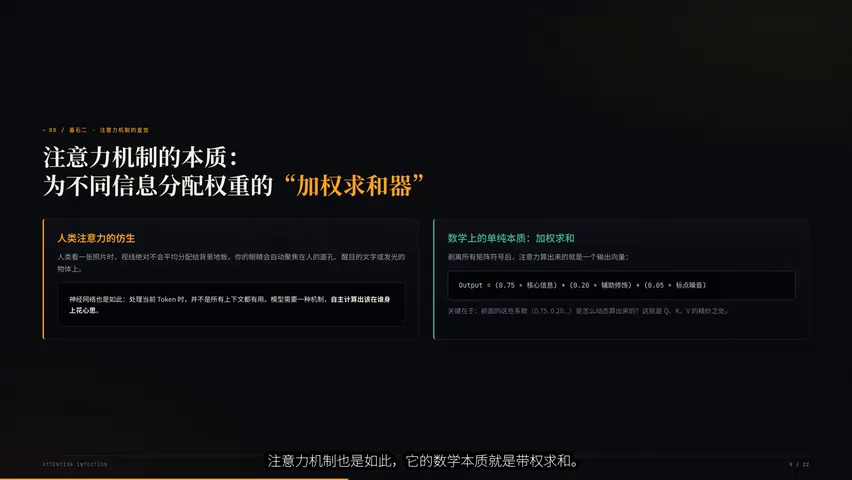

# 第 1 章 LLM 入门

大语言模型（Large Language Model，LLM）既是对话、翻译和代码生成等应用的核心，也是后续推理系统所服务的计算对象。理解模型“算什么”与“怎样一步步算”，才能把模型能力与推理引擎的效率区分开来。本章从 next-token 预测出发，梳理 Transformer 的主要组件，并说明其能力边界。

## 从语言建模到大语言模型



*图 1.1　注意力并不是简单地平均汇聚上下文，而是根据相关性分配权重后再求和。这个加权求和视角是理解 Transformer 信息交换与后续 KV Cache 设计的基础。（原课程视频帧，03:53）*


语言模型为 token 序列分配概率。对序列 $x_{1:n}$，自回归分解写为：

$$
P(x_{1:n})=\prod_{t=1}^{n}P(x_t\mid x_{1:t-1})
$$

训练时，模型在大量文本上学习条件分布，通常以交叉熵损失调整参数；推理时，参数固定，模型根据给定上下文反复预测后续 token。因此，“生成一篇文章”在计算上不是一次完成，而是许多次条件预测的串联。

“大”通常同时涉及参数规模、训练数据规模和计算规模。规模扩大与训练方法改进使模型表现出指令跟随、少样本学习、翻译和编程等能力，但这些能力并未改变其概率模型的基础。模型输出的流畅性不等于事实正确性，也不能仅凭回答语气判断其把握程度。

### Token、参数与上下文

**Token** 是分词器处理文本后的基本单位，模型实际接收的是整数 ID。一个 token 可以对应字、词、子词或标点；不同分词器对同一文本的切分可能不同，所以不能用固定的“每 token 字数”换算所有模型。

**Embedding** 将离散 ID 映射为连续向量，使神经网络能够处理 token。**参数**是训练得到的权重和偏置等可学习量，常用 M（百万）或 B（十亿）计量；参数量并不直接等于完整显存占用，还需乘以数据类型的字节数，并计入缓存与临时空间。

**上下文窗口**限定模型一次计算可使用的 token 范围。提示词、历史对话、检索结果、工具输出和已生成内容都会占用这一预算。上下文工程的任务不是无限塞入资料，而是选择、组织并及时更新最相关的信息。

## Transformer 的计算骨架

现代生成式 LLM 多采用 decoder-only Transformer。尽管具体模型会替换组件，其主干仍可概括为：token 嵌入与位置信息、若干 Transformer Block、最终归一化、语言模型输出头（LM Head）。每个 Block 通常包含注意力与前馈网络，并配合残差连接和归一化。

### 位置编码：让注意力感知顺序

仅靠自注意力计算内容相似度，并不能自动知道 token 的先后顺序。原始 Transformer 将固定的正余弦位置编码与词嵌入相加：

$$
PE_{(pos,2i)}=\sin\left(\frac{pos}{10000^{2i/d_{\text{model}}}}\right),\qquad
PE_{(pos,2i+1)}=\cos\left(\frac{pos}{10000^{2i/d_{\text{model}}}}\right)
$$

其中，$pos$ 是位置，$i$ 是成对维度的索引，$d_{\text{model}}$ 是隐藏维度。不同维度使用不同频率，使模型能够区分位置并学习相对位移。该方案无需学习位置参数，但并非唯一选择；现代 LLM 常采用 RoPE 等相对位置方法。无论采用哪种方案，都不能把“支持更长输入”简单等同于“在长上下文中始终能可靠利用所有信息”。

### 自注意力：按相关性汇聚信息

输入矩阵 $X\in\mathbb{R}^{n\times d_{\text{model}}}$ 经线性投影得到 Query、Key 和 Value。对第 $j$ 个注意力头：

$$
Q_j=XW_j^Q,\qquad K_j=XW_j^K,\qquad V_j=XW_j^V
$$

$$
\operatorname{head}_j=\operatorname{softmax}\left(\frac{Q_jK_j^\top}{\sqrt{d_k}}+M\right)V_j
$$

点积衡量查询与键的匹配程度，Softmax 将其变为权重，再加权汇总 Value。除以 $\sqrt{d_k}$ 可避免维度增大时点积过大、Softmax 过度饱和。$M$ 是掩码；自回归模型使用因果掩码，将位置 $t$ 对未来位置的注意力 logits 置为 $-\infty$，防止训练或 Prefill 时泄露答案。

多头注意力在不同表示子空间中并行执行上述计算，再拼接并投影：

$$
\operatorname{MHA}(X)=\operatorname{Concat}(\operatorname{head}_1,\ldots,\operatorname{head}_h)W^O
$$

若均匀拆分，通常有 $d_k=d_{\text{model}}/h$。框架中常先调整张量形状，使批次和头维度位于序列维度之前：

```python
# Q、K、V 的初始形状均为 [batch_size, seq_len, d_model]
Q = Q.reshape(batch_size, seq_len, h, d_k).transpose(1, 2)
K = K.reshape(batch_size, seq_len, h, d_k).transpose(1, 2)
V = V.reshape(batch_size, seq_len, h, d_k).transpose(1, 2)
# 变换后形状为 [batch_size, h, seq_len, d_k]
```

朴素实现需要形成 $n\times n$ 的注意力分数，计算量随序列长度呈二次增长。融合注意力内核可减少中间张量的显存读写，却不会改变因果注意力的数学语义。

### 残差、归一化与前馈网络

残差连接为信息和梯度提供直接通路。原始 Transformer 采用 Post-Norm：

$$
\operatorname{LayerNorm}\bigl(x+\operatorname{Sublayer}(x)\bigr)
$$

对单个 token 的隐藏向量 $v\in\mathbb{R}^d$，LayerNorm 先计算均值 $\mu$ 和方差，再进行仿射变换：

$$
\hat v_i=\frac{v_i-\mu}{\sqrt{\frac{1}{d}\sum_{j=1}^{d}(v_j-\mu)^2+\varepsilon}},\qquad
\operatorname{LN}(v)_i=\gamma_i\hat v_i+\beta_i
$$

$\varepsilon$ 用于避免除零，$\gamma$ 与 $\beta$ 为可学习参数。归一化稳定激活尺度，残差连接保留跨层传递的路径；二者作用不同，不能互相替代。现代模型也常使用 Pre-Norm 和 RMSNorm，具体顺序应以模型实现为准。

位置前馈网络对每个 token 独立施加相同的非线性变换。原始形式为：

$$
\operatorname{FFN}(x)=\max(0,xW_1+b_1)W_2+b_2
$$

注意力负责跨位置交换信息，FFN 负责逐位置变换表示。若缺少非线性激活，多层线性映射仍可合并为一次线性映射。现代模型常用 SwiGLU 等门控激活，也可能用 MoE 替代稠密 FFN；这些变体不能套用原始论文的参数量公式。

## 从 logits 到文本生成

LM Head 将最后隐藏状态映射为词表大小的 logits，Softmax 给出下一 token 分布。贪心解码选择概率最大者，随机采样则按分布抽取，并可用 temperature、top-k 或 top-p 调整候选分布。采样策略会影响输出文本，但不会更新模型参数。

生成 token 被追加到上下文，再预测下一个，直至遇到 EOS、达到长度上限或满足停止规则。系统通常流式返回 token，并由分词器解码为文本。RAG 可在生成前提供外部资料，工具调用可让模型触发检索或执行程序；它们能扩展信息来源与行动能力，却不能从机制上保证引用正确或调用安全。

## 能力边界与系统含义

LLM 可能产生幻觉，知识受训练数据与所提供上下文限制，对数值计算、事实核验和长程一致性也并非天然可靠。生产应用需要评估输出质量、约束工具权限，并对关键结果进行外部验证。

对推理系统而言，自回归意味着生成步骤之间存在依赖，注意力意味着历史状态需要保留，参数规模意味着权重搬运不可忽略。后续的 Prefill/Decode 划分、KV Cache、GPU 带宽分析与 Benchmark，都从这些机制出发，而不是把 LLM 当作一个不可拆分的黑盒。

## 实践检查

1. 对序列 $x_1x_2x_3$ 展开链式分解，指出预测 $x_3$ 时允许使用哪些位置，并说明因果掩码矩阵中哪些元素应为 $-\infty$。
2. 取 $d_{\text{model}}=512$、$h=8$，计算 $d_k$；再取 batch size 为 2、序列长度为 16，写出变换后的 Q、K、V 形状以及单头 $QK^\top$ 的形状。
3. 手算向量 $[1,2,3,4]$ 的均值和方差，并说明 LayerNorm 中的 $\varepsilon$、$\gamma$、$\beta$ 分别起什么作用。
4. 使用同一分词器比较一句中文、一句英文和一段代码的 token ID；再换用另一模型的分词器重复。只记录实际观察，不预设每个汉字对应多少 token。
5. 为一个知识问答应用列出模型、检索器与工具各自负责的部分，并设计至少一种能够发现“回答流畅但事实错误”的检查。

## 小结

LLM 通过自回归条件分布逐 token 建模与生成。Transformer 以位置编码补充顺序信息，以注意力跨位置汇聚信息，以 FFN 变换逐位置表示，并借助残差和归一化构建深层网络。理解这些计算及其边界，是分析推理延迟、显存和吞吐的前提；模型质量与推理系统性能则应分别评估。

## 参考资料

- 本章基于 Datawhale × RadixArk 的 zero-to-sglang 原课程重组；原文件：[第 1 章 LLM 入门](https://github.com/datawhalechina/zero-to-sglang/blob/296fec5d215408f918c0e4007e71c962e804ef7e/course-material/ch/part1/第1章_LLM入门.md)；原课程采用 [CC BY-NC-SA 4.0](https://creativecommons.org/licenses/by-nc-sa/4.0/deed.zh) 许可。
- Vaswani et al.：[Attention Is All You Need](https://arxiv.org/abs/1706.03762)，Transformer、正余弦位置编码与原始 Post-Norm 架构。
- Datawhale：[diy-llm：大模型的基本训练流程](https://datawhalechina.github.io/diy-llm/chapter13/chapter13_%E7%AC%AC%E5%8D%81%E4%B8%89%E7%AB%A0%E5%A4%A7%E6%A8%A1%E5%9E%8B%E7%9A%84%E5%9F%BA%E6%9C%AC%E8%AE%AD%E7%BB%83%E6%B5%81%E7%A8%8B.html)。
