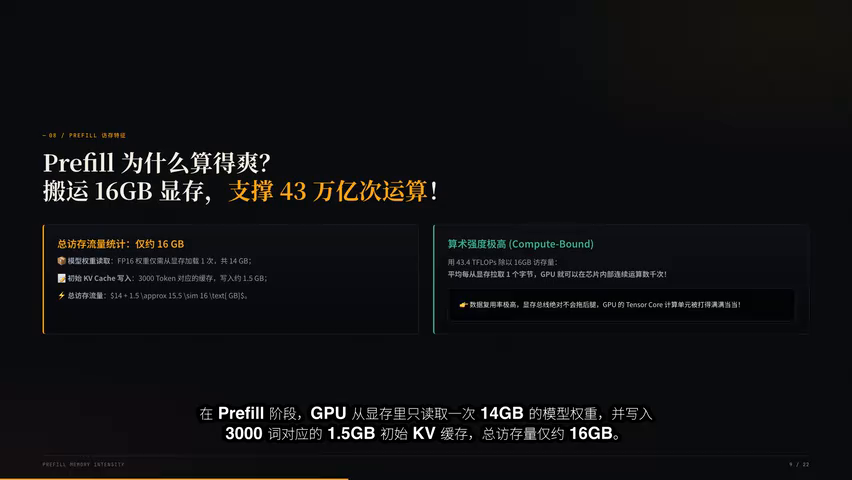
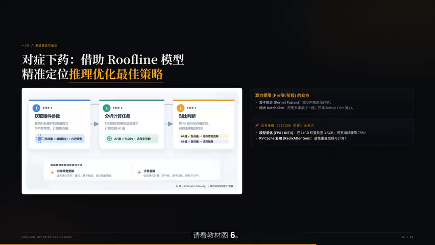

# 第 2 章 推理入门

模型训练完成后，真正面向用户的是推理服务：接收提示、执行前向计算、逐 token 生成并返回结果。一次回答既包含模型计算，也包含排队、调度和数据传输。本章拆解这条链路，并用 Roofline 模型判断瓶颈来自计算还是显存带宽。

## 推理与训练：相同前向，不同目标

*图 2.1　Prefill 在一次权重读取后对整段 Prompt 的多个位置并行计算，因而具有较高的算术强度。图中用权重与 KV 数据搬运量对照计算量，说明其更容易受计算能力限制。（原课程视频帧，03:55）*

推理是使用固定参数完成前向计算并产生输出的过程。训练则通过前向计算、损失计算和反向传播更新参数。二者在单个位置上都估计 $P(x_t\mid x_{<t})$，但前文的来源与可并行性不同。

| 维度 | 训练 | 自回归推理 |
| --- | --- | --- |
| 目标 | 最小化损失、更新参数 | 使用固定参数生成结果 |
| 输入前文 | 数据集中的真实前缀 | Prompt 与模型已生成 token |
| 序列处理 | 借助因果掩码并行计算各位置损失 | 输出步间串行，单步内部并行 |
| 反向传播 | 需要，通常保留反向所需激活 | 通常不需要 |
| 主要状态 | 参数、梯度、优化器状态等 | 参数、KV Cache、临时激活等 |

训练中的 teacher forcing 同时提供整段真实序列，因此可以并行得到各位置 logits；推理时尚未生成的 token 不存在，只能生成一个、追加一个。所谓“推理串行”指生成步骤的依赖，并不表示 GPU 在每一步中只使用一个线程。

训练与推理又相互联系：验证和强化学习阶段需要推理，架构设计则预先决定推理成本。例如层数和隐藏维度影响计算量，GQA 影响 KV Cache 大小，权重量化影响显存占用与数值误差。推理引擎无法随意改变已训练模型的这些结构约束。

## 一个请求的完整生命周期

一次基本请求可以按以下顺序理解：

1. **预处理**：服务接收文本，分词器生成 token IDs；调度器根据资源和队列状态安排执行。
2. **Prefill（预填充）**：模型并行处理整段 Prompt，逐层计算并保存 K、V，最后位置的 logits 用于得到第一个输出 token。
3. **Decode（解码）**：将新生成 token 作为下一步输入，只计算当前位置的 Q、K、V，读取历史 KV Cache 并追加当前 K、V，再预测下一 token。
4. **结束与返回**：遇到 EOS、达到最大输出长度或满足其他停止条件后结束；分词器将 token IDs 解码为文本，服务释放或保留可复用缓存。

首个输出 token 已由 Prefill 产生，其 K、V 通常要等它作为下一次 Decode 的输入时才写入缓存。Prefix Cache 等机制可跳过共享前缀的重复计算，但属于优化路径，不改变基本的数据依赖。

## Prefill 与 Decode 的计算特征

| 特征 | Prefill | Decode |
| --- | --- | --- |
| 单步处理对象 | 当前批次中的全部输入 token | 每个活跃请求的一个新 token |
| 典型线性代数形态 | 较大的 GEMM | 小 batch 时更接近 GEMV 或窄 GEMM |
| KV Cache | 批量构建并写入 | 读取历史并逐位置追加 |
| 并行机会 | 序列和批次维度提供较多并行工作 | 步间受限，步内仍有矩阵并行 |
| 常见瓶颈 | 较长输入时更易受计算能力限制 | 小 batch 时更易受权重和 KV 搬运限制 |
| 直接影响的体验 | 首 token 等待 | 后续输出速度与间隔 |

这些是典型的资源倾向，而不是无条件定律。极短 Prefill 未必能充分利用 GPU；很大的 Decode batch 也可能提高算术强度并转为计算受限。调度、通信和内核启动同样可能成为端到端瓶颈。

## 用 FLOPs 与字节数建立数量级认识

*图 2.2　Roofline 的用途是先判定负载落在计算受限还是访存受限区域，再选择优化手段。图中把硬件拐点、任务算术强度和具体推理阶段串成可执行的诊断流程。（原课程视频帧，07:05）*

对原课程采用的 LLaMA-7B 风格结构，设层数为 $L$、隐藏维度为 $d$；一个 Prefill 批次中第 $b$ 条请求处理 $N_b$ 个 token，批次总 token 数为 $N=\sum_bN_b$，单请求 Decode 可见历史长度为 $S$。忽略归一化等较小项，可近似写为：

$$
F_{\text{prefill}}\approx L\left(24d^2\sum_bN_b+4d\sum_bN_b^2\right)
=L\left(24Nd^2+4d\sum_bN_b^2\right)
$$

$$
F_{\text{decode-step}}\approx L(24d^2+4Sd)
$$

$24d^2\sum_bN_b=24Nd^2$ 包含 QKV/输出投影与特定 SwiGLU FFN 的线性计算，$4d\sum_bN_b^2$ 是各请求独立执行注意力得分及加权求和的近似项，不包含跨请求注意力。因此，$N$ 若是多请求总 token 数，就不能把二次项写成 $4N^2d$；只有单条长度为 $N$ 的 Full Attention 序列，或明确采用这一等效序列近似时，才能写成 $L(24Nd^2+4N^2d)$。换成 GQA、其他 FFN 比例或稀疏结构后，系数必须重新推导。通用的“每个 token 约 $2P$ FLOPs”也只适用于估算参数矩阵乘法，不能覆盖全部注意力和系统开销。

为复现后文的 AI 演算，进一步采用原课程的极简流量模型，只统计线性层权重、每层输入/输出以及 Decode 的历史 KV 读取。BF16 每元素占 2 字节时：

$$
Bytes_{\text{prefill}}\approx2L(12d^2+2Nd)
$$

$$
Bytes_{\text{decode-step}}\approx2L(12d^2+2d+2Sd)
$$

其中 $12d^2$ 是特定模型的单层线性权重项，Decode 的 $2Sd$ 对应 K、V 两份历史张量。该模型忽略 KV 写入、注意力中间张量、其他权重与实际缓存命中，只用于教学推导，不能替代真实内存流量测量。

若将 $N=3000$ 解释为单条 Full Attention 等效序列，在 $L=32$、$d=4096$ 时，前述 FLOPs 公式给出约 $43.4$ TFLOPs。原课程两个请求合计 3000 token 的场景不能无说明地沿用这个精确值：必须分别给出两条请求的长度 $N_1,N_2$（满足 $N_1+N_2=3000$），再以 $N_1^2+N_2^2$ 计算二次项；仅知道总长度不能唯一确定结果。相同模型在 $S=3000$ 时，一个 Decode step 约为 $14.5$ GFLOPs。二者相差很大，但 Decode 仍可能每步读取约 14 GB 权重，并读取随上下文增长的 KV Cache。

若该步总显存流量按约 15.5 GB 粗估，在 1.6 TB/s 带宽下，仅数据搬运的理论下界约为 $15.5/1600\ \text{s}\approx9.7$ ms。这里是数量级演算，不是任何机器上的实测延迟；缓存命中、并发、内核效率和具体硬件都会改变结果。

## Roofline：把负载与硬件放在同一张图上

**算术强度**（Arithmetic Intensity，AI）表示每搬运一字节所执行的浮点运算数：

$$
AI=\frac{\text{浮点运算次数（FLOP）}}{\text{目标存储层实际搬运量（Byte）}}
$$

若硬件峰值算力为 $P_{\text{peak}}$、相应存储带宽为 $B_{\text{mem}}$，理想 Roofline 上界为：

$$
P_{\text{attainable}}\leq\min(P_{\text{peak}},\,AI\cdot B_{\text{mem}})
$$

拐点为 $AI^*=P_{\text{peak}}/B_{\text{mem}}$。$AI<AI^*$ 时，理论性能主要受带宽约束；$AI>AI^*$ 时，主要受峰值算力约束。分析 DRAM 瓶颈时，分母应是实际 DRAM 流量，不能把片上缓存命中重复计入，也不能把理论分配字节数直接当作实际流量。

以原课程的 A100 40GB 示例参数 $312$ TFLOPS 与 $1.6$ TB/s 计算，拐点约为：

$$
AI^*=\frac{312\times10^{12}}{1.6\times10^{12}}=195\ \text{FLOP/Byte}
$$

采用同一简化模型，单条 Full Attention 序列 $N=100$ 的 Prefill AI 约为 100，而 $S=100$、单请求 Decode 的 AI 约为 1，均落在该拐点的带宽受限一侧；增大 Prefill 的 token 数或有效 batch 可提高数据复用。这里的峰值对应特定精度和硬件规格，不能与其他精度或稀疏峰值混用。

Roofline 给出的是上界和归因起点，不是完整性能预测器。它不能单独解释 kernel launch、主机调度、PCIe/NVLink 通信、同步、排队和低利用率等问题；这些需要 profiling 与端到端测量进一步定位。

## 从瓶颈到优化假设

Prefill 较长时，可优先检查 GEMM 效率、Tensor Core 利用率、算子融合与批处理；Decode 较慢时，可检查权重和 KV 的实际搬运量、低精度方案、批处理及缓存管理。优化方向必须与测量对象匹配：减少 KV 重复计算未必能降低权重读取，提升单请求速度也未必提高整体吞吐。

多轮对话和 Agent 工作流会持续累积历史、工具定义及工具结果。若每轮重新处理完整上下文，Prefill 成本和 KV 占用都会增长；若多个 Agent 串行等待，网络与工具执行还会放大端到端延迟。因此，应把“模型内部慢”与“上下文变长”“请求在排队”“外部工具慢”分别验证。

## 实践检查

1. 推导 $C_{M\times N}=A_{M\times K}B_{K\times N}$ 的计算量 $2MKN$。若三矩阵均按 BF16 存储且只各读写一次，推导 $AI=MKN/(MK+KN+MN)$，并说明这一流量假设何时不成立。
2. 使用本章 $L=32$、$d=4096$ 的参数，将 $N$ 视为单条 Full Attention 序列长度，分别计算 $N=100$ 与 $N=3000$ 时的 Prefill FLOPs，观察线性项和二次项各自的增长；若改为两个请求，还需分别给出 $N_1,N_2$ 并使用 $\sum_bN_b^2$。
3. 选择一块 GPU，记录具体 SKU、所用精度的稠密峰值算力与 HBM 带宽，计算拐点；不要混用稀疏峰值、不同精度或不同统计口径的数据。
4. 对“发出请求后很久才开始输出，但输出过程流畅”和“首 token 很快，后续逐字很慢”两种现象，分别提出至少两个可观测指标或 profiling 证据，再决定优化方向。
5. 将一次 Agent 请求拆成排队、Prefill、Decode、工具执行和网络五段计时。若工具时间占主导，说明为什么单纯优化 Decode 不能等比例缩短总时延。

## 小结

推理由 Prefill 与 Decode 串联：前者批量处理输入并建立缓存，后者依赖历史逐 token 生成。FLOPs、实际内存流量和算术强度将模型结构与硬件能力联系起来，Roofline 则提供初步的瓶颈分类。所有分类都有负载和实现边界，最终优化仍需以端到端指标和 profiling 证据闭环验证。

## 参考资料

- 本章基于 Datawhale × RadixArk 的 zero-to-sglang 原课程重组；原文件：[第 2 章 推理入门](https://github.com/datawhalechina/zero-to-sglang/blob/296fec5d215408f918c0e4007e71c962e804ef7e/course-material/ch/part1/第2章_推理入门.md)；原课程采用 [CC BY-NC-SA 4.0](https://creativecommons.org/licenses/by-nc-sa/4.0/deed.zh) 许可。
- NVIDIA：[A100 Tensor Core GPU 数据手册](https://www.nvidia.com/content/dam/en-zz/Solutions/Data-Center/a100/pdf/nvidia-a100-datasheet-us-nvidia-1758950-r4-web.pdf)，硬件峰值与带宽规格。
- Datawhale：[diy-llm：推理](https://datawhalechina.github.io/diy-llm/chapter10/chapter10_%E6%8E%A8%E7%90%86.html) 与 [Scaling Laws](https://datawhalechina.github.io/diy-llm/chapter9/chapter9_Scaling_Laws.html)。
- SGLang：[官方文档](https://docs.sglang.io/)，请求执行与推理引擎的后续实现资料。
