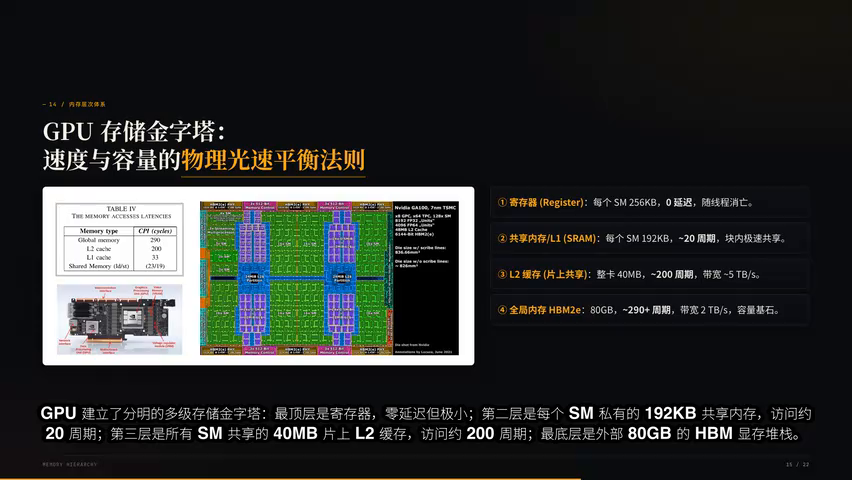

# 第 3 章 GPU 入门

LLM 推理中的矩阵乘法、注意力与 KV Cache 访问，最终都要映射到具体硬件。GPU 的价值不只是“核心多”，而是把大规模并行执行、高带宽存储和专用矩阵单元组合起来。本章以 NVIDIA A100 为例建立硬件与执行模型，再说明这些概念如何对应 Prefill 和 Decode。

## CPU 与 GPU：延迟取向和吞吐取向



*图 3.1　GPU 内存层次体现了速度与容量的权衡：越靠近计算核心，访问越快但容量越小。理解寄存器、共享内存、L2 与 HBM 的位置，有助于分析数据局部性和显存带宽瓶颈。（原课程视频帧，06:39）*


CPU 通常面向复杂控制流和单线程响应优化，具备较强的分支预测、乱序执行与缓存机制；GPU 通常把更多资源用于大量算术单元和可快速切换的线程，以吞吐量为重要目标。两者都能并行，也都包含控制与缓存，区别是设计取舍，而不是“CPU 只能串行”或“GPU 做所有计算更快”。

在典型异构系统中，CPU 负责请求处理、分词、资源管理与 kernel 启动，GPU 执行适合并行的大规模数值计算。主机与设备间的数据传输、同步和频繁小 kernel 启动都有成本，所以局部 kernel 加速不等于端到端加速。

GPU 最初用于图形管线。大量顶点和像素可以独立执行相似运算，这种数据并行性同样存在于矩阵乘法中。CUDA 等可编程平台、深度学习框架及专用 Tensor Core 的发展，使 GPU 成为 LLM 训练与推理的重要平台。

## 从板卡到 SM：以 A100 为例

A100 板卡包含 GPU 裸片、HBM 显存堆栈、供电电路以及 PCIe 等互连接口。HBM 与 GPU 通过封装内互连提供高带宽；PCIe 常用于 CPU—GPU 通信，NVLink 可用于支持的 GPU 间互连。不同容量、SXM/PCIe 形态和产品 SKU 的规格不能混用。

GA100 是物理芯片设计，实际 A100 产品可能只启用其中一部分单元。以原课程的 A100 PCIe 80GB 为例，其启用 108 个 SM；每个 SM 含 64 个 FP32 CUDA Core 和 4 个第三代 Tensor Core，因此共有 6912 个 FP32 CUDA Core 与 432 个 Tensor Core。上述数量属于该型号，不是所有 A100 或其他 GPU 的固定参数。

硬件可按以下层次理解：

- **GPC/TPC**：组织图形与计算资源的硬件层级，具体结构随架构变化；
- **SM（Streaming Multiprocessor）**：承接线程块、调度 Warp，并提供 CUDA Core、Tensor Core、寄存器和共享内存等资源；
- **CUDA Core**：执行通用整数与浮点运算；
- **Tensor Core**：执行面向矩阵乘加的专用操作，适用于深度学习中的 GEMM 等负载。

Tensor Core 的吞吐取决于数据类型、累加方式、矩阵形状及稠密/稀疏模式。A100 支持 FP16、BF16、TF32 等路径；标称的 2:4 结构化稀疏峰值以特定零值布局为前提，不能拿来代表普通稠密模型。即使峰值很高，窄矩阵、低占用率或数据供给不足也可能使实际性能远低于峰值。

## SIMT 执行模型

CUDA 编程模型把 kernel 组织为 Grid、Block 和 Thread。一个 kernel 启动包含多个 Block，每个 Block 包含多个 Thread；线程通过内建索引确定自己处理的数据。下面的向量加法片段展示了最基本的映射，边界判断用于避免越界：

```cpp
__global__ void add(const float* a, const float* b, float* c, int n) {
    int i = blockIdx.x * blockDim.x + threadIdx.x;
    if (i < n) {
        c[i] = a[i] + b[i];
    }
}
```

Block 被分配到一个 SM 上执行，不能拆到多个 SM；一个 SM 可根据资源同时驻留多个 Block。Block 内线程在 NVIDIA GPU 上按连续线程编号组成 **Warp**，每个 Warp 通常含 32 个线程，是 SM 调度指令的基本单位。

SIMT（Single Instruction, Multiple Threads）允许程序员以独立线程表达计算，硬件则以 Warp 为单位向活跃线程发射指令。逻辑上的线程数通常远大于物理执行单元数，因此“启动了一百万个线程”不表示它们在同一时刻都运行。

### Warp 切换与分支发散

当某个 Warp 等待长延迟访存时，调度器可以选择其他已就绪 Warp 执行，以隐藏延迟。这需要足够的驻留 Warp、独立工作和指令级并行；若所有 Warp 都在等待同一数据，或共享资源已经耗尽，仅增加线程并不能消除停顿。

同一 Warp 内线程进入不同分支时，硬件可能使用活跃掩码分别执行各条路径，这称为 **Warp Divergence**。不同路径的指令不能在同一发射中一起完成，因而会降低有效吞吐；但性能损失取决于路径长度、活跃线程数和后续是否重新收敛，不能简单认定一定减半。

Block 过大或每线程寄存器、共享内存用量过高，会减少 SM 能驻留的 Block/Warp 数。占用率并非越高越好：高占用率有利于隐藏延迟，但数据复用、每线程工作和缓存效率也同样重要。

## GPU 内存层次

GPU 通过多级存储在容量、带宽、延迟和成本之间折中。越靠近 SM 的存储通常越快、越小，但具体延迟和带宽必须通过对应架构资料或微基准确认。

| 层级 | 典型作用域 | 管理方式 | 对程序的意义 |
| --- | --- | --- | --- |
| 寄存器 | 线程私有 | 编译器分配为主 | 保存局部变量和临时结果，用量影响驻留能力 |
| L1 Cache / Shared Memory | SM 内；Shared Memory 通常供 Block 内共享 | L1 主要由硬件管理；Shared Memory 由程序显式使用 | 缓存或分块复用数据，减少对下一级存储访问 |
| L2 Cache | 全 GPU 的 SM 共享 | 硬件管理为主 | 缓存全局数据并连接 SM 与显存路径 |
| Global Memory / HBM | 全设备可访问 | 运行时和程序管理分配 | 保存权重、激活、KV Cache 等大对象 |

原课程所列 A100 每个 SM 的 L1/Shared Memory 合计为 192 KB，Shared Memory 最大可配置 164 KB；L2 为 40 MB，80GB PCIe 型号的 HBM 带宽约为 2 TB/s。这些是特定架构与型号的数据，不应外推为所有 GPU 的常数。

“Local Memory”这一编程术语也不一定代表片上高速存储：当局部变量无法放入寄存器而发生 spill 时，其存储可落到全局内存路径。判断性能时要看实际数据位置和访问次数，而不能只看变量名称。

### 局部性、合并访问与分块

**时间局部性**指刚访问的数据可能再次使用，**空间局部性**指相邻地址可能一起使用。缓存与共享内存利用这些特征，降低昂贵的远端访问。Warp 中线程若能以规则方式访问连续地址，通常更有利于形成高效的合并内存事务；离散、跨步很大的访问可能产生更多事务。

矩阵乘法常采用 Tiling：先把输入矩阵的小块搬到 Shared Memory，再由线程协作读取到寄存器并执行乘加，最后写出结果。这样，同一份数据可被多个输出元素复用。真实 cuBLAS、FlashAttention 或 Triton 内核会针对形状和架构选择不同流水线，上述路径是分析模型，而不是每次调用都完全相同的固定步骤。

## 将 LLM 推理映射到 GPU

模型加载后，权重通常驻留在 GPU 显存。请求到来时，CPU 完成分词和调度并启动 GPU 计算；中间激活尽量留在设备侧，避免无必要的主机往返。Transformer 中的 QKV 投影、输出投影、FFN、$QK^\top$ 与注意力加权求和，最终由大量并行线程和矩阵单元执行。

**Prefill** 同时处理较多 token，较大的 GEMM 提供数据复用与并行度，更容易发挥 Tensor Core 的计算吞吐；但短输入、小 batch 或低效内核仍可能受内存和启动开销限制。**Decode** 在小 batch 下每步只处理少量新 token，权重与 KV Cache 搬运占主导，常更接近 GEMV 和带宽受限负载。

由此可得到两条检查线索：Prefill 慢时先区分计算、形状和调度问题，Decode 慢时先检查每步读取的权重与 KV 字节数、有效带宽和批处理效率。两者都要观察端到端排队与通信，不能仅凭“Tensor Core 很忙”或“显存很大”判断系统健康。

## 实践检查

1. 某 kernel 的 Block 含 256 个线程，按每 Warp 32 线程计算应有几个 Warp？若启动 80 个 Block，是否意味着它们必然同时驻留并执行？列出限制驻留的资源。
2. 对上述 `add` kernel，分别说明 `blockIdx.x`、`blockDim.x` 和 `threadIdx.x` 的作用；解释去掉 `i < n` 后，在 $n$ 不是 Block 大小整数倍时会发生什么。
3. 设计一个 Warp 内奇偶线程走不同分支的例子，分析哪些路径可能串行执行；再说明为什么不能仅凭分支数量推断精确加速比。
4. 在目标机器上执行 `nvidia-smi --query-gpu=name,memory.total,driver_version --format=csv`，记录实际输出，并用对应型号官方资料核对 SM、峰值算力和带宽。不要把其他 SKU 的参数填入报告。
5. 对一个矩阵乘法标出输入、输出和权重的复用机会，说明 Tiling 为什么能减少 HBM 流量；再分别列出 Prefill 与 Decode 中可能破坏这一复用的因素。

## 小结

GPU 以 SM、CUDA Core、Tensor Core 和多级存储提供高吞吐。Grid—Block—Warp—Thread 将并行工作映射到硬件，Warp 切换用于隐藏延迟，缓存与 Shared Memory 则通过数据复用降低访存成本。LLM 的 Prefill 和 Decode 对计算、带宽及容量的需求不同，分析时应结合具体形状、实现和硬件，而不是套用绝对标签。

## 参考资料

- 本章基于 Datawhale × RadixArk 的 zero-to-sglang 原课程重组；原文件：[第 3 章 GPU 入门](https://github.com/datawhalechina/zero-to-sglang/blob/296fec5d215408f918c0e4007e71c962e804ef7e/course-material/ch/part1/第3章_GPU入门.md)；原课程采用 [CC BY-NC-SA 4.0](https://creativecommons.org/licenses/by-nc-sa/4.0/deed.zh) 许可。
- NVIDIA：[NVIDIA A100 Tensor Core GPU Architecture](https://images.nvidia.com/aem-dam/en-zz/Solutions/data-center/nvidia-ampere-architecture-whitepaper.pdf)，GA100、SM 与内存架构。
- NVIDIA：[CUDA Programming Guide](https://docs.nvidia.com/cuda/cuda-c-programming-guide/index.html)，SIMT、线程层次与内存模型。
- NVIDIA：[Ampere Tuning Guide](https://docs.nvidia.com/cuda/ampere-tuning-guide/)，A100 的资源配置与调优约束。
