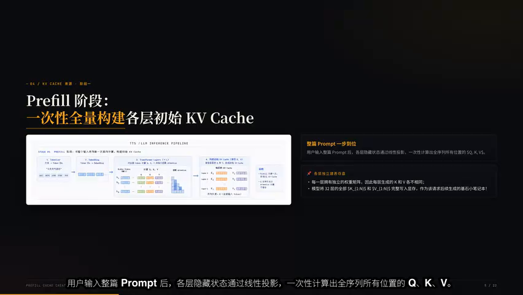
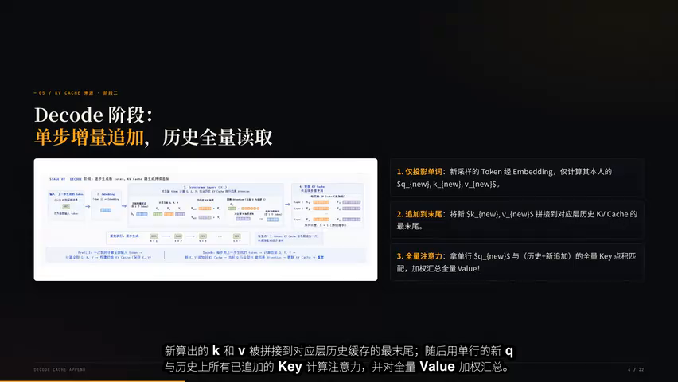

# 第 4 章 KV Cache：推理的核心数据结构

自回归 Decode 每步都要访问历史上下文。若每次都重算全部历史 token 的 Key 和 Value，计算会大量重复；若把历史状态全部留在显存，又会持续消耗容量与带宽。KV Cache 正是这一交换的核心：以持久保存 K、V 为代价，避免重复投影计算。本章推导其来源、生命周期、显存公式与管理边界。

## 从 Attention 推导 KV Cache



*图 4.1　Prefill 对整段 Prompt 做一次前向计算，并在每一层写入初始 Key/Value 缓存。它建立了后续 Decode 可复用的历史上下文，避免每生成一个 token 都重算整段前缀。（原课程视频帧，02:06）*


在第 $\ell$ 个 Transformer 层，位置 $t$ 的隐藏状态 $h_t^{(\ell)}$ 经线性投影得到：

$$
q_t=h_tW_Q,\qquad k_t=h_tW_K,\qquad v_t=h_tW_V
$$

为简化记号，以下省略层上标，但实际模型每一层都有不同投影权重，因此必须分别保存每一层的 K、V。对多头或分组查询注意力，还要按相应的 KV 头组织数据。

处理到位置 $t$ 时，普通因果自注意力为：

$$
o_t=\operatorname{softmax}\left(\frac{q_tK_{1:t}^{\top}}{\sqrt{d_h}}\right)V_{1:t}
$$

其中 $K_{1:t}$ 和 $V_{1:t}$ 包含当前及历史位置。历史 $k_i,v_i$ 由该层已经确定的历史隐藏状态计算，后续生成不会改变它们，因此可以缓存。下一位置只需计算新的 $q_{t+1},k_{t+1},v_{t+1}$，并执行：

$$
K_{1:t+1}=\operatorname{concat}(K_{1:t},k_{t+1}),\qquad
V_{1:t+1}=\operatorname{concat}(V_{1:t},v_{t+1})
$$

随后用 $q_{t+1}$ 查询更新后的全部 K、V。普通实现不缓存 Q，因为历史 Query 不参与未来位置的注意力；也不会因使用 KV Cache 而省略当前层的 FFN、归一化、输出投影或 LM Head。

KV Cache 消除了历史 K、V 的重复投影及其上游重复前向计算，却没有消除当前 Query 对历史 K、V 的读取和注意力计算。它将“重复计算问题”部分转化为“容量与带宽问题”，这就是长上下文 Decode 仍可能很慢的原因。

## Prefill、Decode 与请求结束

一个请求的缓存生命周期可概括为：

1. **分配**：推理引擎为请求准备逻辑 KV 空间；采用分页实现时，物理块可以随需要分配，而非一次申请最大长度的连续区域。
2. **Prefill 写入**：整段 Prompt 经过各层前向计算，所有输入位置的 K、V 写入缓存；因果掩码保证每个位置只能看自身及过去。最后位置的 logits 用于采样第一个输出 token。
3. **Decode 读取与追加**：将上一步采样的 token 作为输入，计算当前位置 Q、K、V；当前 K、V 追加到对应层，当前 Q 读取历史与当前的 K、V，随后预测下一个 token。
4. **结束处理**：遇到 EOS、长度上限、取消或错误后，请求释放其引用。无人引用且不复用的 block/page 回到空闲池；启用前缀复用时，部分缓存可能继续保留直至被淘汰。

注意“采样得到 token”与“处理该 token”是两个时刻。Prefill 已产生第一个输出 token，但该 token 的 K、V 通常到下一次前向计算才写入。因此，估算实际缓存时应数**已经写入的位置**，而不是机械地把返回文本的 token 数全部计入。

基本流程可写成下面的伪代码，省略了层循环和输出头：

```python
cache, logits = prefill(prompt_ids) # 写入 Prompt 各层 K、V，并返回 logits
next_id = sample(logits)
while not should_stop(next_id):
    logits = decode(next_id, cache) # 追加当前 K、V，读取完整可见历史
    next_id = sample(logits)
release_or_retain(cache)
```

真实引擎还可能包含前缀命中、分页映射、抢占、推测解码回滚和分层卸载，因此逻辑上的“追加”不保证对应一段物理连续、永不搬移的显存。

## KV Cache 的显存公式

先考虑标准 Full Attention、MHA/GQA、每层每 token 各保存一份 K 和 V 的稠密 BF16/FP16 场景。定义：

- $B$：活跃请求数；
- $T_b$：第 $b$ 个请求已缓存的 token 数；
- $L$：Transformer 层数；
- $n_{\mathrm{kv}}$：KV 头数，GQA 中它小于 Query 头数；
- $d_h$：每个 KV 头的维度；
- $s$：每个缓存元素的字节数。

总逻辑占用为：

$$
M_{\mathrm{KV}}=2sLn_{\mathrm{kv}}d_h\sum_{b=1}^{B}T_b
$$

若所有请求都有相同缓存长度 $T$，则：

$$
M_{\mathrm{KV}}=B\,T\,L\,2n_{\mathrm{kv}}d_h\,s
$$

因子 2 表示 K 与 V 两份数据，不能与 BF16 的 2 字节混淆。若每个活跃请求在一个 Decode step 都追加一个位置，则该步新增量为 $B\times2sLn_{\mathrm{kv}}d_h$；实际批中请求完成或槽位变化时，应按真实新增位置求和。

下面的无依赖函数可用于核对单位，`tokens` 是所有请求已缓存位置数之和：

```python
def kv_cache_bytes(tokens, layers, kv_heads, head_dim, element_bytes=2):
    return 2 * tokens * layers * kv_heads * head_dim * element_bytes
```

### Qwen3-4B 配置演算

原课程使用 Qwen3-4B-Thinking-2507 的配置：$L=36$、$n_{\mathrm{kv}}=8$、$d_h=128$、BF16 即 $s=2$。单请求每个已缓存位置的理论 KV 占用为：

$$
2\times36\times8\times128\times2=147{,}456\ \text{B}=144\ \text{KiB}
$$

若 Prefill 已写入 100 个位置，缓存为 $14{,}745{,}600$ B，即约 $14.06$ MiB；再追加 200 个位置后，总计 300 个位置，缓存约为 $42.19$ MiB。这里的新增位置数按已写入缓存计数，避免最后一个已采样但尚未处理 token 的差一错误。

同一请求缓存 4096 个位置时约为 $576$ MiB，即 $0.5625$ GiB；缓存 32768 个位置时约为 $4.5$ GiB。8 个这样的满长请求约需 $36$ GiB，仅指 KV 的逻辑数据量，不含权重、临时激活、workspace、页表和其他运行时开销。

这些结果说明：短上下文、低并发时权重可能占主导；长上下文或高并发时，KV Cache 可成为主要显存消耗。使用 GiB 还是 GB 必须明确，1 GiB 等于 $2^{30}$ 字节，而 1 GB 常按 $10^9$ 字节计。

## 连续分配的边界问题



*图 4.2　Decode 每轮只处理最新 token：把新的 K/V 追加到缓存，再让当前 Query 对全部历史 Key/Value 进行注意力计算。两图合看可区分 Prefill 的“批量建缓存”和 Decode 的“增量追加、历史读取”。（原课程视频帧，02:35）*


若每个请求都按最大上下文预留一段连续显存，尚未生成的位置也会提前占用空间；若按当前长度反复扩容，则可能需要寻找更大的连续区域并复制旧缓存。请求不断加入、退出且长度不一，会留下难以再次利用的空洞。

多请求独立保存缓存时，公共 system prompt 或对话前缀会产生重复的 K、V。Continuous Batching 每轮允许请求动态加入和退出，若仍用按最大长度对齐的矩形张量，可能出现 padding、无效计算和重排成本。连续存储不是无法实现动态批处理，而是元数据、搬移和碎片管理会更复杂。

分页管理把逻辑缓存划分为固定大小 block/page，通过映射关联请求位置与物理块，使分配、回收和共享更细粒度。它能减少最大长度预留和外部碎片，但最后一个块仍可能有内部碎片，页表与元数据也有成本；共享前缀还需要引用计数，并在私有写入时处理隔离，不能简单覆盖公共块。

## 公式的适用边界

上述公式描述的是标准稠密 KV 布局。KV 量化会改变 $s$，但还需加入 scale、zero-point 等元数据；滑动窗口只保留有限历史，缓存不一定随总生成长度无限增长；MLA 等结构缓存的不是简单的逐 KV 头 K、V，必须按实际潜在表示重算；Prefix Caching 会让多个逻辑序列共享物理块。

因此，显存估算应从模型 `config`、注意力实现和运行时布局出发。分页池的物理已分配量还可能大于所有逻辑 token 的公式值。把 KV Cache 卸载到 CPU 可缓解 GPU 容量压力，却会引入 PCIe/NVLink 传输、同步与调度开销，是否获益需要按访问模式和实测延迟判断。

## 实践检查

1. 对两个历史位置手写 Decode 的 $q_tK_{1:t}^{\top}$，列出哪些 K、V 来自缓存、哪些在当前步计算；解释为什么历史 Q 不需要保存。
2. 使用 `kv_cache_bytes` 核对 100、300、4096 和 32768 个位置的上述结果，统一输出 MiB/GiB，并写出换算过程。这里只验证算术，不把结果当成本机显存测量。
3. 某模型为 $L=32$、$n_{\mathrm{kv}}=8$、$d_h=128$、FP16。若 4 个请求分别缓存 512、1024、2048、4096 个位置，按不等长公式计算总占用，再计算下一 Decode step 每请求各追加一个位置的增量。
4. 给定设备显存，列出权重、KV 池、workspace、临时激活和安全余量五项预算。说明为什么“总显存减去权重再除以单 token KV”只是过于乐观的并发起点。
5. 画出一个共享前缀请求发生私有追加时的页引用变化，标出哪些页可共享、哪些页必须私有，以及请求结束后引用计数如何变化。

## 小结

KV Cache 按层保存历史 K、V，使 Decode 无需重算整段历史，但当前注意力仍需读取不断增长的缓存。其逻辑占用对缓存位置数、请求数、层数、KV 头数、头维度和元素字节数均为线性关系。长上下文与高并发会把计算节省转化为容量、带宽和管理压力，分页与前缀复用则需要在碎片、元数据和共享语义之间权衡。

## 参考资料

- 本章基于 Datawhale × RadixArk 的 zero-to-sglang 原课程重组；原文件：[第 4 章 推理的核心数据结构入门](https://github.com/datawhalechina/zero-to-sglang/blob/296fec5d215408f918c0e4007e71c962e804ef7e/course-material/ch/part1/第4章_推理的核心数据结构入门.md)；原课程采用 [CC BY-NC-SA 4.0](https://creativecommons.org/licenses/by-nc-sa/4.0/deed.zh) 许可。
- Qwen：[Qwen3-4B-Thinking-2507 config.json](https://huggingface.co/Qwen/Qwen3-4B-Thinking-2507/blob/main/config.json)，本章层数、KV 头数和头维度示例。
- SGLang：[HiCache](https://www.lmsys.org/blog/2025-09-10-sglang-hicache)，缓存复用与分层管理的扩展阅读。
- SGLang：[官方文档](https://docs.sglang.io/)，具体运行时配置与缓存实现以所使用版本为准。
