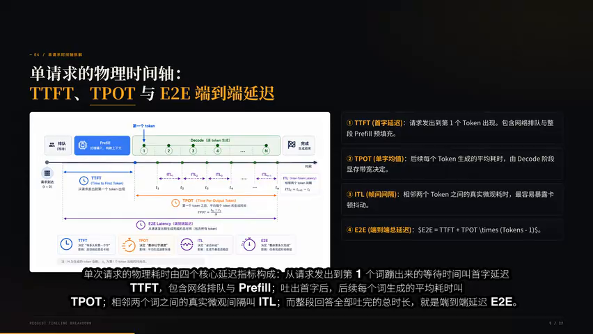

# 第 5 章 Benchmark：指标与实验方法

“更快”只有转化为可复现的数据才有工程意义。推理 Benchmark 的对象不是抽象的最高分数，而是特定模型、实现、硬件与请求负载共同构成的系统。本章区分模型能力与推理性能评测，定义延迟、吞吐和 Goodput，并给出从实验设计到结果解读的检查方法。

## 先区分两类 Benchmark



*图 5.1　一次请求的延迟不能只用总时长概括。TTFT 描述首个 token 到达前的等待，TPOT/ITL 描述后续生成节奏，E2E 则覆盖完整请求，为 Benchmark 指标选择提供统一时间轴。（原课程视频帧，02:04）*


**模型能力 Benchmark** 通过 MMLU、GSM8K、HumanEval、SWE-bench 等任务检查答案质量，关注模型“答得好不好”。**推理负载 Benchmark** 向已部署服务施加请求，测量 TTFT、TPOT、吞吐和尾延迟，关注系统“运行得多快、多稳、成本多高”。

两类实验可以共享同一模型，却不能互相替代。系统提速不应以未经检查的质量下降为代价，模型分数更高也不能推出服务延迟更低。本章后续所称 Benchmark，默认指推理负载 Benchmark；若修改了量化、推测解码或停止策略，还应同时核对输出质量与长度。

Benchmark 的用途包括建立性能基线、验证单项优化、比较部署方案和支持容量规划。有效结论必须带着实验条件一起陈述；脱离负载的“每秒多少 token”通常无法回答真实业务能否满足要求。

## 一次请求的时间轴

设请求提交时刻为 $t_0$，各输出 token 的观测到达时刻为 $t_1,\ldots,t_n$，输出 token 数为 $n$。至少应明确时间戳是在客户端还是服务端记录：客户端包含网络与流式传输，服务端则更接近引擎内部耗时。

**TTFT（Time to First Token）**为：

$$
\mathrm{TTFT}=t_1-t_0
$$

它可包含排队、预处理、Prefill 和首 token 返回的开销，具体边界由测量位置决定。不能把 TTFT 直接当作纯 Prefill kernel 时间。

**ITL（Inter-Token Latency）**是相邻输出 token 的间隔：$\mathrm{ITL}_j=t_j-t_{j-1}$，其中 $j=2,\ldots,n$。逐个 ITL 能揭示输出抖动，单个均值会掩盖停顿。

**TPOT（Time Per Output Token）**通常定义为首个 token 之后的平均生成时间：

$$
\mathrm{TPOT}=\frac{t_n-t_1}{n-1},\qquad n>1;
\qquad n=1\ \text{时该式无数学定义}
$$

因此 TPOT 是这些 ITL 的平均值；$n=1$ 时分母为零，应单独报告这一例外。SGLang `bench_serving` 为统计和 Goodput 将单 token 响应的 TPOT 记为 `0`，这是避免除零的工具约定，**不是真实零延迟**；解读或自行汇总时，应把这一工具值与 $n>1$ 时有数学定义的 TPOT 区分开。**E2E Latency**为 $t_n-t_0$；$n>1$ 时满足：

$$
\mathrm{E2E}=\mathrm{TTFT}+(n-1)\mathrm{TPOT}
$$

$n=1$ 时不存在首 token 后的生成区间，直接有 $\mathrm{E2E}=\mathrm{TTFT}$，不能把未定义的 TPOT 代入上式。

例如 TTFT 为 250 ms、TPOT 为 25 ms、输出 200 个 token，则 E2E 为 $250+199\times25=5225$ ms。该例说明长输出往往更敏感于 TPOT，长输入短输出则更需关注 TTFT，但实际仍以分解测量为准。

下面的函数只计算客户端观测指标，输入时间单位为秒；它是校验公式的小工具，不代表某次运行结果：

```python
def latency_metrics(submit, arrivals):
    if not arrivals:
        raise ValueError("at least one output token is required")
    intervals = [b - a for a, b in zip(arrivals, arrivals[1:])]
    return {
        "ttft": arrivals[0] - submit,
        "tpot": sum(intervals) / len(intervals) if intervals else None,
        "itl": intervals,
        "e2e": arrivals[-1] - submit,
    }
```

## 吞吐、Goodput 与尾延迟

**Throughput** 是单位时间的系统产出，常用 output token/s 或 request/s。报告 token/s 时必须说明只计输出、还是输入与输出都计，以及统计区间如何处理未完成请求。单请求 $1/\mathrm{TPOT}$ 与全系统 output token/s 不是同一指标，多请求并发时不能混用。

**Goodput** 是在统计窗口内已完成、结果有效且满足业务服务等级目标（SLO）的请求上所计算的有效吞吐。若要求 TTFT 不超过 $D_f$、TPOT 不超过 $D_t$，request Goodput 可写为：

$$
G=\frac{1}{\Delta t}\sum_r\mathbf{1}\bigl(\mathrm{TTFT}_r\le D_f\ \land\ \mathrm{TPOT}_r\le D_t\bigr)
$$

求和只覆盖统计窗口内已完成且结果有效的请求，指示函数再排除不满足时延约束者。也可以按合格请求的 output token 计量，但必须注明口径。采用上述数学定义自行计算时，含 TPOT 的比较要求 $n_r>1$；$n_r=1$ 需单独约定 SLO 处理方式。使用 SGLang `bench_serving --goodput ... tpot:...` 时，单 token 响应按前述 `TPOT=0` 的工具约定参与判定，不能把通过该约束解释为实际 token 间隔为零。SLO 还可包含 E2E、ITL 或 P99 约束；只满足 TTFT 的请求不一定就是业务合格请求。

延迟应观察分布。将 $N$ 个观测值升序排列，P50 表示中位水平，P99 描述最慢尾部附近的位置。常见的 nearest-rank 定义取第 $\lceil pN\rceil$ 个值，不同工具也可能使用插值分位数，因此精确对比需使用同一算法。样本很少时 P99 极不稳定，100 个请求中的一个尾部样本不能支持精细的总体结论。

并发增加通常先提高资源利用率和吞吐，随后排队与资源竞争推高延迟，吞吐最终趋于饱和甚至下降。理想配置不是裸吞吐最大的点，而是在延迟约束下 Goodput 最大且留有余量的区域。

## 从业务问题构造负载

首先确定评价对象和问题：验证 Prefill 优化、Decode 优化、前缀复用，还是评估线上容量？随后让请求集匹配目标分布，至少记录输入长度、输出长度、共享前缀比例、多轮关系、到达过程和并发水平。

SGLang 提供的常用负载类型包括：

- `sharegpt`：真实对话来源，适合构造聊天类负载，但仍需检查其分布是否代表目标业务；
- `random`：控制输入输出长度，便于隔离性能因素，不代表真实语义和采样路径；
- `generated-shared-prefix`：构造共享前缀，用于观察前缀复用；
- `agentic-trace`：包含多轮和工具调用轨迹，更接近 Agent 工作流。

工具所在层次同样重要：

| 工具 | HTTP 与服务层 | 调度路径 | 主要用途 |
| --- | --- | --- | --- |
| `bench_serving` | 包含 | 包含 | 测量服务端到端延迟、吞吐和分位数 |
| `bench_one_batch_server` | 包含 | 包含 | 观察单 batch 的服务路径 |
| `bench_offline_throughput` | 不包含在线 HTTP | 包含引擎批处理 | 测量离线吞吐能力 |
| `bench_one_batch` | 不包含 | 隔离在线请求过程 | 分析单批次底层执行，不代表线上表现 |

绕过 HTTP 的结果不能当作客户端延迟，单 batch 结果也不能外推动态并发。跨层比较会把被绕过的组件误算成“优化收益”。

## 控制变量与可复现性

一次对比实验至少应固定以下条件：

1. 模型权重与 revision、分词器、精度/量化方式、最大上下文和采样参数；
2. 推理引擎及依赖版本、启动参数、并行方式、关键功能开关和代码变更；
3. GPU 具体型号与数量、CPU、内存、互联拓扑，以及相关功耗或时钟状态；
4. 同一请求集或可复现生成方式、输入输出长度分布、随机种子和停止规则；
5. 闭环并发或开环到达速率、请求总量、测试时长、客户端位置与网络条件。

闭环负载在若干请求完成后才补充新请求，`max-concurrency` 控制同时在途数量；开环负载按 `request-rate` 等过程到达，更能暴露请求堆积。二者回答不同问题，不能只写“并发 16”而省略负载生成方式。

正式统计前应充分预热，让初始化、编译、CUDA Graph 捕获和缓存分配等一次性过程不污染稳态测量。预热请求不计入正式结果。应重复多轮、保留逐请求原始记录和完整命令，同时报告波动，而不是只挑选最好的一次。

## 解读结果与常见误区

推荐顺序是：先核对有效性和实验条件，再检查延迟是否满足 SLO，最后比较吞吐、资源利用率与成本。若吞吐提升来自更短的随机输出、不同分词器或提前结束，比较就失去共同基准；若平均延迟很好而 P99 严重超限，在线服务仍可能不可用。

其他常见误区包括：把冷启动当稳态、用不同输入输出长度比较 token/s、忽略跨模型分词差异、把 kernel 结果当线上结果、只测单卡却外推多卡通信性能，以及只报告均值或最好值。性能异常时还应检查输出是否完整、请求是否失败、失败请求是否被错误地排除。

在已经部署的测试服务上，可先通过 `python -m sglang.bench_serving --help` 核对当前版本参数。下面的命令仅是实验模板，执行前需按版本与服务地址调整，本书不预设其运行结果：

```bash
python -m sglang.bench_serving \
  --backend sglang \
  --dataset-name random \
  --num-prompts 256 \
  --random-input-len 512 \
  --random-output-len 128 \
  --max-concurrency 16
```

该模板只构成一个负载点，不能单独证明最优并发。完整实验应扫描多个并发或速率点，绘制吞吐—延迟曲线并计算相同 SLO 下的 Goodput。

## 实践检查

1. 用 $t_0=0$、$t_1=0.25$ s、$n=200$、TPOT 为 25 ms 验算 E2E，并解释为什么公式使用 $n-1$ 而非 $n$；再说明 $n=1$ 时如何报告 TPOT。
2. 构造 10 个请求的 TTFT，使均值看似正常但至少一个请求明显拖尾。分别计算均值、P50 和所选定义下的 P90，并说明为何小样本 P99 不可靠。
3. 为“长文档问答”和“离线批量生成”各写一组 SLO 与主要指标，指出二者为何不能只按同一个 output token/s 排名。
4. 设计 A/B 实验验证一项 KV Cache 优化：列出唯一自变量、固定条件、预热方式、负载点、重复次数、质量检查和原始记录字段。
5. 对上述 SGLang 命令模板，先用当前版本 `--help` 核对参数，再规划至少四个并发点。报告模板应包含 TTFT/TPOT 的 P50/P95/P99、E2E、吞吐、Goodput、失败数及实际输出长度分布。
6. 若高并发下吞吐上升而 Goodput 下降，给出一种符合该现象的逐请求数据解释，并说明应怎样选择部署点。

## 小结

推理 Benchmark 以可复现负载测量系统，而非替代模型能力评测。TTFT、TPOT、ITL 和 E2E 描述请求时间轴，Throughput 与 Goodput 描述系统产出，分位数揭示尾部体验。可信比较依赖相同模型、负载、测量边界和运行条件，并应通过多负载点、重复实验与原始记录验证优化收益。

## 参考资料

- 本章基于 Datawhale × RadixArk 的 zero-to-sglang 原课程重组；原文件：[第 5 章 Benchmark 入门](https://github.com/datawhalechina/zero-to-sglang/blob/296fec5d215408f918c0e4007e71c962e804ef7e/course-material/ch/part1/第5章_Benchmark入门.md)；原课程采用 [CC BY-NC-SA 4.0](https://creativecommons.org/licenses/by-nc-sa/4.0/deed.zh) 许可。
- SGLang：[Benchmark and Profiling](https://docs.sglang.io/docs/developer_guide/benchmark_and_profiling#benchmark)，工具入口、数据集与参数以当前版本为准。
- Datawhale：[diy-llm：评估与基准测试](https://github.com/datawhalechina/diy-llm/blob/main/docs/zh/chapter12/chapter12_%E8%AF%84%E4%BC%B0%E4%B8%8E%E5%9F%BA%E5%87%86%E6%B5%8B%E8%AF%95.md)，模型能力评测的扩展阅读。
- NVIDIA：[NIM LLMs Benchmarking](https://docs.nvidia.com/nim/benchmarking/llm/latest/overview.html)，推理服务指标与测量方法参考。
