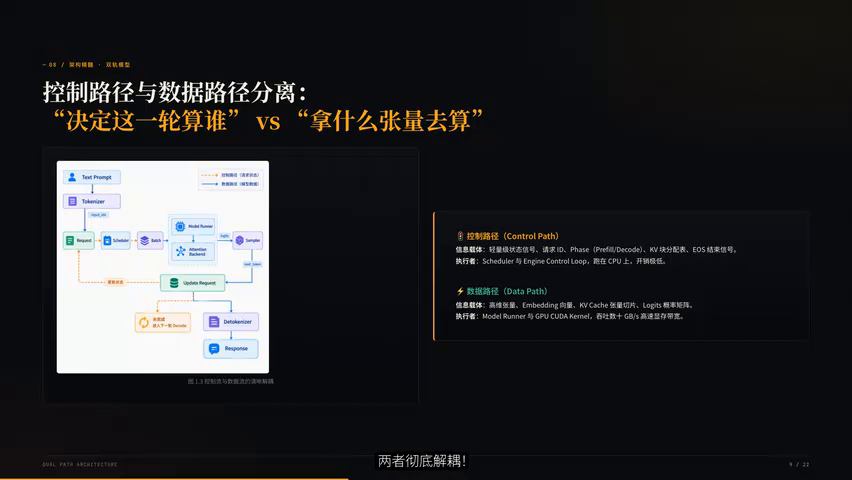

# 第 6 章 mini-sglang：推理引擎长什么样

能够调用模型生成文本，并不等于已经拥有推理引擎。模型解决的是“给定上下文，下一批分数是什么”；引擎还要决定为谁计算、何时计算、历史状态放在哪里，以及结果怎样送回调用者。本章先建立一张 mini-sglang 的架构地图，后续章节再沿请求、前向、缓存和服务接口逐项深入。

> 本章基于 Datawhale × RadixArk 的 [zero-to-sglang](https://github.com/datawhalechina/zero-to-sglang) 原课程重组。原始材料为 [Part II 第 1 章概念文档](https://github.com/datawhalechina/zero-to-sglang/blob/main/course-material/ch/part2/第1章_mini-sglang：推理引擎长什么样.md)。本文按 [CC BY-NC-SA 4.0](https://creativecommons.org/licenses/by-nc-sa/4.0/) 共享。

## 从生成循环看系统缺口



*图 6.1　mini-sglang 将“这一轮算什么”的控制决策与“张量怎样计算”的数据路径分开。该划分让请求调度、状态同步和模型执行各守边界，是理解推理引擎整体架构的关键。（原课程视频帧，05:00）*


最朴素的自回归生成可以概括为“前向、采样、追加”三步。下面是**教学伪代码**，假设模型已经加载，`sample` 负责选择下一个 token；它不代表 mini-sglang 的完整 API。

```python
# 伪代码：单请求、无 KV Cache
input_ids = tokenize(prompt)
for _ in range(max_new_tokens):
    logits = model(input_ids)
    next_token = sample(logits[-1])
    input_ids.append(next_token)
    if next_token == eos_id:
        break
return detokenize(input_ids)
```

这段逻辑足以解释模型如何逐 token 生成，却留下了一串工程问题：多个请求如何排队，哪些请求能组成一个批次，显存是否容得下新增缓存，请求取消后由谁清理资源，增量文本又怎样返回客户端？此外，每轮重新处理完整 `input_ids` 还会重复计算历史状态。

推理引擎由此承担四类职责：

1. **输入输出管理**：完成文本与 token IDs 的转换，传递采样参数，组织普通或流式响应。
2. **请求编排**：记录每条请求的输入、进度、停止条件和缓存归属，处理完成、取消与异常。
3. **计算调度**：组织 Prefill 或 Decode 批次，在延迟、吞吐和资源预算之间作出选择。
4. **状态与内存管理**：保存各层 KV Cache，维护逻辑 token 到物理存储的映射，并复用或回收空间。

因此，模型负责神经网络计算，引擎负责组织这些计算；HTTP 接口只是其中一层，而不是全部。

## 四层逻辑架构

mini-sglang 可以按职责划分为四层。分层描述的是依赖关系，不要求每一层对应一个独立进程。

| 层次 | 主要组件 | 回答的问题 |
|---|---|---|
| 接口层 | API Server、Tokenizer、Detokenizer | 请求怎样进入，文本怎样转换，结果怎样返回 |
| 编排层 | Scheduler、等待队列、Batch 管理 | 当前有哪些请求，这一轮算谁 |
| 执行层 | Engine、Model Runner、Attention Backend、Sampler | 输入怎样完成前向并产生新 token |
| 状态与内存层 | Req、Token Pool、KV Cache Pool、Page Table | 请求进度与历史计算结果保存在哪里 |

在运行时，官方 mini-sglang 将 API Server 留在主进程，并为 scheduler、tokenizer 和 detokenizer 创建工作进程。Scheduler 与 Engine 位于同一 worker 中，两者通过函数调用协作；文本转换与结果回复则跨进程传递。逻辑边界因此不等于进程边界，这一点在阅读调用链时尤其重要。

多进程使输入处理、GPU 调度和输出解码有机会重叠，也带来消息序列化、进程同步、就绪等待和故障清理成本。不能仅凭“进程更多”推断系统一定更快。

## 控制路径与数据路径

阅读引擎时，可以同时追踪两条路径：

- **控制路径**传递请求是否可运行、应进入 Prefill 还是 Decode、是否已经结束，以及缓存能否分配。Scheduler 是主要决策者。
- **数据路径**传递本轮 `input_ids`、位置、注意力元数据、logits、新 token 和 KV Cache。Batch、Engine 与 Attention Backend 是主要参与者。

可用下面的**结构示意伪代码**理解一次循环；它省略了重叠调度、异常处理和分布式分支。

```python
# 伪代码：控制决策与模型数据的交接
receive_messages()
batch = scheduler.select_batch(cache_budget, token_budget)
if batch is not None:
    prepared = scheduler.prepare_tokens_and_cache(batch)
    output = engine.forward_and_sample(prepared)
    scheduler.update_requests(output)
    detokenizer.send_incremental_results(output)
```

`select_batch` 决定“为谁算”，`forward_and_sample` 决定“怎样算”。把二者混在一起，会让性能问题难以定位：GPU 没有任务可能是没有就绪请求，也可能是缓存预算不足，而不一定是模型执行太慢。

## 请求生命周期与核心对象

为便于分析，可将请求状态简化为 `WAITING → PREFILL → DECODE → FINISHED`，取消或错误则进入 `ABORTED`。这是**教学抽象**，不是源码中必然存在的同名枚举；真实实现还可能出现分块 Prefill、等待显存或被抢占等状态。

Prefill 处理已知 prompt，建立初始 KV Cache，并给出首个输出 token 所需的 logits。Decode 每轮利用已有缓存继续生成。达到长度上限、生成 EOS、命中停止条件或外部取消，都会改变后续生命周期。

源码中的共享对象把这条生命周期与模型执行连接起来：

| 对象 | 保存的内容 | 不应混淆的边界 |
|---|---|---|
| `SamplingParams` | 温度、Top-k、Top-p、最大生成长度、是否忽略 EOS 等 | 配置不属于模型权重 |
| `Req` | 请求 uid、输入 IDs、设备侧长度、已缓存长度、缓存句柄等 | 当前序列长度不等于已缓存长度 |
| `Batch` | 一组请求及本轮输入、位置、写入位置和 Attention 元数据 | 一个 batch 只描述当前执行，不等于完整请求历史 |
| `Context` | 当前 Batch、Attention Backend、KV Cache Pool、Page Table 等共享依赖 | 运行时环境不归属于单条请求 |

`Req.extend_len` 可用 `device_len - cached_len` 理解：前者是本轮要处理到的总长度，后者是已有可复用 K/V 的长度。这个差值决定本轮真正需要计算和写入多少 token，是后续缓存与调度章节的关键。

## 架构与源码定位

原课程概念文档以 mini-sglang 提交 `9a91cfafe754aa85daee49998176275667eb58f2` 为参考基线。以下路径均位于该仓库的 `python/minisgl/`，阅读新版本时应以实际代码为准。

```text
python/minisgl/
├── core.py          # Req、Batch、Context、SamplingParams
├── server/          # API Server、启动参数与进程启动
├── tokenizer/       # Tokenize 与 Detokenize
├── scheduler/       # 请求队列、调度、批次与缓存位置管理
├── engine/          # 模型执行、采样及运行时初始化
├── models/          # 具体模型结构
├── layers/          # Attention、归一化、Embedding 等模型层
├── attention/       # Attention 后端与元数据
├── kvcache/         # 物理 KV 池与缓存抽象
├── distributed/     # 分布式执行
└── message/         # 跨 worker 的消息类型
```

推荐从问题反向定位：请求状态看 `core.py`，组 batch 看 `scheduler/`，前向与采样看 `engine/` 和 `models/`，缓存读写看 `kvcache/` 与 `attention/`，HTTP 入口看 `server/`。首次阅读不必从目录第一行顺序读到最后。

## 关键边界

- 四层架构是职责视图；进程视图还受通信和部署方式影响，二者不能机械对应。
- `WAITING` 等名称用于解释生命周期，不应据此搜索并断言源码必有同名字段。
- 调度器选中请求不代表本轮一定能执行；长度限制、token 预算和 KV Cache 容量都可能阻止组批。
- Prefill 与 Decode 使用同一个模型，区别在输入组织、缓存访问和并行性，而不是两套权重。
- 教学片段省略了初始化、设备同步、分布式通信和异常路径，不能直接当作完整服务运行。
- “能生成正确文本”只覆盖正确性的一部分，还不能证明并发隔离、资源回收或性能满足要求。

## 实践检查

1. 不用看图，独立写出“接口—编排—执行—状态与内存”四层，并为每层列出输入和输出。
2. 在参考提交的 `core.py` 中找到 `Req`、`Batch` 和 `Context`，逐项核对其字段；解释 `device_len`、`cached_len` 与 `extend_len` 的关系。
3. 沿 `scheduler/scheduler.py` 找一次 Engine 调用，标出调用前的调度决策和调用后的请求状态更新。
4. 用一条假设请求走完接收、Prefill、Decode、结束与清理，分别注明哪些步骤跨进程、哪些步骤只是函数调用。
5. 对“GPU 空闲但请求仍在排队”列出至少三种可检查原因，并说明需要查看队列、预算还是缓存状态；此练习不要求运行模型。

## 小结

mini-sglang 的价值在于把推理引擎的必要职责放进可追踪的结构中：接口层转换输入输出，Scheduler 组织计算，Engine 执行前向与采样，请求对象和缓存系统保存状态。控制路径与数据路径提供了两条互补的阅读线索，而 `Req`、`Batch`、`Context` 则是连接源码的锚点。后续章节将依次展开请求流转、模型生成、KV Cache 和 HTTP 并发。

## 参考资料

- [原课程：mini-sglang 推理引擎概念文档](https://github.com/datawhalechina/zero-to-sglang/blob/main/course-material/ch/part2/第1章_mini-sglang：推理引擎长什么样.md)
- [mini-sglang 参考提交 9a91cfa](https://github.com/sgl-project/mini-sglang/tree/9a91cfafe754aa85daee49998176275667eb58f2)
- [mini-sglang 架构说明](https://github.com/sgl-project/mini-sglang/blob/9a91cfafe754aa85daee49998176275667eb58f2/docs/structures.md)
- [mini-sglang `core.py`](https://github.com/sgl-project/mini-sglang/blob/9a91cfafe754aa85daee49998176275667eb58f2/python/minisgl/core.py)
- [SGLang 官方仓库](https://github.com/sgl-project/sglang)
- [Creative Commons BY-NC-SA 4.0 许可协议](https://creativecommons.org/licenses/by-nc-sa/4.0/)
