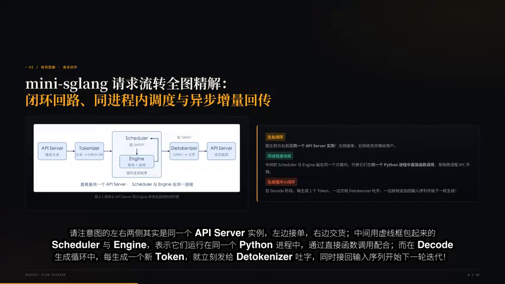
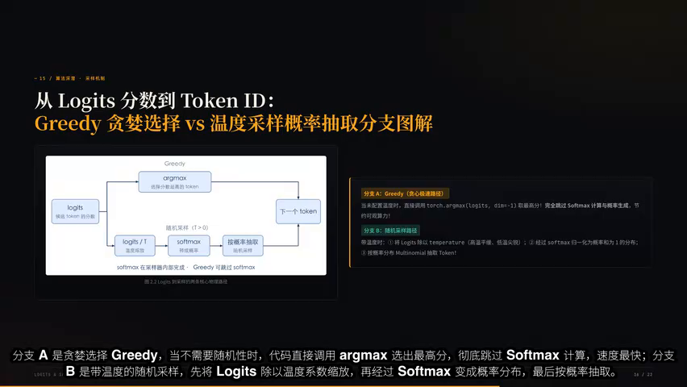

# 第 7 章 一个请求的旅程

上一章给出了推理引擎的静态架构，本章改用动态视角：一条流式聊天请求从 HTTP 入口出发，经过分词、调度、模型计算和反分词，最后回到原来的客户端。沿这条路径阅读源码，比孤立记忆模块名称更容易理解请求状态在哪里改变、数据在哪里转换，以及取消后需要清理什么。

> 本章基于 Datawhale × RadixArk 的 [zero-to-sglang](https://github.com/datawhalechina/zero-to-sglang) 原课程，由 [Part II 第 2 章概念文档](https://github.com/datawhalechina/zero-to-sglang/blob/main/course-material/ch/part2/第2章_一个请求的旅程.md) 与 [代码走读](https://github.com/datawhalechina/zero-to-sglang/blob/main/course-material/ch/part2/第2章_一个请求的旅程_代码.md) 重组。本文按 [CC BY-NC-SA 4.0](https://creativecommons.org/licenses/by-nc-sa/4.0/) 共享。

## 全链路概览



*图 7.1　请求在系统中经历接收、分词、排队调度、模型前向、采样、反分词和流式返回。图中同时呈现闭环数据流与组件边界，可作为逐站阅读源码时的路线图。（原课程视频帧，02:50）*


假设客户端请求“什么是 KV Cache？”，并设置 `stream=true`。请求的主要路线是：

```text
Client
  → API Server：解析 HTTP、分配 uid、提交 TokenizeMsg
  → Tokenizer：应用对话模板，文本 → input_ids，发送 UserMsg
  → Scheduler：检查长度、排队、组 batch、准备缓存
  → Engine：模型前向 → logits → 采样新 token
  → Scheduler：更新请求、判断停止、发送 DetokenizeMsg
  → Detokenizer：结合历史状态，token → 增量文本，返回 UserReply
  → API Server：按 uid 找到连接，以 SSE 返回新增内容
  → Client
```

生成循环发生在 Scheduler 与 Engine 之间，而“新 token → 增量文本 → SSE 数据块”会重复多次。链路两端是同一个 API Server；Scheduler 和 Engine 则在同一 scheduler worker 内通过函数调用协作，并不经过 ZMQ。

请求在各站经历三次关键表示转换：输入文本变成 token IDs，模型依据上下文产生新 token，输出 token 再转成文本。`uid` 贯穿消息传递，使异步交错的结果仍能回到正确连接。

## 进程启动与消息边界

参考实现的 `server/launch.py` 使用 `multiprocessing` 创建 scheduler、detokenizer 和 tokenizer 子进程，主进程运行 FastAPI。单卡时可看到主 rank 的 scheduler worker；启用张量并行时，每张 GPU 对应一个 scheduler worker，但它们协同处理同一批请求，不能各自独立组批。

子进程调用 `.start()` 不代表立即可服务。Tokenizer 要初始化词表，Scheduler/Engine 要加载模型并准备显存，主进程需要等待就绪信号。分词和反分词共用 `tokenize_worker` 入口，实际行为由收到的消息类型决定。

| 消息 | 主要方向 | 携带的核心信息 |
|---|---|---|
| `TokenizeMsg` | API Server → Tokenizer | uid、文本或对话、采样参数 |
| `UserMsg` | Tokenizer → Scheduler | uid、`input_ids`、采样参数 |
| `DetokenizeMsg` | Scheduler → Detokenizer | uid、新 token、结束状态 |
| `UserReply` | Detokenizer → API Server | uid、增量文本、结束状态 |
| `AbortMsg` / `AbortBackendMsg` | 前台 → Tokenizer → Scheduler | 待取消请求的 uid |

这些消息是跨 worker 的控制边界；模型张量并不会简单地随每种消息序列化。Scheduler 调用 Engine 时，则直接传递批次与执行所需对象。

## 源码走读：请求进入系统

以下路径均相对于 mini-sglang 的 `python/minisgl/`，参考提交为 `9a91cfafe754aa85daee49998176275667eb58f2`。片段是**源码结构的简化示意**，省略参数和异常分支，不能单独运行。

### API Server：接收并登记

`server/api_server.py` 的聊天路由解析请求，调用 `state.new_user()` 分配 uid、创建结果缓冲和通知对象，再发送 `TokenizeMsg`。流式请求返回 `StreamingResponse`，此时回答尚未生成完，HTTP 连接会保持打开。

后台的 `listen` 协程持续接收 `UserReply`，按 uid 把消息放入 `ack_map`，再通过 `event_map` 唤醒对应请求的等待协程。共享返回通道因此不会把不同用户的文本写在一起。

### Tokenizer：转换输入表示

`tokenizer/server.py` 收到 `TokenizeMsg` 后完成分词。若输入采用 `messages`，还要先应用模型对应的 chat template，把角色和历史对话组织成训练时约定的文本格式。输出的 `input_ids` 与 uid、采样参数一起封装为 `UserMsg`，发往 Scheduler。

Tokenizer 不理解语义，也不负责生成。模板、特殊 token 和 EOS 配置必须与模型匹配；使用相同文本但不同模板，实际送入模型的序列可能不同。

### Scheduler：排队并选择本轮工作

`scheduler/scheduler.py` 的 `normal_loop` 可用下面的**简化伪代码**理解：

```python
# 伪代码：普通调度循环，省略 overlap 与错误处理
while True:
    blocking = not (prefill_manager.runnable or decode_manager.runnable)
    for msg in receive_msg(blocking=blocking):
        process_one_msg(msg)

    batch = (prefill_manager.schedule_next_batch(prefill_budget)
             or decode_manager.schedule_next_batch())
    if batch is not None:
        output = forward(batch)
        process_last_data(batch, output)
```

新请求先进入等待队列，而不是到达即执行。Scheduler 组 Prefill batch 时会考虑输入长度、token 预算、KV Cache 可用空间和可复用前缀；无法组出 Prefill batch 时才尝试 Decode batch。这段优先级描述的是参考实现的普通路径，不应推广为所有引擎的固定策略。

### Engine：前向与采样

Scheduler 的 `_forward` 从 token pool 取出本轮 IDs，调用 `engine.forward_batch`，再把输出 token 写回。`engine/engine.py` 先执行模型前向，再由 `engine/sample.py` 选择下一 token，并将结果复制回 CPU 供调度器处理。

Logits 是词表候选的未归一化分数。全贪心 batch 可以直接 `argmax`；随机采样则进行温度调整、候选截断和概率抽样。EOS 与最大长度判断位于 Scheduler，而不是 Sampler：采样器只负责“选哪个 token”，不拥有整条请求的生命周期。

### Scheduler：更新进度与停止

新 token 会接回请求序列。Scheduler 检查是否达到 `max_tokens`、是否生成 EOS，以及 `ignore_eos` 是否要求忽略结束符。未结束请求留待后续 Decode，结束请求释放表项并按缓存策略处理 KV Cache。随后，新 token 与 `finished` 状态被装入 `DetokenizeMsg`。

这里的“释放缓存”不一定等于立即擦除全部数据。可复用前缀可能继续保留，回收通常只是让位置可被重新分配。

## 反分词与流式返回

`tokenizer/detokenize.py` 不能简单地对每个 token 单独调用解码再拼接。一个字节的片段可能尚不足以组成完整 UTF-8 字符，独立解码会产生替代字符或错误边界。Detokenizer 因而按 uid 保留解码状态，结合已有 token 找出已经可安全输出的后缀，只发送新增文本。

API Server 收到 `UserReply` 后，流式分支把 `incremental_output` 编码为 SSE 数据块；收到结束状态后发送结束块和 `data: [DONE]`。非流式分支则先拼接全部增量文本，再返回普通 JSON。流式改善的是用户看到首段内容的等待体验，并不减少前向次数，也不保证整段生成更快结束。

SSE 事件不必然与 token 一一对应：反分词可能暂缓不完整字符，网络和服务器缓冲也可能合并或拆分实际读取的数据。客户端应按 SSE 事件边界解析，而不是假定一次网络读取就是一条消息。

## 取消与资源回收



*图 7.2　模型前向产生的是 logits，还需要采样策略才能确定下一个 token。Greedy 每轮选择最高分项，温度采样则保留随机性；采样结果随后进入反分词与下一轮生成。（原课程视频帧，07:50）*


客户端中断流式连接后，API Server 检测断连并发送 `AbortMsg`；Tokenizer 将其转换成 `AbortBackendMsg`；Scheduler 再从等待队列或运行集合中移除相应请求，并调用资源清理路径。迟到回复若发现 uid 已不在前台映射中，会被忽略。

这是协作式取消：已经提交给 GPU 的工作不会瞬间消失，取消消息也需要传播时间。因此，“客户端停止等待”“Scheduler 不再推进请求”“各组件资源完成清理”是不同事件。只关闭 HTTP 连接而不传递取消，后端可能继续为无人接收的结果计算。

## 为什么拆成多个进程

HTTP I/O、CPU 分词和 GPU 前向具有不同资源特征。拆分后，请求 B 分词时，Scheduler 可以继续推进请求 A，Detokenizer 也能处理其他请求的文本，从而减少不同阶段互相等待。按瓶颈增加 tokenizer worker 也有意义，但若 GPU 已饱和，增加分词进程只会让后续队列更长。

代价是消息传输、初始化、同步和故障处理。一个进程退出可能使其请求状态丢失，其他进程还可能等待回复；多进程本身不提供容错。阅读日志时，可用 uid 沿各站缩小故障范围，但仍需设计协调退出与清理机制。

## 关键边界

- 本章描述普通文本生成主路径，不展开多模态、LoRA、投机解码和 Prefill/Decode 分离部署。
- Scheduler 与 Engine 是不同职责，不要求位于不同进程；mini-sglang 参考实现中二者同进程。
- `normal_loop` 用于建立基本认识，参考实现还包含重叠调度等路径。
- EOS、长度上限和取消的语义不同；`ignore_eos` 不等于取消最大上下文限制。
- 原课程代码篇的命令依赖匹配的安装环境和模型权重。本章不提供也未声称任何本地运行结果。

## 实践检查

1. 合上正文，画出完整链路，在每个箭头旁标注数据形式、消息类型和是否跨进程。
2. 在 `server/api_server.py` 中找到 uid 的创建与回复分发位置，解释为什么 `Event` 通知还需要结果列表配合。
3. 在 `scheduler/scheduler.py` 中分别圈出“组 batch”“调用 Engine”“追加 token”“判断停止”“发送 DetokenizeMsg”。
4. 在 `engine/sample.py` 对比贪心与随机采样路径，确认 softmax 和采样不等于停止条件判断。
5. 沿 `AbortMsg → AbortBackendMsg → abort_req → _free_req_resources` 阅读取消路径，列出前台、调度器和 Detokenizer 各自应清理的状态。
6. 若环境已按官方说明准备好，可运行 `python -m minisgl --model "Qwen/Qwen3-0.6B"`，另发流式请求并对照日志；将实际现象记录下来，不以文档示意代替观察。

## 小结

一条请求以 uid 为线索，在 API Server、Tokenizer、Scheduler、Engine 和 Detokenizer 之间完成表示转换与状态推进。Scheduler 决定算谁，Engine 负责怎么算；反分词保存增量解码状态，前台再把结果交给正确连接。理解正常路径之后，还必须追踪结束、取消和迟到消息，才能完整理解请求生命周期。

## 参考资料

- [原课程：一个请求的旅程（概念）](https://github.com/datawhalechina/zero-to-sglang/blob/main/course-material/ch/part2/第2章_一个请求的旅程.md)
- [原课程：一个请求的旅程（代码）](https://github.com/datawhalechina/zero-to-sglang/blob/main/course-material/ch/part2/第2章_一个请求的旅程_代码.md)
- [mini-sglang 架构与请求流程](https://github.com/sgl-project/mini-sglang/blob/9a91cfafe754aa85daee49998176275667eb58f2/docs/structures.md)
- [mini-sglang API Server](https://github.com/sgl-project/mini-sglang/blob/9a91cfafe754aa85daee49998176275667eb58f2/python/minisgl/server/api_server.py)
- [mini-sglang Scheduler](https://github.com/sgl-project/mini-sglang/blob/9a91cfafe754aa85daee49998176275667eb58f2/python/minisgl/scheduler/scheduler.py)
- [mini-sglang Sampler](https://github.com/sgl-project/mini-sglang/blob/9a91cfafe754aa85daee49998176275667eb58f2/python/minisgl/engine/sample.py)
- [SGLang 服务启动实现](https://github.com/sgl-project/sglang/blob/main/python/sglang/srt/entrypoints/engine.py)
