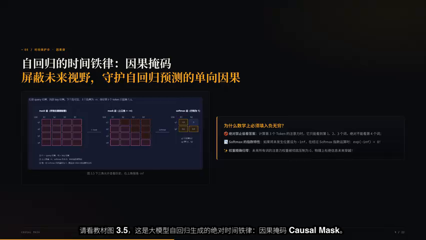

# 第 8 章 前向与生成

一次 Forward Pass 把 token IDs 变成词表分数，一次 Generation Step 再从分数中选出下一个 token 并更新上下文；完整生成则由许多这样的步骤组成。本章先建立这条计算链，再对照 mini-sglang 的 Qwen3 实现，解释源码中的打包布局、融合残差和最后位置选择为何与教科书写法不同、但数学含义一致。

> 本章基于 Datawhale × RadixArk 的 [zero-to-sglang](https://github.com/datawhalechina/zero-to-sglang) 原课程，由 [Part II 第 3 章概念文档](https://github.com/datawhalechina/zero-to-sglang/blob/main/course-material/ch/part2/第3章_前向与生成.md) 与 [代码走读](https://github.com/datawhalechina/zero-to-sglang/blob/main/course-material/ch/part2/第3章_前向与生成_代码.md) 重组。本文按 [CC BY-NC-SA 4.0](https://creativecommons.org/licenses/by-nc-sa/4.0/) 共享。

## 从 token 到隐藏状态



*图 8.1　因果掩码禁止当前位置读取未来 token，从而维持自回归生成的单向依赖。它将不允许的注意力logit置为负无穷，使 Softmax 后对应权重为零。（原课程视频帧，04:12）*


Tokenizer 将文本切分为 token，并映射为整数 ID。Embedding 则是一张形状为 `[vocab_size, d_model]` 的可学习查找表：每个 ID 选择一行，得到该 token 的初始向量。对规则的批量输入 `[B,T]`，Embedding 输出为 `[B,T,C]`，其中 `B` 是批大小，`T` 是序列长度，`C` 是隐藏维度。

初始向量不包含上下文。模型还需要位置信息，才能区分 token 集合相同但顺序不同的序列。Qwen3 等模型使用 RoPE，在 Attention 内对 Q、K 按位置旋转，使注意力分数携带相对位置信息；V 通常不做这种旋转。RoPE 不是简单地向 Embedding 加一个绝对位置向量。

## Transformer Block 如何交换信息

### QKV 与因果注意力

每个位置的隐藏状态经线性投影得到 Query、Key、Value。Q 表示当前位置要查询什么，K 提供可匹配的索引，V 提供实际汇聚的内容。多头注意力将这些表示拆到不同头中并行计算，再合并结果。

对单个注意力头，核心计算为：

\[
\operatorname{Attention}(Q,K,V)=\operatorname{softmax}\left(\frac{QK^\top}{\sqrt{D}}+M\right)V,
\]

其中 `D` 是头维度，`M` 是因果掩码。第 `i` 个位置只能访问 `0..i`，未来位置的注意力分数被屏蔽，因而较早位置的输出不会依赖未来 token。softmax 后的权重再对 V 加权求和。

GQA 允许多个 Query 头共享一组 K/V 头，以减少缓存和带宽需求。设 Query 头数为 `Hq`、KV 头数为 `Hkv`，通常要求 `Hq` 可被 `Hkv` 整除。下面的**教学伪代码**仅展示规则布局下的数学关系，不是高效 GPU 后端实现。

```python
# 伪代码：q/k 已完成 QK Norm 与 RoPE，且无 padding、无缓存
groups = Hq // Hkv
k_for_q = repeat_kv_heads(k, groups)  # 仅为说明共享关系
v_for_q = repeat_kv_heads(v, groups)
scores = q @ transpose_last_two(k_for_q) / sqrt(D)
scores = mask_future_positions(scores)
weights = softmax_in_higher_precision(scores)
attention = weights @ v_for_q
```

真实后端通常不为 GQA 显式复制完整 K/V，也会采用 IO 感知实现减少中间矩阵的显存访问。`head_dim` 是独立配置，不应未经验证就假设 `C = Hq × D`。

### 残差、归一化与门控 MLP

Attention 负责跨 token 通信，MLP 则对每个位置独立做非线性变换。以 Pre-Norm 结构表示，一个 Block 的主要顺序为：

```text
h   = x + Attention(RMSNorm(x))
out = h + MLP(RMSNorm(h))
```

残差连接保留直接信息通路，RMSNorm 调整子层输入尺度。Qwen3 的门控 MLP 将合并投影拆成 gate 与 up，计算可概括为 `down_proj(silu(gate) * up)`。它不在 token 之间交换信息。

多个 Block 堆叠后，最终归一化把隐藏状态交给 LM Head。后者通常是线性层，将 `C` 维表示映射到 `V` 维词表空间，得到 logits。第 `t` 个位置的 logits 表示“读完前 `t` 个 token 后，下一个 token 是什么”的未归一化分数。

## 从 logits 到下一个 token

Logits 可以为负，也不要求总和为 1，不能直接当作概率。贪心解码选择分数最大的 token，不必先计算 softmax，因为 softmax 不改变同一分布内候选的大小顺序。

随机采样先用温度 `T>0` 调整分布：

\[
p_i=\frac{\exp(z_i/T)}{\sum_j\exp(z_j/T)}.
\]

`T<1` 会放大分数差异，`T>1` 会使分布更平坦。Top-k 固定保留概率最高的 `k` 个候选；Top-p 按概率降序保留累计概率达到阈值的最小候选集合。截断后需要重新归一化，再抽取 token。温度、Top-k 和 Top-p 作用在候选分布上，不会改变模型权重。

自回归生成不断重复“前向—选择—追加”。下面是**单请求、无 KV Cache 的教学伪代码**；`forward_all` 是抽象接口，不是 mini-sglang 的现成函数。

```python
# 伪代码：模型已加载并处于推理模式，tokens 非空
output = []
for _ in range(max_new_tokens):
    logits = forward_all(tokens)
    token = argmax(logits[last_position])
    output.append(token)
    tokens = append(tokens, token)
    if token == eos_id:
        break
return output
```

`max_new_tokens=0` 时不应调用模型；是否把 EOS 纳入返回内容，需要由接口约定并保持一致。生产实现还需处理停止字符串、上下文上限、取消、采样参数和批量请求。

## Prefill 与 Decode

Prefill 在生成首个新 token 前处理整段已知 prompt。所有位置可并行进入 Transformer，但因果掩码仍阻止位置偷看未来；同时，各层写入 prompt 的 KV Cache，最后位置的 logits 用于产生第一个输出 token。它主要影响 TTFT，即首 token 延迟。

Decode 使用上一步的新 token 和已有 KV Cache，计算当前表示并选择下一 token。未来 token 尚未确定，不能像 Prefill 那样一次性并行算出。普通 Decode 每一步通常只处理每条活跃请求的一个新 token，重复读取模型权重和历史缓存，往往更受显存带宽限制。

两阶段使用同一套权重。KV Cache 消除历史 K/V 的重复计算，却不会消除自回归依赖，也不会把整个 Decode 的累计注意力成本变成线性。

## 架构与源码定位

以下路径均相对于 mini-sglang 参考提交 `9a91cfafe754aa85daee49998176275667eb58f2` 的 `python/minisgl/`。

| 文件与入口 | 阅读重点 |
|---|---|
| `models/qwen3.py`：`Qwen3Model`、`Qwen3DecoderLayer` | Embedding、Block 堆叠、最终归一化与 LM Head |
| `models/utils.py`：`RopeAttn`、`GatedMLP` | 合并 QKV 投影、输出投影与门控 MLP |
| `layers/attention.py`：`AttentionLayer.forward` | Q/K 归一化、RoPE 与后端调用 |
| `layers/norm.py`：`RMSNormFused.forward` | 残差相加与归一化融合 |
| `layers/embedding.py`：`ParallelLMHead.forward` | 最后位置选择与词表投影 |
| `engine/engine.py`、`engine/sample.py` | 前向、采样与设备间结果传递 |
| `scheduler/scheduler.py` | 生成循环、请求进度与停止判断 |

`Qwen3Model.forward` 的结构可简化为以下**源码示意**，初始化与权重加载均已省略：

```python
# 源码结构示意：models/qwen3.py
x = self.embed_tokens.forward(input_ids)
residual = None
for layer in self.layers.op_list:
    x, residual = layer.forward(x, residual)
return self.norm.forward(x, residual)[0]
```

mini-sglang 将本轮需要计算的 token 打包为一维 IDs，隐藏状态常写作 `[N,C]`；`N` 是本批所有待算 token 的总数，而非固定的 `B×T`。讲解数学时常用规则 `[B,T,C]` 布局，阅读源码时不能将两种形状直接混用。

Decoder Layer 中看不到显式的 `x + attention(x)`，是因为 `RMSNormFused` 同时传递并更新 `x` 与 `residual`，把相加融入归一化路径。最后一层的剩余残差由模型末尾的 norm 完成。看到“没有加号”不能据此认定实现遗漏了残差。

`ParallelLMHead.forward` 在 Prefill 时先选取每条请求最后一个位置的隐藏状态，再做词表投影。供采样使用的是每条请求一行的 logits，无需为当前不需要的早期位置都计算完整词表分数。真实生成循环分散在 Scheduler 与 Engine 中，而非一个本地 `for` 函数里。

## 关键边界

- `model.eval()` 控制模型层的推理行为，`torch.inference_mode()` 关闭梯度相关记录，两者不能互相替代。
- 贪心等价于选择最大 logit；随机采样才需要构造并截取概率分布。温度取零应走专门的贪心分支，不能直接做除法。
- 最大生成长度只计算新增 token，模型上下文上限则包含 prompt 和输出。
- Prefill 高度并行不等于没有因果约束；Decode 单步输入短也不等于整段生成成本恒定。
- 教学注意力省略了打包、分页缓存、CUDA Graph、分布式与数值优化，不能替代后端代码。

## 实践检查

1. 取 `B=1,T=3,C=32,Hq=4,Hkv=2,D=8,V=64`，依次写出 Embedding、Q、原始 K/V、注意力分数、全位置 logits 与最后位置 logits 的形状。
2. 修改上述输入中最后一个未来 token，检查哪些较早位置在因果掩码下应保持不变；再说明去掉掩码会破坏什么性质。
3. 在 `layers/norm.py` 与 `models/qwen3.py` 之间追踪 `residual`，还原两处残差相加的位置。
4. 在 `layers/embedding.py` 中找到最后位置选择，解释为什么不能用第一个位置的 logits 继续当前前缀。
5. 对无缓存伪代码统计每轮输入长度，列出下一轮可以复用的每层的 K/V，为下一章建立问题清单。
6. 源码阅读无需运行 GPU；若进行数值验证，应使用小规模受控张量，并记录精度、设备和预期关系，不把随机文本质量当作唯一正确性依据。

## 小结

前向链路是 token IDs → Embedding → 多层 Attention/MLP → 最终归一化 → LM Head → logits；生成链路再从最后位置选择 token、更新前缀并检查停止条件。mini-sglang 通过打包输入、融合残差、GQA 后端和最后位置选择实现同一数学过程。分清 Forward、单次生成步骤、Prefill 与 Decode，才能进一步理解 KV Cache 优化的对象和收益。

## 参考资料

- [原课程：前向与生成（概念）](https://github.com/datawhalechina/zero-to-sglang/blob/main/course-material/ch/part2/第3章_前向与生成.md)
- [原课程：前向与生成（代码）](https://github.com/datawhalechina/zero-to-sglang/blob/main/course-material/ch/part2/第3章_前向与生成_代码.md)
- [mini-sglang Qwen3 模型](https://github.com/sgl-project/mini-sglang/blob/9a91cfafe754aa85daee49998176275667eb58f2/python/minisgl/models/qwen3.py)
- [mini-sglang Attention 层](https://github.com/sgl-project/mini-sglang/blob/9a91cfafe754aa85daee49998176275667eb58f2/python/minisgl/layers/attention.py)
- [mini-sglang 融合归一化](https://github.com/sgl-project/mini-sglang/blob/9a91cfafe754aa85daee49998176275667eb58f2/python/minisgl/layers/norm.py)
- [mini-sglang 采样实现](https://github.com/sgl-project/mini-sglang/blob/9a91cfafe754aa85daee49998176275667eb58f2/python/minisgl/engine/sample.py)
- [Attention Is All You Need](https://arxiv.org/abs/1706.03762)
- [RoFormer：旋转位置编码](https://arxiv.org/abs/2104.09864)
