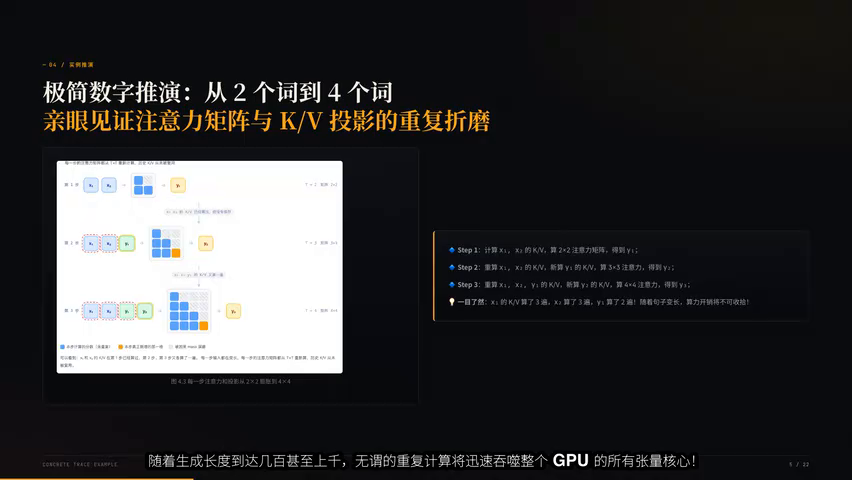

# 第 9 章 KV Cache 优化

自回归生成每增加一个 token，都要再次访问此前的上下文。若每次都把完整序列重新送入模型，历史 token 的 Key、Value 会被反复投影。KV Cache 将这部分结果保存在显存中，使 Decode 只计算新 token 的 K/V，再让当前 Query 读取历史缓存。本章既推导它减少了什么，也追踪 mini-sglang 中“数值存哪里、地址由谁给、位置何时回收”的完整链路。

> 本章基于 Datawhale × RadixArk 的 [zero-to-sglang](https://github.com/datawhalechina/zero-to-sglang) 原课程，由 [Part II 第 4 章概念文档](https://github.com/datawhalechina/zero-to-sglang/blob/main/course-material/ch/part2/第4章_KVCache优化.md) 与 [代码走读](https://github.com/datawhalechina/zero-to-sglang/blob/main/course-material/ch/part2/第4章_KVCache优化_代码.md) 重组。本文按 [CC BY-NC-SA 4.0](https://creativecommons.org/licenses/by-nc-sa/4.0/) 共享。

## 无缓存时重复了什么



*图 9.1　没有缓存时，序列每增加一个 token，历史位置的 K/V 投影也会随整段前向重新计算。图中的增量对照直观展示了 KV Cache 要消除的重复工作。（原课程视频帧，02:27）*


设 prompt 为 `x₁...xₚ`，需要生成 `y₁...yₙ`。无缓存时，第一轮输入完整 prompt 得到 `y₁`；第二轮输入 prompt 与 `y₁` 得到 `y₂`；之后每轮都重新处理不断增长的前缀。虽然只使用最后位置的 logits，前面的位置仍要再次经过各层投影和注意力计算。

在自注意力中，历史 token 的 K/V 由历史隐藏状态与固定权重计算。只要模型参数、位置和前缀不变，这些结果就可在下一步复用。无缓存 Forward 本身是无状态的，不会自动记住上次结果，因此需要推理引擎在模型外部显式维护缓存。

缓存对象是**每一层 self-attention 中历史 token 经 K/V 投影后的张量**。它不是整个 hidden state，不是各层共享的一份数据，也不是 attention 矩阵或 logits。历史 Query 不再被后续位置查询，因此通常无需缓存。使用 RoPE 时，K 通常在应用位置旋转后写入缓存，V 不做旋转；具体读写时点应与 Attention 后端保持一致。

## 复杂度收益要说清口径

令第 `t` 个 Decode 步的总上下文长度为 `Tₜ=p+t`，只考察序列长度，暂时忽略层数、隐藏维度和头数等因子。

| 计算或存储口径 | 无 KV Cache | 有 KV Cache |
|---|---|---|
| 单步 K/V 投影 | `O(T)` | `O(1)` 个新 token |
| `n` 步累计 K/V 投影 | `O(n²)`（`p` 固定时） | `O(n)` |
| 单步注意力 | `O(T²)` | 当前 Q 查询历史，`O(T)` |
| `n` 步累计注意力 | `O(n³)`（`p` 固定时） | `O(n²)` |
| 缓存空间 | 不保存历史 K/V | 随有效 token 数线性增长 |

“从 `O(n²)` 降到 `O(n)`”通常指**累计 K/V 投影**，不是整个生成都变成线性。无缓存时累计投影量为 `ΣTₜ`；有缓存时，每步只投影一个新 token，总量为 `Σ1`。若观察完整 `QKᵀ`，无缓存单步为 `T²`、累计为立方量级；有缓存单步只需当前 Q 对长度为 `T` 的 K，累计注意力仍为平方量级。

若把 Prefill 一并计入，有缓存时的 K/V 投影约为 `O(p+n)`，标准全注意力的总量级约为 `O((p+n)²)`。这些渐进式忽略常数和硬件特性，不能直接替代 TPOT、吞吐或显存占用的实测。

## Prefill 与 Decode 的读写时序

Prefill 一次处理 prompt，计算所有位置的 K/V 并写入缓存；同时用最后位置的 logits 生成第一个新 token。Decode 每轮只计算新 token 的 `q,k,v`，先追加当前层的新 K/V，再让当前 Q 在因果允许的范围内读取历史与本轮缓存。

下面是**教学伪代码**，用于说明时序，不对应某个后端的完整函数签名：

```python
# 伪代码：对每一层执行；positions 必须与原始序列位置一致
def cached_attention(q_new, k_new, v_new, layer_id, out_loc, page_table):
    kv_pool.store_kv(k_new, v_new, out_loc, layer_id)
    k_history = kv_pool.k_cache(layer_id)
    v_history = kv_pool.v_cache(layer_id)
    return attention_from_cache(q_new, k_history, v_history, page_table)
```

先写后读使当前 token 的 K/V 也能参与本步计算。若位置、有效长度或页表映射错误，即使张量形状正确，也可能读到别的请求、旧数据或尚未初始化的位置。

## 物理存储：K/V 数值放在哪里

mini-sglang 的 `kvcache/base.py` 定义统一接口：`k_cache(layer_id)`、`v_cache(layer_id)` 和 `store_kv(k,v,out_loc,layer_id)`。`kvcache/mha_pool.py` 中的 `MHAKVCache` 只负责物理数值，不知道某个 slot 属于哪条请求。

参考实现的 `_kv_buffer` 形状为：

```text
[2, num_layers, num_pages, page_size, local_kv_heads, head_dim]
 ↑       ↑           ↑          ↑             ↑             └ 单个头内维度
 K/V     层号        页号       页内 token     当前 TP rank 的 KV 头数
```

`k_cache(layer_id)` 或 `v_cache(layer_id)` 返回当前层的视图，不复制整块数据。将页号和页内偏移展开后，可得到 `[num_pages × page_size, local_kv_heads, head_dim]` 的 token-slot 视图，`store_kv` 按 `out_loc` 写入指定行。

估算单请求、单 TP rank 的有效缓存量时，可从下式出发：

\[
\text{bytes}=2\times L\times T\times H_{kv,\mathrm{local}}\times D\times\text{dtype\_bytes}.
\]

其中 `2` 表示 K 和 V，`L` 为层数，`T` 为有效 token 数。实际池容量还受页粒度、dummy page、运行请求数、TP 切分和其他显存预留影响；不能把有效数据量直接当成整个进程显存占用。GQA/MQA 减少 `Hkv`，因此也会降低缓存容量与读取量。

## 逻辑映射：请求怎样找到自己的 K/V

物理池之外还需要地址管理。`Engine` 初始化全局 `page_table`，一行对应一个运行请求，表项记录逻辑位置到**物理 token slot** 的映射；Attention 后端若需要页号，再把页起始 slot 除以 `page_size` 做格式转换。

`Req` 中三个长度决定了本轮计算范围：

- `cached_len`：已经拥有可复用 K/V 的前缀长度；
- `device_len`：本轮要处理到的总长度；
- `extend_len = device_len - cached_len`：本轮真正需要计算并写入的 token 数。

Scheduler 先为未覆盖范围分配页，再用 `(table_idx, 逻辑位置)` 组成索引，从 `page_table` 取出 `batch.out_loc`。`out_loc` 只包含当前 batch、当前轮新增 token 的写入地址，其顺序必须与打包后的模型输入一致，而不是整张页表的副本。

`CacheManager.free_slots` 按页记录空闲起始 slot。以 `page_size=4` 为例，页起始值 `8` 展开为 `[8,9,10,11]`。页分配解决空间管理，token-slot 映射解决准确读写，二者是同一地址链路的不同层次。

## 源码定位与一次写入链路

以下路径均相对于 mini-sglang 的 `python/minisgl/`，原课程代码篇使用的参考提交为 `9a91cfafe754aa85daee49998176275667eb58f2`。

| 文件 | 关键职责 |
|---|---|
| `engine/engine.py` | 按可用显存初始化 KV 池、`page_table` 与运行时上下文 |
| `core.py` | 保存 `Req.cached_len`、`device_len`、`extend_len` 等进度 |
| `scheduler/cache.py` | 页分配、前缀匹配、锁定、插入与回收 |
| `scheduler/prefill.py` | 估计资源需求，复制命中前缀的 token IDs 与物理位置 |
| `scheduler/scheduler.py` | `_prepare_batch` 准备位置、`out_loc` 和 Attention 元数据 |
| `kvcache/mha_pool.py` | 持有各层 K/V，执行物理写入与按层读取 |
| `attention/fa.py` | 写入新 K/V，并调用读取分页缓存的注意力实现 |

`Scheduler._prepare_batch` 的关键顺序可概括为：**补齐页表 → 生成逻辑位置与二维索引 → 查询 `out_loc` → 准备 Attention 元数据**。`attention/fa.py` 随后调用 `store_kv`，再把当前层的 K/V 视图、后端页表和有效序列长度交给 kernel。

## 前缀复用与生命周期

可复用前缀由策略层登记物理位置，并不另存一份 K/V 浮点数据。`naive` 与 `radix` 策略可共用同一 `MHAKVCache`；区别在于已有前缀如何匹配和管理，而不是 Attention 的数值布局不同。

参考实现的新请求只匹配 prompt 最后一个 token 之前的前缀。最后 token 仍需参与前向，才能产生用于采样第一个输出 token 的 logits。命中位置在使用期间必须锁定，否则其他请求可能淘汰并覆盖这些 slot。

请求继续 Decode 时，新计算的有效前缀可登记供后续复用；请求结束或取消时，旧前缀解锁，不可复用的尾部与重复登记位置归还空闲列表。回收通常不清零张量，只表示该位置可重新分配并在下次写入时覆盖。使用引用、锁和句柄的目的，就是避免“页表仍指向它，但数据已经被别人覆盖”。

## 关键边界

- KV Cache 用显存换重复计算；缓存越大，可保存的历史越多，但能同时容纳的请求和批次可能受限。
- 缓存正确性依赖 token、层号、RoPE 位置、dtype、设备、有效长度和物理映射一致，不能只比较形状。
- 前缀相同才可复用对应 K/V；模型、权重、位置约定或模板不同，不能仅因可见文本相似就共享。
- 命中前缀不等于可跳过整个 Prefill，最后输入位置和后续未命中部分仍需计算。
- 本章介绍基本缓存与地址链路；分页碎片、RadixAttention 的匹配淘汰及 TP 详细切分属于后续专题。
- 文中的复杂度和容量式是分析工具，不是本章实际 benchmark 结果。

## 实践检查

1. 固定 `p`，分别写出无缓存与有缓存时前三步的输入长度、K/V 投影 token 数和注意力分数形状，核对上表口径。
2. 令 `page_size=4`，将空闲页起始 slot `[0,4,8]` 展开；再说明 `out_loc=[4,5]` 在本轮表示什么。
3. 在 `scheduler/scheduler.py` 中找到 `allocate_paged` 与 `batch.out_loc` 的生成顺序，解释若先查询页表再分配会缺少什么。
4. 在 `attention/fa.py` 和 `kvcache/mha_pool.py` 间追踪 `layer_id`，说明不同层为何可使用相同 slot 编号而不共享数值。
5. 用 `L=2`、`T=3` 的玩具例子给每条 K/V 标上“层—逻辑位置—物理 slot”，验证读取集合不包含未来位置或其他请求。
6. 在 `scheduler/cache.py` 的 `cache_req` 中把位置分成“旧命中、保留复用、归还空闲”三类，并检查解锁与回收的先后关系。

## 小结

KV Cache 按层保存历史 K/V，把 Decode 的累计 K/V 投影从平方量级降为线性，并把单步注意力从完整矩阵降为当前 Query 对历史的访问；其代价是显存占用与复杂的生命周期管理。mini-sglang 用物理 KV 池保存数值，用 `page_table` 和 `out_loc` 确定地址，用缓存策略保留可复用前缀。只有数值、映射和回收三条链路同时正确，优化才有意义。

## 参考资料

- [原课程：KV Cache 优化（概念）](https://github.com/datawhalechina/zero-to-sglang/blob/main/course-material/ch/part2/第4章_KVCache优化.md)
- [原课程：KV Cache 优化（代码）](https://github.com/datawhalechina/zero-to-sglang/blob/main/course-material/ch/part2/第4章_KVCache优化_代码.md)
- [mini-sglang KV Cache 接口](https://github.com/sgl-project/mini-sglang/blob/9a91cfafe754aa85daee49998176275667eb58f2/python/minisgl/kvcache/base.py)
- [mini-sglang MHA KV Cache](https://github.com/sgl-project/mini-sglang/blob/9a91cfafe754aa85daee49998176275667eb58f2/python/minisgl/kvcache/mha_pool.py)
- [mini-sglang CacheManager](https://github.com/sgl-project/mini-sglang/blob/9a91cfafe754aa85daee49998176275667eb58f2/python/minisgl/scheduler/cache.py)
- [mini-sglang FlashAttention 后端](https://github.com/sgl-project/mini-sglang/blob/9a91cfafe754aa85daee49998176275667eb58f2/python/minisgl/attention/fa.py)
- [Attention Is All You Need](https://arxiv.org/abs/1706.03762)
