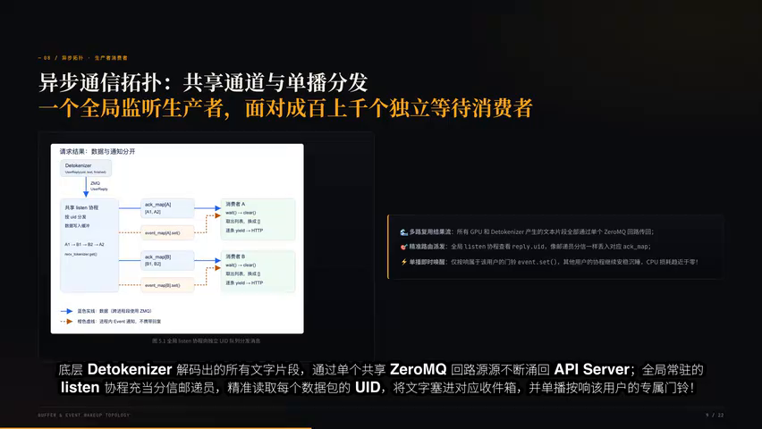

# 第 10 章 HTTP 服务与并发请求

本地生成函数只在当前进程中可用；聊天网页、移动应用和其他服务则需要通过约定接口共享模型。服务化不仅是增加一条 HTTP 路由，还要管理连接、请求归属、流式响应、取消与资源回收。本章对照 mini-sglang，说明 API Server 如何在不直接执行 GPU 前向的情况下管理多条并发请求，并识别参考实现尚未覆盖的异常路径。

> 本章基于 Datawhale × RadixArk 的 [zero-to-sglang](https://github.com/datawhalechina/zero-to-sglang) 原课程，由 [Part II 第 5 章概念文档](https://github.com/datawhalechina/zero-to-sglang/blob/main/course-material/ch/part2/第5章_HTTP服务与并发.md) 与 [代码走读](https://github.com/datawhalechina/zero-to-sglang/blob/main/course-material/ch/part2/第5章_HTTP服务与并发_代码.md) 重组。本文按 [CC BY-NC-SA 4.0](https://creativecommons.org/licenses/by-nc-sa/4.0/) 共享。

## HTTP 请求约定了什么



*图 10.1　共享结果通道配合 UID 分发，使单个 Detokenizer 的输出能够回到正确的并发请求。API Server 的异步监听与等待让网络服务不必为每个请求串行阻塞。（原课程视频帧，04:06）*


客户端是发起请求的程序，可以是浏览器、命令行脚本或另一台服务器；服务端接收请求并返回结果。HTTP 规定通用的消息结构，具体路径和 JSON 字段则由接口定义。HTTP 本身不决定模型如何计算，也不保证回答内容正确。

下面是一次**简化请求示意**，省略了与理解无关的传输字段：

```http
POST /v1/chat/completions HTTP/1.1
Host: localhost:1919
Content-Type: application/json

{
  "model": "Qwen/Qwen3-0.6B",
  "messages": [{"role": "user", "content": "什么是 KV Cache？"}],
  "max_tokens": 128,
  "stream": true
}
```

`POST` 和路径选择接口，`Content-Type` 声明请求体格式。`messages` 按顺序表达对话历史，`max_tokens` 限制新增 token 而非字符数，`stream` 决定逐步返回还是收集后返回。多轮历史通常需要客户端随请求重新提交，不能假定服务端会因上次调用而自动记住对话。

非流式响应可以在生成结束后返回普通 JSON，包含助手消息和结束原因。状态码 `200` 只说明 HTTP 交互成功，不等于模型回答事实正确；格式错误、内部失败和生成结束原因也应分别表达。

## 从外部协议到内部消息

mini-sglang 使用 FastAPI 与 Pydantic。`OpenAICompletionRequest` 是描述 HTTP 字段的请求模型，不是神经网络模型；它声明 `prompt`、`messages`、`max_tokens`、`stream` 及采样参数，框架据此解析和校验输入。

路由在 `server/api_server.py` 中把外部请求转换为内部 `TokenizeMsg`：

1. 将 `messages` 转为对话结构，或读取普通 `prompt`；
2. 用 `state.new_user()` 分配 uid，并建立该请求的结果缓冲与通知对象；
3. 把文本和采样参数通过异步 ZMQ 通道交给 Tokenizer Worker；
4. 根据 `stream` 选择普通 JSON 收集器或 SSE 异步生成器。

模型前向不在 HTTP 事件循环里执行。API Server 等待的是后端消息，Tokenizer、Scheduler 和 Engine 在其他进程中工作，因此一条长请求等待时，前台仍能处理其他网络事件。

## `async` 与真正的等待让渡

下面的**反例伪代码**说明 `async def` 并不会自动消除阻塞：

```python
# 反例：blocking_generate 没有异步让渡
@app.post("/generate")
async def generate(req):
    text = blocking_generate(req.prompt)
    return {"text": text}
```

同步函数执行期间，当前事件循环无法切换到其他协程。异步并发的关键是将耗时工作交给合适的后端，并在等待网络、队列或消息时使用 `await` 让出执行权；仅仅添加 `async` 关键字没有这种效果。

还要区分三个概念：**并发**是同一时间段管理多个未完成任务，**并行**是多个执行单元在同一时刻工作，**批处理**是把多条请求组织进同一次模型执行。API Server 同时接收十条请求，不代表 GPU 正在同批计算它们；HTTP 并发也不会自动提高 GPU 利用率。

## 用 uid 隔离并发请求

多个请求共享从 Detokenizer 返回的通道。`FrontendManager` 为每条请求分配进程内递增 uid，并维护两组映射：

```python
# 源码结构示意：server/api_server.py
ack_map: dict[int, list[UserReply]]
event_map: dict[int, asyncio.Event]
```

`ack_map[uid]` 保存已到达但尚未被该请求消费的回复；`event_map[uid]` 只负责通知“有结果了”。Event 不携带文本，列表也不能主动唤醒等待者，所以两者不能互相替代。uid 不是跨服务重启仍唯一的全局 ID，它只服务于当前实例内的请求关联。

一个长期运行的 `listen` 协程统一接收 `UserReply`，将单条或批量回复展开，再按 uid 存入列表并设置 Event。若回复来自已删除的 uid，参考实现会忽略它，避免取消后的迟到消息继续堆积。

每条请求的 `wait_for_ack(uid)` 按下面的**源码流程简化**消费结果：

```text
等待 Event → clear → 接住当前列表并将映射换成新空列表
→ 逐条 yield 旧列表中的回复 → 下一轮等待
```

从 `clear()` 到替换列表之间没有 `await`，同一事件循环中的 `listen` 不会插入这段局部操作。消费者处理旧列表时，新回复写入新列表并再次设置 Event。Event 是通知标志而不是计数器，多次 `set()` 可合并为一次唤醒，但所有回复仍保留在列表中。

假设返回顺序为 `A1 → B1 → B2 → A2`，共享监听者按 uid 分桶，A、B 的消费者分别只读取自己的列表。请求隔离依靠标识和状态归属，而不是要求结果按提交顺序返回。

## 非流式与 SSE 流式响应

非流式分支持续读取同一 uid 的增量文本，拼接完整内容后返回 JSON。“非流式”描述客户端收到结果的方式，不表示整个服务同步阻塞；当前协程等待时，其他请求仍可推进。

流式分支把异步生成器交给 `StreamingResponse`，媒体类型为 `text/event-stream`。其**简化事件示意**如下：

```text
data: {"choices":[{"delta":{"role":"assistant","content":"KV Cache"}}]}

data: {"choices":[{"delta":{"content":" 会保存历史 K/V。"}}]}

data: {"choices":[{"delta":{},"finish_reason":"stop"}]}

data: [DONE]
```

SSE 使用普通 HTTP 保持服务端到客户端的单向事件流，每个 `data:` 事件由空行分隔。`[DONE]` 是这类聊天接口的约定，不是 SSE 标准强制字段。参考实现的首块可同时包含角色和文本，结束块与 `[DONE]` 分开发送。

流式让用户更早看到首段内容，改善感知 TTFT，却不减少模型前向次数，也不保证完整回答更早结束。SSE 事件不必然一一对应 token 或网络数据包；反分词、服务器和网络缓冲都可能改变交付粒度。

## 正常结束、取消与迟到结果

正常结束时，Scheduler 判断停止条件并释放请求表项、按缓存策略处理 KV Cache，再发送 `finished=True`。Detokenizer 清理相应解码状态，API Server 交付结束响应。可复用前缀不一定会被立即删除。

客户端提前断开时，流式分支检测断连或收到协程取消，经 `AbortMsg` 通知 Tokenizer，再转换为 `AbortBackendMsg` 交给 Scheduler。Scheduler 从等待或运行集合中移除请求并尝试回收资源，前台也清理对应映射。

这是协作式取消，而不是强制终止 GPU 指令。取消消息需要传播，已提交的计算可能继续短暂完成，因此取消后仍可能出现迟到 token；前台通过 uid 已不存在来丢弃它们。

慢客户端则形成另一类问题：后端生产结果快于网络消费时，`ack_map` 中未读回复可能积压。参考实现的独立 `listen` 仍会持续接收 ZMQ 消息，没有把客户端读取速度反馈给 Scheduler。生产服务还需有界缓冲、超时、断开策略或向上游传递背压。

## 参考实现的生命周期缺口

以下判断针对原课程固定的 mini-sglang 参考提交 `9a91cfafe754aa85daee49998176275667eb58f2`，用于源码分析，不应直接套用到其他版本：

- `wait_for_ack` 把删除映射的语句放在生成器尾部，但调用方收到 `finished` 后会提前 `break`。底层生成器可能停在 `yield`，普通尾部语句并不保证执行；修复应围绕 `try/finally`、显式关闭和统一生命周期管理设计。
- 非流式聊天路径没有同等的客户端断连检查，客户端离开后后端仍可能继续生成。
- Tokenizer 转换取消消息时没有同步通知 Detokenizer 清理该 uid；被取消请求通常不再提供正常 `finished` 消息，解码状态可能残留。
- 某些输入长度错误只记录并丢弃请求，没有向前台返回错误或结束标记，HTTP 协程可能持续等待。
- OpenAI 风格不等于完整协议兼容。参考实现的 token 用量仍有占位值，`model` 字段不切换启动时加载的模型，部分请求参数尚未传入后端。

这些缺口说明“主路径能返回文本”与“异常情况下资源一定回收”是两个不同的验证目标。完整服务应让所有组件理解结束、失败和取消，并在每条路径上给出确定的终态。

## 架构与源码定位

| 文件或对象 | 阅读重点 |
|---|---|
| `server/api_server.py`：`OpenAICompletionRequest`、`v1_completions` | 请求校验、参数转换、响应分支 |
| `server/api_server.py`：`FrontendManager` | uid、`ack_map`、`event_map`、共享监听与取消 |
| `message/` | `TokenizeMsg`、`UserReply`、`AbortMsg` 等消息结构 |
| `tokenizer/server.py` | 分词、回复转发与取消消息转换 |
| `tokenizer/detokenize.py` | 按请求维护增量解码状态 |
| `scheduler/scheduler.py` | 停止判断、取消处理与资源释放 |

以上路径均相对于 `python/minisgl/`。阅读时先跟普通文本主路径，再逐一注入断连、异常和慢消费条件；不要在尚未理解 uid 流向前陷入所有协议分支。

## 关键边界

- HTTP 服务化不等于 Continuous Batching；前者管理连接与任务，后者组织 GPU 计算。
- 流式与非流式只改变结果交付方式，不天然改变后端生成算法。
- 断开连接、发送取消、Scheduler 停止推进、资源回收完成是不同时间点。
- 异步生成器的普通尾部清理不等于必然执行，异常与提前退出需要专门验证。
- 本章没有执行服务或并发 benchmark，不给出延迟、吞吐和资源占用的实测结论。

## 实践检查

1. 用纸面模拟 `A1 → B1 → B2 → A2`，逐步写出两个 uid 的列表和 Event 状态，确认一次唤醒可以交付多条回复。
2. 在 `v1_completions` 中追踪 `messages`、`max_tokens`、`stream`，分别指出它们进入分词消息、采样参数和响应分支的位置。
3. 不依赖 GPU，用假的 `UserReply` 驱动 `listen` 与 `wait_for_ack`，覆盖连续到达、提前 `break`、显式关闭和取消，检查映射是否最终删除。
4. 对照 `stream_chat_completions` 找出首个角色块、增量文本、结束原因和 `[DONE]`；按空行而不是网络读取次数解析事件。
5. 沿 `AbortMsg → AbortBackendMsg → abort_req` 检查取消路径，并为前台、Scheduler、Detokenizer 分别列出终态清理断言。
6. 若环境已按官方说明准备好，可用 `curl -N` 发送流式请求，再与非流式请求对照；记录实际观察到的事件与断连行为，不用本章示意代替结果。

## 小结

HTTP 层把外部协议转换为带 uid 的内部消息，通过异步等待维持连接并发，再用 `ack_map` 与 `event_map` 完成结果存储和通知。非流式负责汇总，SSE 负责增量交付；取消、迟到回复、慢客户端和错误路径则决定生命周期是否真正闭合。只有同时验证正常、异常与清理路径，才能把“可调用接口”推进为可靠服务。

## 参考资料

- [原课程：HTTP 服务与并发（概念）](https://github.com/datawhalechina/zero-to-sglang/blob/main/course-material/ch/part2/第5章_HTTP服务与并发.md)
- [原课程：HTTP 服务与并发（代码）](https://github.com/datawhalechina/zero-to-sglang/blob/main/course-material/ch/part2/第5章_HTTP服务与并发_代码.md)
- [mini-sglang API Server（参考提交）](https://github.com/sgl-project/mini-sglang/blob/9a91cfafe754aa85daee49998176275667eb58f2/python/minisgl/server/api_server.py)
- [mini-sglang 系统架构](https://github.com/sgl-project/mini-sglang/blob/9a91cfafe754aa85daee49998176275667eb58f2/docs/structures.md)
- [FastAPI：StreamingResponse](https://fastapi.tiangolo.com/advanced/custom-response/#streamingresponse)
- [MDN：HTTP 概述](https://developer.mozilla.org/zh-CN/docs/Web/HTTP/Overview)
- [MDN：Server-Sent Events](https://developer.mozilla.org/en-US/docs/Web/API/Server-sent_events/Using_server-sent_events)
- [Python：异步生成器](https://docs.python.org/3/reference/expressions.html#asynchronous-generator-functions)
