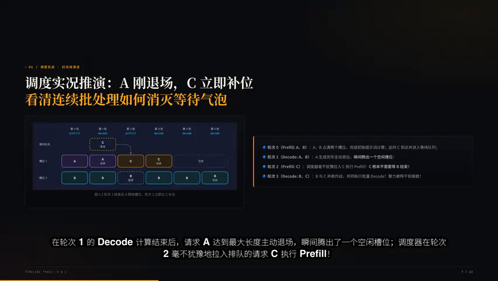
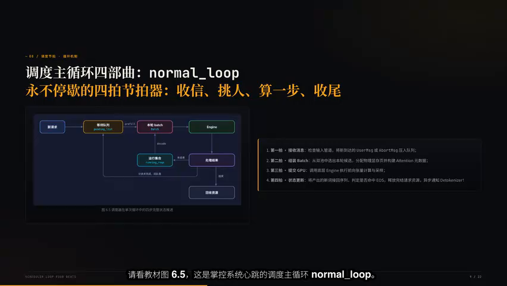

# 第 11 章 Continuous Batching 与调度

> 本章基于 Datawhale × RadixArk 的 zero-to-sglang 原课程《ContinuousBatching与调度》重组，原文见[概念篇](https://github.com/datawhalechina/zero-to-sglang/blob/main/course-material/ch/part2/第6章_ContinuousBatching与调度.md)与[代码走读](https://github.com/datawhalechina/zero-to-sglang/blob/main/course-material/ch/part2/第6章_ContinuousBatching与调度_代码.md)，采用 [CC BY-NC-SA 4.0](https://creativecommons.org/licenses/by-nc-sa/4.0/) 许可。

在线服务的请求不会同时到达，也不会同时结束。若把一组请求固定在同一批次中，直到最长请求完成才允许补入新请求，短请求提前结束后留下的执行机会便无法充分利用。Continuous Batching（连续批处理）把批次调整的时机放在相邻模型执行轮次之间，让调度器持续移除已完成请求、保留运行中请求，并在资源允许时接纳新请求。

## 从固定批次到逐轮组批



*图 11.1　连续批处理以单次迭代而不是完整请求为调度粒度。某请求结束就释放槽位，新请求可在下一轮补位，因此无需等待整批最长请求结束，减少了固定批处理的空转。（原课程视频帧，03:15）*


普通自回归解码仍存在严格依赖：第 $t+1$ 个 token 的计算要使用第 $t$ 个 token。连续批处理不消除这条依赖，也不会把请求插入正在执行的 CUDA 内核；它改变的是**下一次前向由哪些请求共同参加**。

合批也不等于拼接多段对话。Prefill 可以把不同请求的有效 token 打包，Attention 再根据请求边界、位置和 KV 索引施加各自的因果约束；Decode 则通常让每条运行中请求贡献一个新位置。各请求的 KV、采样参数和结束条件始终独立。

以 A、B、C 为例：A 已接近结束，B 还要生成较长时间，C 刚刚到达。固定批次要求 C 等 B 完成；连续批处理则在 A 结束并释放资源后，让 C 在下一轮进入 Prefill。这里的“下一轮”是调度边界，不代表各轮耗时相同。

## 架构与源码定位

本章以原课程固定的 mini-sglang 提交 `9a91cfa` 为实现参照。以下路径均相对于 `python/minisgl/`：

| 文件与入口 | 职责 |
| --- | --- |
| `scheduler/scheduler.py`：`normal_loop` | 接收消息、选择批次、执行前向、处理结果 |
| `scheduler/prefill.py`：`PrefillManager`、`PrefillAdder` | 管理等待队列，检查资源并切分 Prefill |
| `scheduler/decode.py`：`DecodeManager` | 保存已完成 Prefill、仍需生成的请求 |
| `core.py`：`Req` | 记录 token、已缓存长度、输出余量等状态 |
| `scheduler/table.py` | 分配和回收请求表槽位 |
| `scheduler/cache.py` | 协调 KV 容量估计、分配和缓存生命周期 |

需要区分三个集合概念：`pending_list` 是等待处理输入的队列，`running_reqs` 是 Decode 运行集合，本轮 `Batch` 则是实际交给模型的执行视图。某请求本轮没有参加前向，不代表它已退出运行集合。

## 一轮调度如何完成

参考实现的主循环可概括为下面的伪代码。它省略了重叠执行、消息类型和异常处理，只保留状态转换顺序：

```python
while True:
    messages = receive_requests(blocking=system_is_idle())
    update_request_states(messages)

    batch = prefill_manager.schedule_next_batch(prefill_budget)
    if batch is None:
        batch = decode_manager.schedule_next_batch()
    if batch is None:
        continue

    outputs = engine.forward(batch)
    commit_tokens_and_check_finish(batch, outputs)
    release_resources_for_finished_requests()
```

没有工作时，接收消息可以阻塞；已有可运行请求时，不应为了凑满批次而主动等待。该版本采用 **Prefill 优先**：能组成可执行 Prefill 批次时先执行，否则推进 Decode。等待队列非空并不必然产生 Prefill 批次，因为槽位或 KV 资源检查仍可能失败。

输出处理是调度的一部分。采样 token 必须按 `batch.reqs` 与请求身份写回，随后检查最大输出长度、EOS 和取消状态。只有运行集合、请求表和缓存资源都完成更新，空出的容量才能安全地供后续请求使用。

## 接纳请求的三类约束



*图 11.2　调度器每轮都要完成收信、选择本轮工作、执行一步前向和更新收尾。该闭环把连续批处理的时间线落实到具体控制流程，也解释了请求状态为何需要逐轮维护。（原课程视频帧，04:01）*


### 请求槽位

请求表为每条活动请求保存 token 与 KV 位置映射。一行对应一个请求槽位，限制的是同时活动的请求数，而不是单条请求的长度。没有空槽位时，即使本轮计算预算充足，新请求也只能等待。

### KV 容量与运行中预留

该版本接纳新请求时，以“尚未缓存的输入长度 + 最大输出长度”估计需求，并叠加 Decode 运行集合及本轮已接纳请求的预留。其教学形式为：

```text
estimated_len = input_len - cached_len + output_len
require(estimated_len + reserved_size <= available_kv_tokens)
```

这里按 token 位置计量，不是直接比较字节。实际每位置字节数还取决于层数、KV 头数、头维度和缓存精度。按最大输出预留较为保守，但可避免把全部剩余空间用于 Prompt 后无法继续 Decode；提前结束的请求会释放不再需要的资源。

启用前缀缓存时，`available_size` 还可能包含可淘汰缓存对应的空间。加锁会把命中前缀从可淘汰变为受保护，因此源码在加锁前后再次检查容量。可用估计不等于已经完成物理页分配。

### Prefill token 预算与分块

本轮预算限制所有新计算输入 token 的总数，它与请求槽位、KV token 容量是不同约束。若请求有 2500 个未缓存 token、每轮可用预算为 1024，则可依次处理 1024、1024、452 个 token，前提是中间没有其他请求分走预算。

中间块只建立对应范围的 KV，不能提前采样第一个回答 token，也不能进入普通 Decode 集合。只有最后一个输入位置完成前向，才能得到用于生成首个 token 的 logits。该版本把未完成请求放回等待队首并继续优先 Prefill，因此**分块本身不保证块间插入 Decode**。

## 调度策略与服务指标

Prefill 优先有利于新请求更早得到首 token，却可能暂停已有请求的 Decode；Decode 优先则相反。较大的批次通常能复用权重读取并分摊启动成本，但单次前向也可能更慢。调度评价至少应同时观察：

- **吞吐量**：单位时间完成的有效 token 数，需区分输入与输出 token；
- **TTFT**：请求到达到首个输出 token 的延迟；
- **TPOT/ITL**：相邻输出 token 的生成时间或间隔；
- **单用户生成速度**：不能用系统总吞吐简单除以在线人数代替。

GPU 利用率也不能单独证明合批有效。`utilization.gpu` 主要反映采样窗口内是否有内核执行，不表示峰值算力或显存带宽的使用比例，更不直接给出每轮推进了多少有效 token。

## 正确性与边界情况

1. **请求隔离**：打包输入不能造成跨请求注意力可见，输出不能写错请求。
2. **完成语义**：达到长度上限或采样到 EOS 后停止；`ignore_eos` 时不能只凭 EOS 结束。草稿、缓存中的历史内容不等于正式输出。
3. **取消路径**：排队请求只需移出队列；已分配资源的请求还要回收槽位与 KV。重叠执行需防止在途结果重复提交或重复释放。
4. **资源一致性**：接纳、分配、执行和回收必须对同一请求状态操作，不能把预算估计当作已分配页。
5. **结束不等于清空 KV**：请求退出后，可复用前缀仍可能留在共享缓存中；请求槽位释放与所有 KV 立即删除不是同一件事。
6. **公平性**：持续到来的 Prefill 可能推迟 Decode。上述行为是该参考实现的策略，不是所有推理引擎的统一规则。

## 实践检查

- 手算两个槽位下的 A/B/C 时间线：A、B 先运行，A 结束，C 随后 Prefill，再与 B 共同 Decode。标出每轮三个集合的变化，而不是只画 GPU 执行成员。
- 构造“槽位为空但 KV 不足”“KV 充足但 Prefill 预算为零”两个案例，确认它们不会被错误地合并为一个条件。
- 对分块 Prefill 断言：中间块无采样输出、不进入 Decode；最后一块完成后才产生首 token。
- 分别为正常结束、EOS、长度上限和取消编写状态检查，验证请求只回收一次，等待队列与运行集合不残留。
- 若开展性能实验，固定模型、负载和采样设置，分别记录吞吐、TTFT、TPOT/ITL 与调度时间线；不要只凭单次运行或 GPU 利用率下结论。

## 小结

连续批处理以模型执行轮次为边界动态调整批次，核心价值是让请求完成与新请求接纳及时衔接。调度器通过等待队列、运行集合和本轮批次维护状态，并分别处理请求槽位、KV 预留和 Prefill 预算。正确的输出写回、结束判断和资源回收与组批同样重要；性能评价则必须兼顾系统吞吐与单请求延迟。

## 参考资料

- [Datawhale × RadixArk 原课程概念篇](https://github.com/datawhalechina/zero-to-sglang/blob/main/course-material/ch/part2/第6章_ContinuousBatching与调度.md)
- [mini-sglang：调度主循环（9a91cfa）](https://github.com/sgl-project/mini-sglang/blob/9a91cfafe754aa85daee49998176275667eb58f2/python/minisgl/scheduler/scheduler.py)
- [mini-sglang：Prefill 接入与分块（9a91cfa）](https://github.com/sgl-project/mini-sglang/blob/9a91cfafe754aa85daee49998176275667eb58f2/python/minisgl/scheduler/prefill.py)
- [mini-sglang：Decode 运行集合（9a91cfa）](https://github.com/sgl-project/mini-sglang/blob/9a91cfafe754aa85daee49998176275667eb58f2/python/minisgl/scheduler/decode.py)
- [NVIDIA：矩阵乘性能说明](https://docs.nvidia.com/deeplearning/performance/dl-performance-matrix-multiplication/index.html)
- [NVIDIA：nvidia-smi 文档](https://docs.nvidia.com/deploy/nvidia-smi/index.html)
