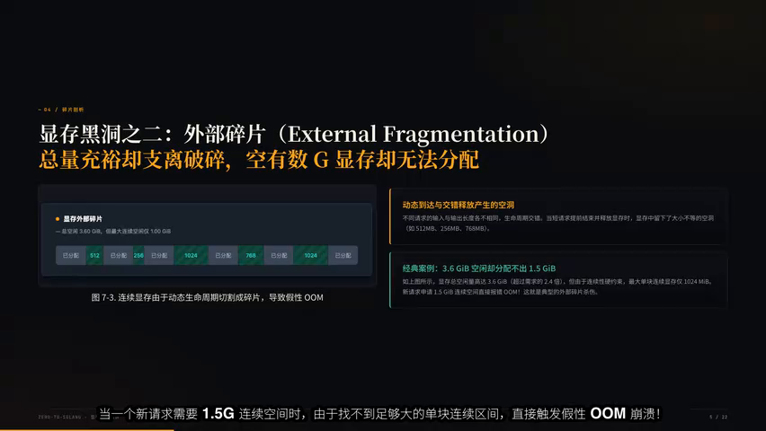
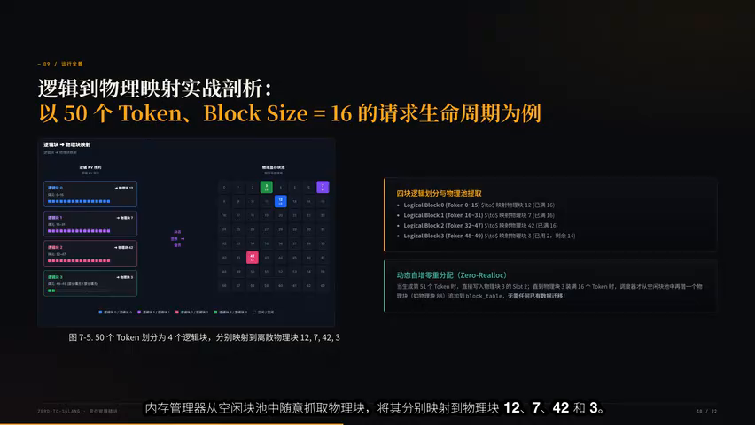

# 第 12 章 Paged KV Cache 与显存管理

> 本章基于 Datawhale × RadixArk 的 zero-to-sglang 原课程《PagedKVCache与显存管理》重组，[原文链接](https://github.com/datawhalechina/zero-to-sglang/blob/main/course-material/ch/part2/第7章_PagedKVCache与显存管理.md)，采用 [CC BY-NC-SA 4.0](https://creativecommons.org/licenses/by-nc-sa/4.0/) 许可。

KV Cache 避免 Decode 重复计算历史 K/V，却将计算压力部分转化为显存压力。序列不断增长、请求长短不一，若每条请求都按最大长度占用一段连续显存，未使用空间和分配空洞会限制并发。Paged KV Cache 用固定大小块和块表把逻辑序列与物理位置解耦；PagedAttention 再按块读取数据，在不改变注意力数学定义的前提下完成计算。

## 先估算 KV Cache 的规模



*图 12.1　连续预留要求一段完整地址空间，分散的空闲区域即使总量足够也无法直接满足大块申请。外部碎片由此造成显存名义充足却分配失败，是分页管理要解决的问题。（原课程视频帧，02:30）*


对常规 MHA/GQA，忽略对齐和实现附加开销时，每个 token 的 KV 字节数可写为：

$$
B_{\mathrm{token}}=2\times L\times H_{kv}\times D\times b,
$$

其中 $L$ 为层数，$H_{kv}$ 为本 rank 的 KV 头数，$D$ 为头维度，$b$ 为单个缓存元素的字节数，前面的 2 分别对应 K 和 V。一个批次当前约占 $B_{\mathrm{token}}\sum_r T_r$ 的 KV 本体空间，$T_r$ 是请求 $r$ 已缓存长度。

这个式子说明容量随层数、上下文长度和并发增长，也提醒我们不要只按权重能否装下判断可服务规模。张量并行时通常使用本地 KV 头数；KV 头复制、页对齐、临时工作区和通信缓冲都会使实际占用不同于上述理想估算。

## 连续预留为什么浪费

按最大可能序列长度为每条请求预留连续空间，会产生三个问题：

1. **内部闲置**：实际长度小于预留长度时，剩余位置在请求生命周期内难以给别的请求使用。
2. **外部碎片**：不同大小区域交替分配和释放后，总空闲量可能足够，却没有足够大的连续区域。
3. **扩展代价**：从小区域扩展到更大区域可能需要迁移整段 KV，并且在扩展瞬间仍需找到连续空间。

分页并非让 Attention 看到一段“物理连续”的序列，而是让它通过映射恢复**逻辑连续**。分配器只处理统一大小的物理块，请求增长时追加映射，已有 KV 无需因扩容而整体搬迁。

## Block、Slot 与 Block Table

设每块容纳 $B$ 个 token。对请求内位置 $p$，逻辑块号与块内偏移为：

$$
j=\left\lfloor p/B\right\rfloor,\qquad o=p\bmod B.
$$

若该请求的块表为 `block_table`，对应物理块号为 `block_table[j]`。在“每块含连续 $B$ 个 token slot”的布局中，可将物理 slot 表示为：

```python
logical_block = p // block_size
offset = p % block_size
physical_block = block_table[request_id, logical_block]
slot = physical_block * block_size + offset
```

实际内核可以按层、K/V 或头拆分地址计算，因此上式表达的是索引关系，不要求所有实现采用同一种张量布局。块表只保存映射，真正的各层 K/V 张量位于 KV Cache Pool。

例如 $B=4$、块表为 `[9, 3, 14]` 时，位置 0–3 位于物理块 9，位置 4–7 位于块 3，位置 8–11 位于块 14。它们逻辑相邻而物理离散；最后一块未满时，最多只浪费该块中的空 slot。就统一 KV 页分配而言，任意空闲页都可复用，从而避免连续大块分配导致的外部碎片，但这不等于消除进程内所有类型的显存碎片。

块大小的选择存在折中：较小块降低尾部浪费，却增加块表项和间接寻址次数；较大块减少管理项，却增加未填满空间。具体取值应结合内核支持与负载验证，不能把某个默认值当作算法必要条件。

## 架构与源码定位

mini-sglang 的教学实现将“索引管理”和“物理存储”分开。可沿以下路径阅读，路径相对于 `python/minisgl/`：

| 模块 | 阅读重点 |
| --- | --- |
| `scheduler/cache.py` | 空闲页、按需分配、页表写入与回收 |
| `scheduler/table.py` | 请求槽位及请求级映射的存储 |
| `kvcache/mha_pool.py` | 按层保存 K/V 的物理缓冲区 |
| `kernel/csrc/jit/store.cu` | 根据物理索引写入新计算的 K/V |
| `scheduler/scheduler.py` | 在前向前准备分配，在结束或取消时回收 |

一个典型顺序是：调度器确定要扩展的逻辑区间，计算需要新增的页数，从空闲池取页并更新页表；Attention 写内核按 `out_loc` 保存新 K/V，读内核依据块表访问历史。若空闲页不足且有前缀缓存，可先淘汰无引用缓存页，但仍不足时必须让请求等待或采用明确的降级策略，不能越界分配。

## PagedAttention 的逐块计算



*图 12.2　分页缓存让逻辑上连续的 token 序列落到不连续的物理块中，Block Table 负责记录映射。显存分配因而可以按块进行，不必为整个请求寻找一大段连续空间。（原课程视频帧，04:45）*


对固定 Query $q$，每个可见 Key 的分数仍为 $s_r=q^\top k_r/\sqrt d$，输出仍是所有可见 Value 的 Softmax 加权和。分页只改变 K/V 的读取顺序，不改变有效位置、因果掩码或数值本身，也不要求先把所有块 Gather 成连续张量。

由于各块可能使用不同的局部最大值，块输出的 Softmax 分母不能直接相加。在线 Softmax 维护运行最大值 $m$、指数和 $\ell$ 与未归一化输出 $O$：

$$
\ell=\sum_{r\in\mathcal S}e^{s_r-m},\qquad
O=\sum_{r\in\mathcal S}e^{s_r-m}v_r.
$$

合并旧状态 $(m,\ell,O)$ 与新块统计 $(m_b,\ell_b,O_b)$ 时，先令 $m'=\max(m,m_b)$，再统一基准：

$$
\ell'=\ell e^{m-m'}+\ell_b e^{m_b-m'},\qquad
O'=Oe^{m-m'}+O_be^{m_b-m'}.
$$

所有有效块处理完后输出 $O/\ell$。可用下面的伪代码检查更新顺序：

```python
m, ell, out = -inf, 0.0, zeros_like(v)
for block in visible_logical_blocks:
    k, v = read_valid_slots(block, block_table, causal_limit)
    scores = q @ k.T / sqrt(head_dim)
    mb = max(scores)
    pb = exp(scores - mb)
    new_m = max(m, mb)
    old_scale = exp(m - new_m)
    new_scale = exp(mb - new_m)
    ell = ell * old_scale + pb.sum() * new_scale
    out = out * old_scale + (pb @ v) * new_scale
    m = new_m
result = out / ell
```

教学代码省略了全掩码块和初始化时的特殊处理。真实内核必须跳过无有效 token 的块，并保证 $\ell$ 与 $O$ 始终使用同一基准同步缩放。数学上结果等价于完整 Softmax；有限精度下，因运算顺序不同可存在微小舍入差异，这不是有意引入的近似 Attention。

## 生命周期与显存一致性

分页系统通常同时存在三类状态：请求正在使用且不可回收的页、已入共享缓存但当前可淘汰的页、立即可分配的空闲页。请求结束不必然让所有页进入空闲池；可复用前缀可能继续保留，空间不足时才按策略淘汰。

批次分配还应具有事务性：若整批所需页无法备齐，不能留下半套页表和无法追踪的页。取消、异常和正常结束应汇入一致的回收路径；重叠执行则必须等不再使用相关缓冲后才能复用。

页对齐是另一个边界。共享缓存可能只接纳完整页，最后一个不满页需要保留给活动请求、按实现特殊处理，或在其不再可用时释放。不能把页内未初始化 slot 当成有效历史参与 Attention。

## 正确性与边界情况

- **映射唯一且同步**：逻辑块必须指向正确物理块，CPU 调度视图与 GPU 块表要一致；复用页前必须清除旧映射关系。
- **有效长度优先于页容量**：最后一块的物理容量不能冒充序列长度，因果边界和 batch 内各请求长度仍需分别处理。
- **写入完成后才可读取**：已分配不代表已生成有效 KV，尤其是分块 Prefill 与异步执行场景。
- **在线 Softmax 不混淆基准**：旧块与新块的 $\ell,O$ 必须按同一对新旧比例换算，不能只修正分母。
- **容量守恒**：空闲页、受保护页和可淘汰页不能重复计数；页表项与物理池对象应可相互核验。
- **分页不消除 OOM**：它改善可利用性，不会增加物理显存，也不会降低有效 token 本身的 KV 需求。

## 实践检查

1. 令块大小为 4、块表为 `[9,3,14]`，手算位置 0、3、4、10 的逻辑块、偏移和物理 slot，并检查跨块边界。
2. 用一组短分数和 Value 分别计算完整稳定 Softmax 与两种不同分块方式的在线 Softmax，比较结果是否仅在浮点容差内不同。
3. 构造全掩码块、单元素块和最后一个不满块，确认不会读取无效 slot，也不会对空集合直接归一化。
4. 在分配器测试中反复执行分配、释放与不同长度扩展，检查页号无重复所有权，且“空闲 + 池内受管理页”满足实现的守恒关系。
5. 模拟整批分配失败和请求取消，验证没有泄漏页、重复释放或残留映射；这些检查属于正确性验证，不是性能实测。

## 小结

Paged KV Cache 用固定物理块、token slot 和块表实现按需增长，将逻辑连续性与物理连续性分离。PagedAttention 通过块表定位 K/V，并用在线 Softmax 精确合并各块统计。其主要收益是减少预留浪费和连续分配碎片，而非减少有效 KV 数据本身；页表一致性、有效长度、引用保护与回收路径决定了这套机制能否安全运行。

## 参考资料

- [Datawhale × RadixArk 原课程：PagedKVCache与显存管理](https://github.com/datawhalechina/zero-to-sglang/blob/main/course-material/ch/part2/第7章_PagedKVCache与显存管理.md)
- [Efficient Memory Management for Large Language Model Serving with PagedAttention](https://arxiv.org/abs/2309.06180)
- [Online Normalizer Calculation for Softmax](https://arxiv.org/abs/1805.02867)
- [mini-sglang：缓存协调](https://github.com/sgl-project/mini-sglang/blob/main/python/minisgl/scheduler/cache.py)
- [mini-sglang：MHA KV Cache Pool](https://github.com/sgl-project/mini-sglang/blob/main/python/minisgl/kvcache/mha_pool.py)
