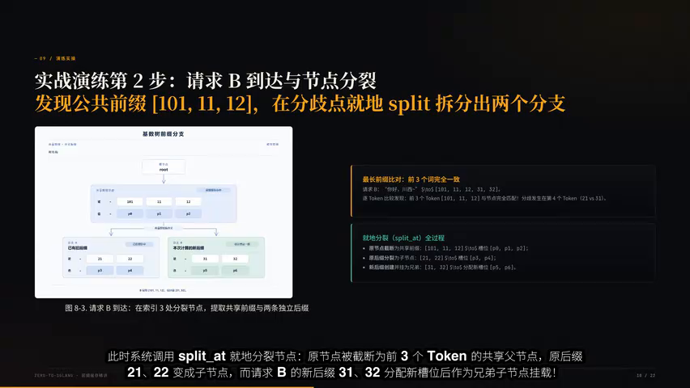
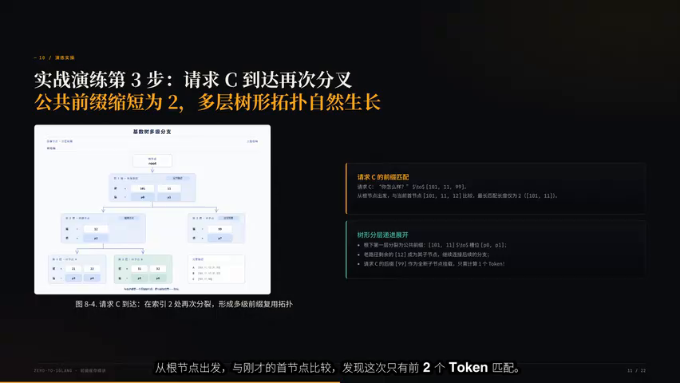

# 第 13 章 RadixAttention 与前缀缓存

> 本章基于 Datawhale × RadixArk 的 zero-to-sglang 原课程《RadixAttention与前缀缓存》重组，原文见[概念篇](https://github.com/datawhalechina/zero-to-sglang/blob/main/course-material/ch/part2/第8章_RadixAttention与前缀缓存.md)与[代码走读](https://github.com/datawhalechina/zero-to-sglang/blob/main/course-material/ch/part2/第8章_RadixAttention与前缀缓存_代码.md)，采用 [CC BY-NC-SA 4.0](https://creativecommons.org/licenses/by-nc-sa/4.0/) 许可。

分页解决了 KV Cache 如何紧凑分配的问题，前缀缓存进一步回答：不同请求已经算过的 K/V 能否复用。系统提示、工具描述和多轮对话常形成长公共前缀，若每次请求都重新 Prefill，便会重复计算。RadixAttention 用压缩前缀树管理 token 序列到物理 KV 索引的映射，并配合引用保护、按需分配和淘汰完成复用。

## 为什么复用的是前缀



*图 13.1　当新请求只复用已有路径的一部分时，Radix Tree 在公共前缀末尾执行 split。共享前缀保留在父节点，不同后缀进入各自分支，从而同时表达复用与分歧。（原课程视频帧，05:20）*


因果模型中，位置 $i$ 的隐藏状态只能依赖位置 $0\ldots i$。后续层的 K/V 由这些隐藏状态投影得到，因此相同 token 出现在不同左侧上下文中，其 KV 通常不同。两个请求即使有相同后缀，也不能据此直接复用该后缀的缓存。

同理，位置编码、模型权重和 Attention 结构都影响可复用性。工程上除了要求 token ID 前缀一致，还要求模型与缓存配置兼容；不能仅凭文本局部相同或词表大小相同就跨模型、跨位置搬用 KV。

RadixAttention 并未提出新的注意力公式。它位于 Attention 之外：Radix Tree 保存逻辑索引，KV Cache Pool 保存真实张量，调度器决定何时匹配、加锁、分配和回收。Attention 仍根据页表读取 K/V 并进行标准计算。

## 路径压缩的 Radix Tree

逐 token Trie 能表达公共前缀，但长而无分支的路径会产生大量节点。Radix Tree 将一段连续 token 压缩到一个节点或一条边上，只在分支或部分匹配处拆分，更适合长 Prompt。

教学实现中的节点可抽象为：

```python
class Node:
    key: list[int]          # 本段 token ID
    value: list[int]        # 等长的物理 KV token-slot 索引
    parent: Node | None
    children: dict
    ref_count: int          # 活动引用保护计数
    last_access: int        # LRU 等策略使用的访问时间
```

从根到某节点的所有 `key` 拼接，得到该节点代表的完整 token 前缀；对应 `value` 按同样顺序拼接，才是完整物理索引。必须维护 `len(key) == len(value)`，并注意根节点为空、不对应 KV。

考虑按 A、B、C 顺序加入三条序列：

```text
A = [101, 11, 12, 21, 22]
B = [101, 11, 12, 31, 32]
C = [101, 11, 99]
```

A 初始形成一条压缩路径。B 与 A 公共前缀长为 3，于是在原节点内部位置 3 分裂，共享 `[101,11,12]`，两个后缀分别挂在下方。C 再次使公共节点在位置 2 分裂，最终 `[101,11]` 成为更高层公共前缀。

分裂只重组 key/value 元数据：公共段的 value 仍指向原物理 KV，不需要复制 K/V。分裂节点还要正确继承父链接、子节点和引用状态，避免把正在使用的缓存变成可淘汰对象。

## 架构与源码定位

以下 mini-sglang 路径均相对于 `python/minisgl/`：

| 文件 | 职责 |
| --- | --- |
| `kvcache/radix_cache.py` | 节点、句柄、最长前缀匹配、分裂、插入、锁与淘汰 |
| `scheduler/cache.py` | 连接 Radix Tree、空闲页和请求页表 |
| `scheduler/prefill.py` | 入批前匹配、容量检查与命中前缀加锁 |
| `kvcache/mha_pool.py` | 按层保存真实 K/V 张量 |
| `scheduler/scheduler.py` | 组批、分配新页、结果归档及结束/取消回收 |
| `kernel/csrc/jit/store.cu` | 将新计算的 K/V 写入指定物理索引 |

完整 SGLang 的主要对应模块是 `python/sglang/srt/mem_cache/radix_cache.py` 与调度、分配器相关模块。版本演进可能调整文件名与策略，阅读时应沿同一条生命周期定位，而不要只搜索某个函数名。

## 一次请求的缓存生命周期

### Match：找到候选前缀

匹配沿子节点索引逐段比较，返回最长可复用长度、对应节点句柄和可取得的物理索引。**匹配到不等于已经安全持有**：未加锁的叶子路径仍可能被空间回收。

在分页实现中，匹配长度通常向下对齐到 `page_size`，不共享非整页前缀。mini-sglang 的 Prefill 接入还会有意只匹配 `input_ids[:input_len-1]`，至少留下最后一个输入 token 参与前向，以产生第一个输出 token 的 logits；这是该执行流程的重要边界，而不是前缀树本身的数学限制。

### Lock：保护使用中的路径

进入执行前，对匹配节点到根的祖先路径增加引用计数。命中前缀由可淘汰状态转为受保护状态，并把对应索引填入请求页表。加锁只保护已有页，不负责为未命中后缀分配新页。

这也解释了为何容量检查可能在加锁前后各做一次：加锁会减少可淘汰空间，先前看似可用的预算未必仍成立。

### Allocate 与 Forward：只计算缺口

已命中段直接复用索引，未命中后缀才申请新页并执行前向。新 K/V 按分配索引写入 Pool，页表把旧前缀与新后缀连成请求的逻辑序列。空闲页不足时，可先淘汰无引用缓存，但不能回收任何仍受保护的路径。

### Insert、Unlock：归档并解除本轮保护

计算完成后，将新 token 段及其物理索引插入树中。若此刻发现相同前缀已被其他请求插入，不能立即释放本请求页表仍在引用的重复页。安全顺序是：先取得树中的共享索引并加锁保护，再把请求页表的重复前缀切换到这些共享索引；确认被替换的旧页已不再由该请求及其他活动请求引用后，才归还分配器。取得共享索引与加锁必须处于同一受控调度过程，避免保护前出现淘汰窗口。否则，释放动作会让 `page_table` 留下悬空索引。

不可共享的非整页尾部也不能仅因未入树就释放。请求尚未完成时，这些页仍可能供后续 Decode 使用；只有在 `finished`、取消后执行已完全停止等确定不再使用页表的路径上，才能回收相应尾部。

解锁按匹配时的路径对称减少引用计数。计数降到零表示允许淘汰，不表示立即释放；若请求还要继续使用共享页，必须先由新句柄承接有效引用。Decode 中生成的新后缀也不必每步插入树；可在请求结束等归档点处理可复用部分，因此前缀缓存并非“只缓存 Prompt”。

### Evict 与 Free：两种回收动作

空间不足时，淘汰策略从无引用叶子中按 LRU 等顺序选择节点，将其从树中移除并归还物理页。不能直接摘除仍拥有后代的内部节点，否则会破坏所有更长前缀的索引，也不能淘汰 `ref_count > 0` 的节点。

`free` 则描述直接把某些页归还分配器，例如完成页表切换后已失去引用的重复页，或 `finished` 后确定不再需要的无法入树尾部。活动请求页表的引用同样属于所有权判断依据，不能把“未入树”等同于“可释放”。不同代码库中“摘除节点”和“物理页回池”可能由不同函数完成，不能只凭函数名判断生命周期。

## 核心操作的教学伪代码



*图 13.2　随着更多请求插入，路径压缩的树会按实际公共前缀逐步形成多级分支。匹配过程沿树寻找最长可复用前缀，之后只需为未命中的后缀分配和计算 KV。（原课程视频帧，05:45）*


```python
def reuse_or_extend(request, finished):
    old_handle = tree.match_prefix(request.ids_for_match())
    lock_ancestors(old_handle.node)              # 先保护命中路径
    new_handle = None
    try:
        reused = old_handle.matched_indices()
        # 分配页并展开为与 reused 同单位的 token-slot 索引
        fresh = allocate_token_slots_for_missing_suffix(request, reused)
        request.page_table = concat(reused, fresh)
        forward_and_store_kv(request, request.page_table)

        result = tree.insert_prefix(
            request.computed_ids(), request.page_table)
        new_handle = result.handle
        lock_ancestors(new_handle.node)           # 先保护树中的共享索引

        old_page_table = request.page_table
        request.page_table = replace_prefix(      # 再切换请求页表
            old_page_table, result.shared_indices, result.shared_len)
        # fresh 为本请求新分配；只回收其中已被替换且不再引用的重复槽位
        free_unreferenced_replaced_fresh_slots(
            fresh, old_page_table, request.page_table)

        if finished:
            # 仅因请求已结束、之后不再读取页表，才可回收未入树的尾部
            free_tail_after_last_use(request.page_table, result.inserted_len)
        else:
            # 未完成请求保留尾部，并由新句柄继续持有共享路径的锁
            request.cache_handle = new_handle
            new_handle = None                     # 锁所有权转交给请求
    finally:
        if new_handle is not None:                # finished 或异常时对称解锁
            unlock_ancestors(new_handle.node)
        unlock_ancestors(old_handle.node)         # 成功、失败与取消都要对称
```

其中 `result.shared_indices` 是插入时已经存在的共享前缀索引，`result.inserted_len` 是按实现规则可入树的长度。伪代码显式区分重复新页与仍在使用的尾部，并处理新句柄的锁所有权。真实实现还需处理分块 Prefill、Decode 持续引用、批量延迟释放和异常回滚，不能把这段伪代码当作可直接运行的资源管理器。

## 调度与复用的关系

前缀感知调度可以优先处理共享前缀长或未命中后缀短的请求，减少重复计算和缓存抖动。但 mini-sglang 教学版本按 `pending_list` 顺序尝试接入，队首资源不足即停止本轮添加，并不等同于完整 SGLang 的各种前缀感知策略。

命中率也不是唯一目标。保留大量低价值前缀会挤压新请求空间，过强复用倾向还可能影响公平性。评价时要同时观察未命中计算量、TTFT、吞吐、可淘汰容量和请求等待情况。

## 正确性与边界情况

1. **索引与数据一致**：树只保存地址；如果页已复用而树仍保留旧映射，后续请求会读到错误 KV。
2. **先保护后使用**：匹配到执行之间存在淘汰窗口，加锁、解锁必须覆盖真实使用期并沿祖先路径对称更新。
3. **只淘汰无引用叶子**：内部节点可能支撑多个后代，活动计数也不能忽略。
4. **分裂不搬 KV**：公共物理索引应保持不变，引用关系和父指针必须正确。
5. **处理重复与尾部**：先取得并保护共享索引、切换请求页表，再释放已失去引用的重复新页；非整页尾部按实现规则处理，不能错误共享，未完成请求仍在使用的尾部也不能释放。
6. **兼容上下文**：模型版本、tokenizer、位置配置与缓存精度等不兼容时，不应复用旧缓存。
7. **失败路径完整**：分配失败、取消和异常都不能遗留锁、半插入节点或重复所有权。

## 实践检查

- 用 A/B/C 示例逐次画树，记录每次分裂前后的 key、value、父子关系，确认公共 KV 索引没有复制或换序。
- 模拟两个请求同时命中同一前缀，检查祖先引用计数；依次解锁后再验证哪些叶子可淘汰。
- 构造“匹配成功但未加锁即发生淘汰”的反例，说明为何必须将 Match 与 Lock 纳入同一受控调度过程。
- 模拟插入时前缀已由另一请求建立，按“取得共享索引并加锁 → 切换请求页表 → 释放不再引用的重复新页”核对顺序；分别检查 `finished` 与未完成请求的非共享尾部，前者可在最后使用后释放，后者必须保留。
- 分别在页大小为 1 和大于 1 时检查匹配长度对齐、非整页尾部与页表拼接；不要假设所有 token 都能跨请求共享。
- 做回归验证时，在兼容模型与相同计算条件下比较启用和关闭前缀缓存的结果，同时核对缓存守恒，而不是把一次命中日志当作正确性证明。

## 小结

RadixAttention 用路径压缩树组织可复用前缀，树节点保存 token 段到物理索引的映射，而不是 KV 张量本身。完整复用依赖 Match、Lock、Allocate、Forward、Insert、Unlock 以及 Evict/Free 的协同。最长匹配、节点分裂、引用保护和叶子淘汰共同保证正确性；分页对齐、重复插入和取消路径则是最需要验证的工程边界。

## 参考资料

- [Datawhale × RadixArk 原课程概念篇](https://github.com/datawhalechina/zero-to-sglang/blob/main/course-material/ch/part2/第8章_RadixAttention与前缀缓存.md)
- [Datawhale × RadixArk 原课程代码走读](https://github.com/datawhalechina/zero-to-sglang/blob/main/course-material/ch/part2/第8章_RadixAttention与前缀缓存_代码.md)
- [SGLang: Efficient Execution of Structured Language Model Programs](https://arxiv.org/abs/2312.07104)
- [SGLang RadixAttention 介绍](https://lmsys.org/blog/2024-01-17-sglang/)
- [mini-sglang：Radix Cache](https://github.com/sgl-project/mini-sglang/blob/main/python/minisgl/kvcache/radix_cache.py)
- [SGLang：Radix Cache](https://github.com/sgl-project/sglang/blob/main/python/sglang/srt/mem_cache/radix_cache.py)
