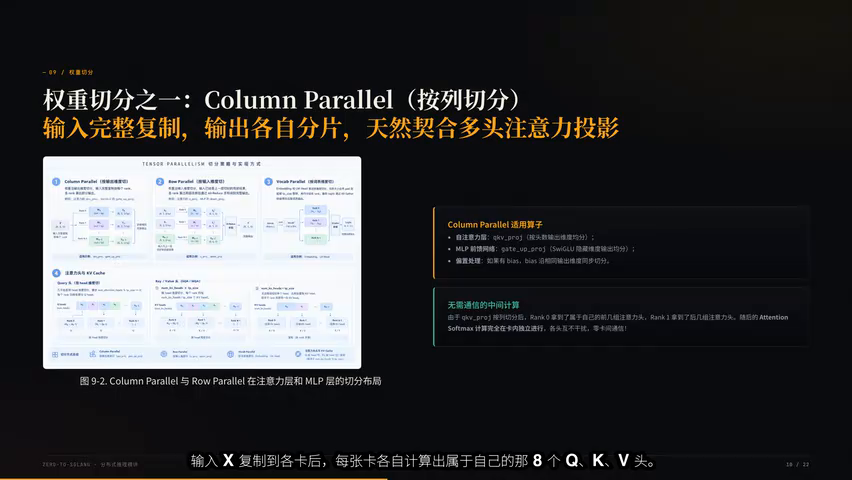

# 第 14 章 多进程与张量并行

> 本章基于 Datawhale × RadixArk 的 zero-to-sglang 原课程《多进程与张量并行》重组，原文见[概念篇](https://github.com/datawhalechina/zero-to-sglang/blob/main/course-material/ch/part2/第9章_多进程与张量并行.md)与[代码走读](https://github.com/datawhalechina/zero-to-sglang/blob/main/course-material/ch/part2/第9章_多进程与张量并行_代码.md)，采用 [CC BY-NC-SA 4.0](https://creativecommons.org/licenses/by-nc-sa/4.0/) 许可。

当单张 GPU 无法容纳模型权重与目标负载所需的 KV Cache，或单卡计算无法满足需求时，可以让多张 GPU 共同执行同一个模型。多进程负责进程组织、请求协调与状态同步，Tensor Parallelism（TP，张量并行）负责切分层内权重和计算。二者解决不同问题：TP 组中的每个 rank 都必须处理同一批 token，而不是各自接收任意请求后独立前进。

## 为什么“权重装得下”仍可能需要多卡



*图 14.1　列并行切分线性层的输出维：各 rank 接收相同输入，但只负责一部分输出通道。它与注意力头和 MLP 中间维的天然分块相契合，并与行并行及 All-Reduce 配合完成前向。（原课程视频帧，05:45）*


推理显存不只包括权重，还包括 KV Cache、临时激活、算子工作区、通信缓冲以及可选的 CUDA Graph 相关空间。短上下文低并发能够启动，不意味着增加并发后仍有足够余量。TP 可以分摊大部分权重和相应计算，为 KV Cache 留出空间，也可能在合适负载下降低前向延迟。

但 TP 不是免费的扩展。每层若干次集合通信会暴露互联带宽和延迟，部分参数或 KV 头还可能复制；因此 TP 大小翻倍不意味着显存严格减半，更不意味着速度翻倍。若单卡已满足容量和延迟目标，增加 TP 反而可能降低效率。

## 多进程架构与控制面

在 mini-sglang 的教学架构中，每个 TP rank 对应一个 Scheduler 进程并绑定一张可见 GPU，Engine、模型执行器和模型运行逻辑位于该进程内。API Server、Tokenizer、Detokenizer 则承担前端和文本转换职责。

只有 rank 0 与 Tokenizer/Detokenizer 交换外部消息，再把请求消息按相同顺序提供给其他 rank。其他 rank 不独立决定接收多少请求；各 rank 根据相同消息执行相同调度逻辑，因而得到一致的请求集合、顺序和批次状态。Decode 组批按 `uid` 排序也是为了维持一致视图，而非按 UID 串行执行请求。

本章实现中的控制面与数据面使用三类机制：

| 层次 | 机制 | 主要用途 |
| --- | --- | --- |
| 进程消息 | ZeroMQ | 前端与 rank 0 通信，rank 0 向其他 Scheduler 发布请求内容 |
| CPU 控制通信 | Gloo 进程组 | Barrier、消息数量同步、NCCL Unique ID 广播 |
| GPU 数据通信 | NCCL/PyNCCL 或 Torch NCCL | All-Reduce、All-Gather 等模型张量集合通信 |

控制面保证“大家在同一步做同一件事”，数据面保证“局部计算能合成为原模型结果”。ZMQ 发布请求内容不能替代 Gloo 的消息数量同步，也不能替代前向中的 NCCL 张量通信。

## 架构与源码定位

以下 mini-sglang 路径均相对于 `python/minisgl/`：

| 文件 | 阅读重点 |
| --- | --- |
| `server/launch.py` | 以 `spawn` 启动各 Scheduler 与文本处理进程，等待就绪 |
| `distributed/info.py` | 保存 rank、world size，并向模型层提供 TP 信息 |
| `distributed/impl.py` | 统一封装 All-Reduce、All-Gather |
| `engine/engine.py` | 绑定设备、初始化通信、加载权重、创建缓存和执行模型 |
| `scheduler/io.py` | rank 0 对外通信、请求广播及消息数量同步 |
| `models/weight.py` | 按 Column/Row/Vocab 规则读取本 rank 权重 |
| `layers/linear.py`、`layers/embedding.py` | 并行线性层、Embedding 与 LM Head |

真实 SGLang 可从 `entrypoints/engine.py`、`managers/scheduler.py`、`managers/tp_worker.py`、`distributed/parallel_state.py` 和 `layers/linear.py` 对照阅读。模块更细，还可能包含 DP、PP、EP 等策略，不能把它们与这里的层内 TP 混为一谈。

## 线性层怎样切分

设 $Y=XW$，其中 $X$ 的形状为 `[tokens, d_in]`，$W$ 为 `[d_in, d_out]`，TP 大小为 $p$。这里以 PyTorch 常见的 `[d_out, d_in]` 存储权重时，需在加载时相应转置理解；数学切分维度不因存储转置而改变。

### Column Parallel：切输出维

将 $W$ 沿 $d_{out}$ 切成 $W_i$，每个 rank 保存 `[d_in,d_out/p]`：

$$
Y_i=XW_i,\qquad Y=\operatorname{concat}(Y_0,\ldots,Y_{p-1}).
$$

输入 $X$ 复制到各 rank，输出先保持分片。若下一层正好是按输入维切分的 Row Parallel，就不必在中间额外拼回完整 $Y$。输出 bias 也按输出维切分。Attention 的 `qkv_proj` 和 SwiGLU 的 `gate_up_proj` 是典型应用。

### Row Parallel：切输入维

将 $W$ 沿 $d_{in}$ 切成 $W_i$，同时把输入按相同维切为 $X_i$：

$$
Y=\sum_{i=0}^{p-1}X_iW_i.
$$

各 rank 先得到同形状的局部贡献，再用 **All-Reduce Sum** 得到完整输出。若存在全输出 bias，应只添加一次，而不是在每个 rank 的局部结果中都添加后再求和。Attention 的 `o_proj` 与 MLP 的 `down_proj` 常采用这一模式。

```python
# 每个 rank 执行；省略非线性、残差和具体张量布局。
def row_parallel(x_local, w_local, bias, tp_group):
    partial = x_local @ w_local
    y = tp_group.all_reduce_sum(partial)
    return y + bias                  # 归约后统一加一次

def column_parallel(x, w_local):
    return x @ w_local               # 供后续 Row Parallel 使用的本地分片
```

Column 后接 Row 的组合使 MLP 和 Attention 可在局部中间维度上计算，只在必要位置通信。RMSNorm 等小参数通常复制，但其输入输出语义必须与所在切分位置一致。

## QKV、KV Cache 与词表的边界

Attention 通常按头切分 Q 投影，每个 rank 只计算本地 Q 头。若 KV 头数不少于 TP 大小，K/V 头也可均分，每个 rank 保存对应头的 KV Cache；当 KV 头数小于 TP 大小，教学实现会让部分 rank 复制 KV 头，而不是把一个头继续拆开。此时 KV 显存不会按 $1/p$ 理想缩减。

切分还要求模型结构满足实现的整除与映射约束。不能简单用 `chunk` 处理所有 GQA 情况，也不能只检查 Q 头而忽略 KV 头。每个 rank 的页表和请求顺序必须一致，否则本地 Attention 会读取不对应的缓存。

Embedding 与 LM Head 可按词表维切分：

- **Embedding**：本地只处理属于自己的词表区间，区间外输出置零，再 All-Reduce 求和，得到每个 token 的完整向量。
- **LM Head**：各 rank 计算本地词表 logits，再按词表顺序 All-Gather；若词表为整除而填充，合并后必须截去填充项。

对 LM Head，应合并**完整 logits**后再进行全局采样或 Softmax，不能把各词表分片分别归一化后的概率直接拼接为全局概率。权重共享的模型还需保持 Embedding 与 LM Head 的分片约定一致。

## 从启动到一次前向

启动过程可概括为：

1. 父进程解析 `tp_size`，为每个 rank 构造独立的 `DistributedInfo(rank, world_size)`，以 `spawn` 创建 Scheduler 子进程。
2. 各进程先设置 TP 信息和本地 CUDA 设备，再创建通信组；模型层据此确定本地参数形状。
3. 各 rank 流式读取 checkpoint，**先取本 rank 分片，再合并本地 QKV 或 gate/up 分量**，避免先全局拼接再均分破坏局部分组。
4. 初始化 KV Cache、Attention 后端和可选 CUDA Graph，完成跨 rank 同步后开放服务。
5. rank 0 收到请求并协调消息，各 rank 独立运行同一调度规则，形成一致 Batch，再执行相同的集合通信序列。

`spawn` 下子进程不会依赖父进程的普通内存状态隐式共享；模型、调度器和缓存均需在各自进程中正确初始化。设备编号通常是可见设备列表中的编号，还要结合 `CUDA_VISIBLE_DEVICES` 理解。

## 正确性与边界情况

1. **集体通信一致**：所有 rank 必须以相同顺序、兼容形状和数据类型参加对应集合操作，否则可能得到错误结果或挂起。
2. **调度状态一致**：任一 rank 多收、漏收或重排请求，都会使后续 Batch 和 KV 页表失去共同语义。
3. **切分与合并等价**：Row Parallel 的输入必须与本地权重输入维对应，bias 不得重复累加，词表拼接顺序不能改变。
4. **局部 KV 映射正确**：Q/KV 头分片或复制规则必须与权重加载、Attention 元数据和缓存形状一致。
5. **初始化有序**：TP 信息应在构建并行层前设置，服务应在权重、通信和缓存就绪后开放。
6. **异常可传播**：一个 rank 失败可能使其他 rank 阻塞在集合通信中，服务需要监测和统一退出，而非把单进程异常当作普通请求失败。
7. **不承诺线性扩展**：复制参数、通信、负载规模与互联拓扑都会影响显存和时延，结论必须来自明确配置下的验证。

## 实践检查

- 用一个小矩阵在 CPU 上手算二路 Column→Row 组合，确认无需拼接中间结果，最终 All-Reduce 后与完整矩阵乘法一致，并验证 bias 只加一次。
- 选择一个 GQA 配置，分别列出 TP 大小为 1、2、4 时各 rank 的 Q 头与 KV 头归属；对 KV 头少于 TP 的情况明确指出复制而非均分。
- 检查词表分片：本地 Embedding 对区间外 token 置零，All-Reduce 恢复完整向量；LM Head All-Gather 后顺序正确且去除 padding。
- 在调试日志中对比各 rank 的请求 ID 序列、Batch 阶段、token 长度和集合通信顺序。出现单 rank 特有请求时应先排查控制面，而不是调采样参数。
- 若进行单卡与多卡回归，固定模型、输入和计算精度，先验证输出等价性，再分别记录显存和时延；不要把理论分片比例当作实测结果。

## 小结

多进程架构为每个 TP rank 建立独立的调度与模型执行环境，rank 0 协调外部消息，各 rank 以相同顺序维护同一批次。TP 则通过 Column Parallel、Row Parallel 和词表切分分摊权重及计算，并用 All-Reduce 或 All-Gather 恢复数学语义。QKV/KV 头、词表 padding、bias 和集合通信顺序是正确性的关键边界，多卡收益必须结合实际通信与复制成本评估。

## 参考资料

- [Datawhale × RadixArk 原课程概念篇](https://github.com/datawhalechina/zero-to-sglang/blob/main/course-material/ch/part2/第9章_多进程与张量并行.md)
- [Datawhale × RadixArk 原课程代码走读](https://github.com/datawhalechina/zero-to-sglang/blob/main/course-material/ch/part2/第9章_多进程与张量并行_代码.md)
- [mini-sglang](https://github.com/sgl-project/mini-sglang)
- [SGLang](https://github.com/sgl-project/sglang)
- [Megatron-LM: Training Multi-Billion Parameter Language Models Using Model Parallelism](https://arxiv.org/abs/1909.08053)
- [NVIDIA NCCL 文档](https://docs.nvidia.com/deeplearning/nccl/user-guide/docs/)
