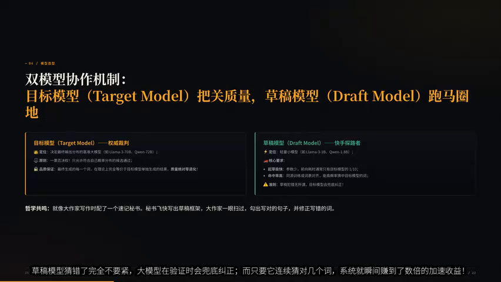

# 第 15 章 投机解码

> 本章基于 Datawhale × RadixArk 的 zero-to-sglang 原课程《投机解码》重组，原文见[概念篇](https://github.com/datawhalechina/zero-to-sglang/blob/main/course-material/ch/part2/第10章_投机解码.md)与[代码走读](https://github.com/datawhalechina/zero-to-sglang/blob/main/course-material/ch/part2/第10章_投机解码_代码.md)，采用 [CC BY-NC-SA 4.0](https://creativecommons.org/licenses/by-nc-sa/4.0/) 许可。

KV Cache、连续批处理和张量并行都能提高推理效率，但普通 Decode 仍要逐 token 解决自回归依赖。投机解码（Speculative Decoding）引入低成本 Draft Model（草稿模型）提出若干候选，再由 Target Model（目标模型）一次前向验证这些位置。只有符合目标模型生成规则的候选才会提交，因此它试图减少昂贵的串行调用，而不是用草稿模型替代目标模型决定答案。

## 起草、验证与提交



*图 15.1　投机解码用小型草稿模型快速提出多个候选，再由目标模型集中验证。最终输出仍由目标模型的分布约束，加速来自减少目标模型的串行调用，而不是绕过其质量把关。（原课程视频帧，02:40）*


设已确认前缀为 $x$，本轮起草 $k$ 个 token。独立草稿模型仍依次计算：

$$
q(y_1\mid x),\quad q(y_2\mid x,y_1),\quad\ldots,\quad q(y_k\mid x,y_1,\ldots,y_{k-1}).
$$

候选 $y_1,\ldots,y_k$ 只是暂存提案。目标模型随后对已给定的候选序列做因果前向，一次获得各候选之前的预测分布，以及全部候选之后的预测分布。计算可以并行，是否采用后面的预测仍取决于前面的候选是否连续被接受。

| 阶段 | 核心工作 | 不能直接做什么 |
| --- | --- | --- |
| 起草 | 草稿模型逐步提出 $k$ 个候选 | 直接写入正式输出 |
| 验证 | 目标模型一次计算 $k+1$ 个相关预测位置 | 把不同前缀下的预测混用 |
| 提交 | 保留连续接受前缀，并追加纠正或额外 token | 跳过首次拒绝继续接受旧草稿 |

低并发 Decode 可能受权重读取和串行调用限制，一次验证多个位置有机会提高有效工作量。但草稿、验证和状态恢复都有成本，高并发且 GPU 已充分使用时，额外计算可能使收益消失。

## 验证位置如何对齐

令已确认前缀 `tokens` 长为 $L$，候选 `proposals` 长为 $k$。若教学接口 `target(sequence)` 返回每个输入位置预测下一个 token 的 logits，则：

```python
verification = target(tokens + proposals)[L - 1:]
# verification[0]     验证 proposals[0]
# verification[k - 1] 验证 proposals[k - 1]
# verification[k]     全部接受后产生 bonus token
```

因此切片包含 $k+1$ 行。第 $i$ 个草稿必须由“已确认前缀 + 前 $i-1$ 个草稿”条件下的目标预测来验证，不能统一取最后一行。真实引擎会复用前缀 KV，只对新增位置执行验证，但逻辑行号关系不变。

目标与草稿必须使用相同的 token ID 语义和兼容词表。词表长度相等并不足以证明兼容，因为同一 ID 在两个 tokenizer 中可能代表不同文本。

## 贪心验证：首次不一致即纠正

当目标原本采用贪心解码时，每个位置取目标 logits 最大值的 token。若它等于草稿，则接受；若不同，则提交目标选择的纠正 token，立即结束本轮。首次拒绝后的旧候选依赖已失效前缀，不能继续提交。

```python
def greedy_commit(proposals, verification, remaining, eos_id=None):
    output = []
    for i, proposed in enumerate(proposals):
        token = argmax(verification[i])
        output.append(token)
        if token != proposed or token == eos_id:
            return output
        if len(output) == remaining:
            return output
    if len(output) < remaining:             # 草稿全部接受
        output.append(argmax(verification[len(proposals)]))
    return output
```

调用方还需在每次追加后检查长度上限和 EOS；伪代码假定 `remaining > 0` 且候选数不超过剩余额度。若草稿提出 `like → green → tea`，目标在对应前两位置选择 `like → black`，本轮只提交 `like black`，旧 `tea` 及其预测全部丢弃。

若 $k$ 个草稿全部被接受且尚未停止，可用第 $k+1$ 行再选一个 **bonus token**。因此无停止条件截断时，一轮起草 $k$ 个、连续接受 $a$ 个，会提交 $m=a+1$ 个 token，最多 $k+1$ 个。即使首次位置就拒绝，也会提交一个目标纠正 token。

固定数值计算和并列最大值处理规则时，贪心路径提交的每个 token 都是目标在当前已确认前缀上本来会选择的 token，因而可与普通贪心生成保持一致。

## 随机采样验证：接受与残差校正

若目标原本按分布 $p$ 采样，草稿从同一条件前缀下的分布 $q$ 提出候选 $y$，则以

$$
\alpha(y)=\min\left(1,\frac{p(y)}{q(y)}\right)
$$

接受。这里 $p,q$ 是实际采样时经过温度、Top-k、Top-p 等处理并归一化的分布，候选来自 $q$ 的支撑集，故其 $q(y)>0$。不能把未经处理的 logits 直接代入比值。

首次拒绝时，从归一化正残差分布抽取纠正 token：

$$
r(v)=\frac{[p(v)-q(v)]_+}{\sum_u[p(u)-q(u)]_+},\qquad [z]_+=\max(z,0).
$$

接受分支对 token $v$ 的概率贡献为 $\min(p(v),q(v))$，拒绝分支补齐剩余的 $[p(v)-q(v)]_+$，所以最终仍为目标分布 $p$。拒绝后直接从 $p$ 重抽并不等价。

例如 $p=[0.4,0.6]$、$q=[0.8,0.2]$：候选 A 的接受率是 $0.4/0.8=0.5$，B 为 1；拒绝分支概率为 0.4，正残差归一化后只会选择 B。最终 A 的概率为 $0.8\times0.5=0.4$，B 为 $0.2+0.8\times0.5=0.6$。

随机路径保证的是目标**输出分布**，不保证相同随机种子下与普通采样逐 token 相同。全接受后的 bonus 也应从目标分布在完整草稿之后的条件分布抽取，首次拒绝同样停止本轮。

## 接受率不等于加速比


*图 15.2　贪心验证从前往后比较草稿与目标模型选择，只提交连续一致的前缀；首次不一致即截断并纠正。若全部候选都被接受，还可多提交一个目标模型给出的 bonus token。（原课程视频帧，03:35）*


需要区分三个量：

- **位置接受率**：已验证候选中被接受的比例，必须说明按 token、按位置还是按请求统计；
- **连续接受长度 $a$**：从第一个候选起，到首次拒绝前连续接受的数量；拒绝后的偶然匹配不能计入；
- **每轮提交数 $m$**：未被停止条件截断时 $m=a+1$，包含纠正或 bonus token。

随机验证中，某位置接受概率由 $p,q$ 共同决定，并不等同于草稿与目标 argmax 相同的比例。即使位置接受率很高，若经常在前面的位置拒绝，长草稿的有效收益仍有限；反之，只报告接受率而不报告 $m$ 和耗时，也无法判断性能。

只有在“各位置接受概率同为 $\rho$ 且相互独立、无提前停止”的简化假设下，才有：

$$
\mathbb E[m]=\sum_{i=0}^{k}\rho^i=\frac{1-\rho^{k+1}}{1-\rho}.
$$

真实文本中的各位置并不独立，条件分布也会变化，因此这个公式只用于理解趋势，不能代替实测的每轮提交数。

评估时可比较普通 Decode 单 token 成本 $T_{\mathrm{dec}}$ 与投机路径的有效成本：

$$
T_{\mathrm{token,spec}}\approx\frac{T_{\mathrm{draft}}+T_{\mathrm{verify}}+T_{\mathrm{state}}}{\mathbb E[m]}
=\frac{T_{\mathrm{round}}}{\mathbb E[m]}.
$$

只有 $T_{\mathrm{token,spec}}<T_{\mathrm{dec}}$ 时，Decode 阶段才有加速机会。草稿长度增加会同时提高起草与验证成本，而越靠后的候选越依赖前面全部接受。端到端收益还受 Prefill、排队、连续批处理和多卡通信影响，不能把单请求 Decode 加速比直接当作服务吞吐提升。

## 架构与源码定位

原课程指出，mini-sglang 的 `9a91cfa` 参考提交没有投机解码模块，因此代码走读使用 SGLang 固定提交 `1291f317`。以下路径相对于 `python/sglang/srt/speculative/`：

| 文件与入口 | 阅读重点 |
| --- | --- |
| `standalone_worker_v2.py` | 独立草稿模型与词表兼容性检查 |
| `eagle_worker_v2.py`：`forward_batch_generation` | 起草、目标验证、草稿状态更新的执行顺序 |
| `eagle_info.py`：`EagleVerifyInput` | 草稿 token、位置、可见掩码、检索索引及草稿概率 |

其调用主线可简化为 `draft → verify → update draft state`。独立草稿模型复用部分 EAGLE 基础设施不代表两者草稿机制相同；本章聚焦独立草稿和线性候选，不把树状候选的接受规则混入线性流程。

## KV Cache 与停止边界

目标验证可能已为所有草稿位置写入 KV，但首次拒绝后只能保留已确认前缀对应的缓存。被拒绝候选及其后续 KV 必须回滚或标记无效，草稿模型侧状态也要恢复到同一已确认前缀。

纠正 token 或 bonus token 是刚由 logits 选出的下一个 token，通常尚未完成自己的前向，因此不能复用被拒绝候选的 KV 冒充它的 KV。下一轮应从实际提交的前缀继续，而非从旧草稿末尾继续。

停止条件只服从正式输出：草稿提出 EOS 仍需验证，被拒绝的 EOS 不会结束请求；提交的纠正 token、接受的 EOS 或 bonus 为 EOS 时才按规则结束。达到最大输出长度后，即使还有未验证候选或 bonus，也不能超额追加。

## 正确性与边界情况

1. **逐位置条件一致**：每个候选都使用其之前的已确认前缀验证，首次拒绝后不再采用旧候选及其预测。
2. **目标语义不变**：贪心路径保持目标选择，随机路径保持目标分布；投机算法不能擅自改变温度、Top-k、Top-p 或停止规则。
3. **提交数量受限**：纠正或 bonus 也占用输出额度，EOS 与长度上限优先于继续追加候选。
4. **两侧状态同步**：目标与草稿的缓存、位置和下一轮输入必须对应同一正式前缀，不能只回滚其中一侧。
5. **数值与词表兼容**：候选处应满足 $q(y)>0$，拒绝时正残差应可安全归一化，且两模型 token ID 含义一致。

## 实践检查

1. **位置检查**：前缀长 5、草稿长 3 时，完整前缀接口应取行 4、5、6 验证三个候选，行 7 仅用于 bonus。
2. **贪心回归**：覆盖全接受、首位置拒绝、中间拒绝、并列最大值和输出额度恰好耗尽，确认首次拒绝后的候选未提交。
3. **分布验证**：对小的 $p,q$ 枚举“候选—接受/拒绝—纠正”分支，验证输出概率总和回到 $p$，不要只比较同 seed 文本。
4. **数值边界**：检查候选处 $q(y)>0$，拒绝时正残差和在有限精度下仍为正，并确认 $p,q$ 分别对应各自实际采样分布、使用同一词表顺序。
5. **缓存检查**：在首次拒绝处对比正式前缀与两侧缓存长度，确保纠正 token 不错误继承被拒候选的状态。
6. **性能记录**：若开展实验，分别记录草稿长度、逐位置接受率、平均连续接受长度、平均提交数及整轮耗时；不得由接受率单独推算实测加速比。

## 小结

投机解码用廉价草稿提供可并行验证的输入，再由目标模型决定正式输出。贪心验证在首次不一致处提交目标纠正 token；随机验证以 $\min(1,p/q)$ 接受，并用正残差校正分布。正确实现必须对齐验证行、只保留连续接受前缀、处理 bonus 与停止条件，并同步恢复目标和草稿两侧 KV 状态。接受率只是收益因素之一，最终应比较整轮成本与有效提交数量。

## 参考资料

- [Datawhale × RadixArk 原课程概念篇](https://github.com/datawhalechina/zero-to-sglang/blob/main/course-material/ch/part2/第10章_投机解码.md)
- [Datawhale × RadixArk 原课程代码走读](https://github.com/datawhalechina/zero-to-sglang/blob/main/course-material/ch/part2/第10章_投机解码_代码.md)
- [Fast Inference from Transformers via Speculative Decoding](https://arxiv.org/abs/2211.17192)
- [SGLang：独立草稿模型（1291f317）](https://github.com/sgl-project/sglang/blob/1291f3175d3b7614821884e9653985fcd3c3dae8/python/sglang/srt/speculative/standalone_worker_v2.py)
- [SGLang：投机执行流程（1291f317）](https://github.com/sgl-project/sglang/blob/1291f3175d3b7614821884e9653985fcd3c3dae8/python/sglang/srt/speculative/eagle_worker_v2.py)
- [SGLang：验证输入（1291f317）](https://github.com/sgl-project/sglang/blob/1291f3175d3b7614821884e9653985fcd3c3dae8/python/sglang/srt/speculative/eagle_info.py)
