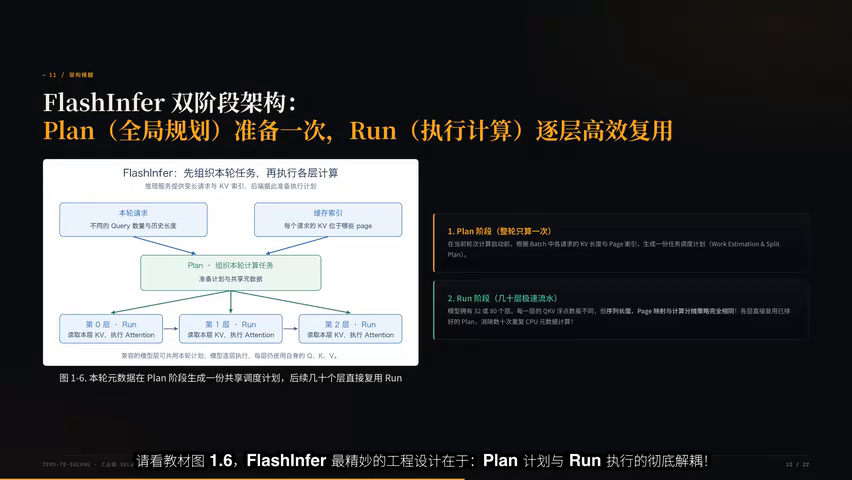

# 第 16 章 注意力后端

> 本章基于 Datawhale × RadixArk 的 zero-to-sglang 原课程《注意力后端》重组，原文见[《第1章_注意力后端.md》](https://github.com/datawhalechina/zero-to-sglang/blob/main/course-material/ch/part3/第1章_注意力后端.md)，采用 [CC BY-NC-SA 4.0](https://creativecommons.org/licenses/by-nc-sa/4.0/) 许可。

Attention 的数学公式并不指定数据怎样进入 GPU、任务怎样划分，也不规定分页 KV Cache 如何寻址。推理引擎中的注意力后端正是模型与具体 GPU kernel 之间的适配层。本章先说明分块与在线归一化这一共同基础，再比较 FlashInfer、Triton、FlashAttention 3（FA3）和 FlashMLA 的设计目标及适用边界。

## 机制、内核与后端



*图 16.1　FlashInfer 将请求级规划与逐层执行分开：Plan 预先组织调度信息，多个 Transformer 层复用规划结果并执行 Run。这样避免每层重复做相同的全局准备工作。（原课程视频帧，06:10）*


对单个注意力头，带掩码的计算可写为：

$$
O=\operatorname{softmax}\left(\frac{QK^\top}{\sqrt{d_k}}+M\right)V
$$

其中，$Q$ 是当前查询，$K,V$ 包含可见历史，$M$ 表达因果掩码、滑动窗口等约束。公式相同，不代表执行路径相同。

| 层次 | 决定的内容 | 典型示例 |
| --- | --- | --- |
| Attention 机制 | 模型的注意力结构和状态表示 | MHA、GQA、MLA |
| Attention kernel | 数据搬运、分块、矩阵运算和归一化怎样执行 | 融合 Softmax、split-KV |
| Attention backend | 准备请求元数据，衔接 KV Cache 并选择 kernel | FlashInfer、Triton、FA3、FlashMLA 后端 |

切换兼容后端通常不改变模型结构和参数，但浮点运算顺序、中间精度及 kernel 配置可能改变，因此仍需做数值正确性检查。

SGLang 的 `AttentionBackend` 接口可用下面的抽象流程理解：

```text
metadata = init_forward_metadata(batch_lengths, kv_indices, mode)
for each model layer:
    write current K/V into allocated cache slots
    if mode is EXTEND:
        output = forward_extend(Q, K, V, cache, metadata)
    else:
        output = forward_decode(Q, cache, metadata)
```

元数据要区分不同请求的新增 token 数、历史长度、KV page 位置和可见范围。缓存管理器负责空间分配与回收，后端按给定位置读写；二者不能混为一谈。

## 分块融合与在线 Softmax

朴素实现会把完整得分矩阵 $S=QK^\top/\sqrt{d_k}+M$ 写入 HBM，再读回计算 Softmax 和 $PV$。当序列较长时，中间矩阵的存储和往返搬运十分昂贵。FlashAttention 的核心不是减少 Attention 的数学项，而是以分块方式融合计算，避免把完整 $S$ 和概率矩阵写回显存。

难点在于 Softmax 必须对整行可见位置统一归一化。处理第 $j$ 个 KV 块时，可维护逐行最大值 $m$、未归一化输出累加器 $a$ 和归一化分母 $\ell$：

$$
m_j=\max(m_{j-1},\operatorname{rowmax}(S_j))
$$

$$
a_j=e^{m_{j-1}-m_j}a_{j-1}+e^{S_j-m_j}V_j,\qquad
\ell_j=e^{m_{j-1}-m_j}\ell_{j-1}+\operatorname{rowsum}(e^{S_j-m_j})
$$

所有块处理完毕后，$O=a/\ell$。更新最大值时同步缩放旧累加值，既保证数学等价，也提高指数计算的数值稳定性。被掩码位置不能进入这些统计量。

这一方法省去完整中间矩阵的物化，但完整 Attention 的 QK 与 PV 计算仍需执行，长序列 Prefill 的计算复杂度不会因此变成线性。

## Prefill、Decode 与 split-KV

Prefill 通常一次给出多个 Query，多个 Query 可复用同一块 KV，矩阵乘规模较大，常见瓶颈偏计算；普通 Decode 每个请求每轮通常只有一个新 Query，却要读取全部可见历史，小 batch 时更容易受显存带宽和 kernel 启动开销限制。这只是常见趋势，实际瓶颈仍取决于上下文、batch、硬件和实现。

Decode 的 Query 维度过小，可能无法提供足够并行任务。split-KV 因而沿历史长度分段：各段独立计算局部 $m,a,\ell$，最后按上述在线归一化规则合并，而不是直接平均各段输出。

```text
for each KV segment in parallel:
    local_m, local_a, local_l = online_attention(Q, segment, mask)
m = max(all local_m)
a = sum(exp(local_m - m) * local_a)
l = sum(exp(local_m - m) * local_l)
output = a / l
```

分段提高并行度，也增加局部结果、额外 kernel 或合并步骤。短上下文或 batch 已使 GPU 饱和时，更多分段未必更快。

## 四种后端的设计重点

### FlashInfer：面向推理请求组织任务

FlashInfer 是面向 LLM 推理的 kernel 库。SGLang 后端把变长请求的历史长度、page 索引等信息交给它，由支持的 kernel 直接读取分页 KV，无需先把每个请求的缓存复制为连续张量。

其重要思路是 **Plan 与 Run 分离**：Plan 根据请求形状安排 Attention 内部工作，可能包含 split-KV；Run 则使用各层自己的 Q、K、V 执行计算。一批请求经过多个注意力配置兼容的层时，可复用计划，但不能复用某一层的计算结果。请求加入、退出或长度变化后，需要更新相应元数据或计划。

Plan 处理的是 kernel 工作划分，不是请求调度器决定“哪些请求进入 batch”。其代价包括索引准备、计划构建、局部结果与合并，因此要把准备成本纳入比较。

### Triton：可调整的 kernel 实现路径

Triton 是编写和编译 GPU 程序的语言与编译器。SGLang 的 `triton` 后端是一组用 Triton 实现的 Attention kernel，而非另一种注意力公式。开发者可用接近 Python 的语法表达分块加载、矩阵运算和归一化，再针对 Prefill、Decode 采用不同入口和配置。

其优势是代码相对容易阅读、修改和扩展，适合功能开发与多环境适配；性能则依赖编译器、block 配置、分段策略与硬件匹配。首次编译有启动成本，稳态测量前应预热。不能仅因实现更易读就推断它一定比专用 kernel 慢。

### FA3：利用 Hopper 异步流水线

FA3 在分块 Attention 上进一步使用 Hopper 的 TMA 数据搬运和异步矩阵计算能力，让搬运、矩阵乘与 Softmax 尽量交叠。处理当前块时准备后续块，可以减少流水线各阶段相互等待。

这类优化要求 GPU 架构、数据类型、head dimension、软件依赖和具体功能路径匹配。SGLang 的 `fa3` 后端还会按设备与模式选择实现，所以参数名称并不能证明所有阶段都执行同一个 FA3 kernel，更不能把 Hopper 上的表现外推到其他 GPU。

### FlashMLA：适配 MLA 的缓存表示

MLA 通过低维 latent 表示等方式保存历史状态，其缓存压缩来自**模型结构**。FlashMLA 负责围绕这种表示、分页布局和任务调度高效执行 Attention，长 KV 同样可分段后按归一化统计量合并。

它不是普通 MHA/GQA 模型的即插即用替代品，模型结构、缓存维度、page size、数据类型和硬件都必须满足实现要求。在课程引用的 SGLang 版本中，FlashMLA 后端主要在 Decode 等路径调用专用 kernel，普通 `EXTEND` 可沿用继承的 Prefill 实现；一个后端组合多种 kernel 是正常现象。

| 后端 | 主要着力点 | 选择前的关键检查 |
| --- | --- | --- |
| FlashInfer | 变长请求、分页 KV、计划复用与任务组织 | 依赖版本、计划开销、请求形状与功能支持 |
| Triton | 用编译器实现可调整的分块和分段 kernel | 编译与预热、配置调优、目标硬件 |
| FA3 | Hopper 上的数据搬运和计算异步交叠 | 架构、head dimension、数据类型与实际路径 |
| FlashMLA | MLA latent 缓存的读取、计算与调度 | 模型必须是兼容 MLA，且缓存布局匹配 |

## 适用边界与选择方法

选择顺序应是“兼容性筛选，再做同条件测量”，而不是寻找脱离场景的固定排名。先确认模型是 MHA/GQA 还是 MLA，再检查 GPU、KV 数据类型、滑动窗口、特殊 mask、投机验证及其他所需能力。不满足功能约束的 kernel，即使单项测试很快，也不能承载真实服务。

SGLang 可用 `--attention-backend` 指定后端，也提供 `--prefill-attention-backend` 和 `--decode-attention-backend` 分开选择两个阶段。混合使用仍须满足共享 KV 布局和功能约束，不能任意拼接。可用参数及默认选择会随版本变化，应以安装版本文档为准。

比较时固定模型、硬件、量化方式、输入输出长度分布、并发与其他配置，分别观察 TTFT、TPOT/ITL、吞吐、尾延迟和显存/workspace。长输入短输出更容易暴露 Prefill 差异，长输出服务则更关注 Decode；报告结果时应包含预热和元数据准备等适用成本。

## 实践检查

1. **数学检查**：用一个小型因果矩阵手算在线 Softmax，确认新块到来时旧 $a,\ell$ 按 $e^{m_{old}-m_{new}}$ 缩放，最终与完整 Softmax 在允许误差内一致。
2. **分段检查**：把同一历史拆成不同段数，验证 split-KV 合并没有直接相加已归一化输出，也没有纳入 mask 位置。
3. **元数据检查**：构造历史长度不同、KV page 不连续的 batch，逐请求核对长度、page 顺序、新增位置和输出形状。
4. **兼容检查**：分别从模型结构、GPU、KV dtype 和特殊功能四方面排除不可用后端；特别确认 MLA 与普通 MHA/GQA 没有混用。
5. **性能检查**：若开展实验，先预热，再分别记录 Prefill、Decode、计划/元数据准备和端到端指标，不将单一 kernel 时间当作服务加速比。
6. **数值检查**：固定输入比较不同后端输出或任务结果；出现差异时先检查掩码、布局、累加精度和数据类型，而不是直接判定某后端有错误。

## 小结

注意力后端把模型张量、请求状态和 KV Cache 组织成具体 kernel 可执行的输入。分块融合与在线 Softmax 减少完整中间矩阵的显存往返，split-KV 用额外合并成本换取 Decode 并行度。FlashInfer 强调推理任务组织，Triton 提供可调整的实现方式，FA3 利用 Hopper 异步能力，FlashMLA 适配 MLA 专用缓存。合理选择必须以兼容性为前提，并在真实请求形状下同时验证正确性与端到端性能。

## 参考资料

- [Datawhale × RadixArk 原课程：注意力后端](https://github.com/datawhalechina/zero-to-sglang/blob/main/course-material/ch/part3/第1章_注意力后端.md)
- [SGLang：Attention Backend 官方文档](https://docs.sglang.io/docs/advanced_features/attention_backend)
- [FlashAttention：IO-aware Exact Attention 论文](https://arxiv.org/abs/2205.14135)
- [FlashInfer：文档与 Attention API](https://docs.flashinfer.ai/api/attention.html)
- [Triton：Fused Attention 教程](https://triton-lang.org/main/getting-started/tutorials/06-fused-attention.html)
- [FlashAttention 3：异步与低精度优化原理](https://tridao.me/blog/2024/flash3/)
- [FlashMLA：项目说明](https://github.com/deepseek-ai/FlashMLA)
