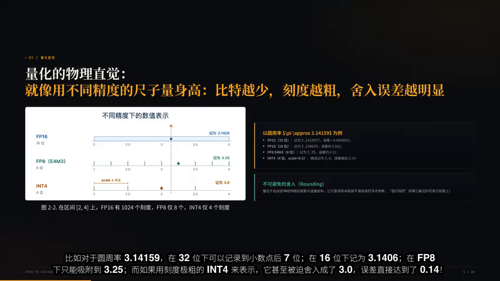

# 第 17 章 量化与低精度推理

> 本章基于 Datawhale × RadixArk 的 zero-to-sglang 原课程《量化与低精度推理》重组，原文见[《第2章_量化与低精度推理.md》](https://github.com/datawhalechina/zero-to-sglang/blob/main/course-material/ch/part3/第2章_量化与低精度推理.md)，采用 [CC BY-NC-SA 4.0](https://creativecommons.org/licenses/by-nc-sa/4.0/) 许可。

量化用更少的比特表示权重、激活或 KV Cache，目标是减少存储和数据搬运，并在硬件支持时利用低精度计算单元。它保留模型结构，却改变数值表示，因此“体积更小”“运行更快”和“任务效果不变”是三个需要分别验证的命题。

## 量化对象与方案名称



*图 17.1　低位宽用更少的离散刻度覆盖数值范围，因此存储与搬运成本下降，但舍入误差通常增大。图中的刻度对照把位宽、分辨率与精度损失放在同一视觉框架中。（原课程视频帧，02:25）*


**权重**是模型参数，**激活**是前向过程中的中间张量，**KV Cache** 是注意力历史状态。三者可以独立选择格式，不能由“模型使用 INT4 权重”推断激活或 KV 也是 INT4。

常用记号中，W 表示权重，A 表示激活，数字表示位宽：

| 方案 | 权重 / 激活 | 主要计算路径 | 需要特别注意 |
| --- | --- | --- | --- |
| W4A16 | INT4 / BF16 或 FP16 | 读取低位权重，反量化后进行 16 位矩阵乘 | 节省权重存储与读取，但反量化有成本 |
| W8A8-INT8 | INT8 / INT8 | 使用支持的 INT8 计算单元 | 激活 scale 与硬件内核都会影响结果 |
| W8A8-FP8 | FP8 / FP8 | 在支持的 Tensor Core 上执行 FP8 矩阵乘 | 需要兼容 GPU、kernel 与 scale 方案 |
| W4A4（如 NVFP4） | FP4 / FP4 | 在支持的硬件和实现上执行低位计算 | 分组 scale 与硬件代际限制更突出 |
| MXFP4 | FP4 权重，其他部分依实现 | Microscaling 格式及相应内核 | 模型可能只量化 MoE 专家等部分张量 |
| FP8/FP4 KV Cache | 只改变历史 KV 表示 | 写入时量化，Attention 按实现读取或反量化 | 不属于 W/A 位宽，需单独配置和评测 |

AWQ、GPTQ 是生成或优化低比特权重的量化方法，不是与 INT4、FP8 同层次的数值格式。模型名称中的 `AWQ`、`FP8-dynamic` 等后缀只是线索，`config.json` 或相应量化配置文件中的位宽、分组、激活方案和未量化层才是进一步确认的依据。

## 数值表示与量化误差

浮点格式由符号、指数和尾数组成：指数位主要影响动态范围，尾数位主要影响有效精度。FP8 E4M3 与 E5M2 的指数、尾数分配不同，不能只凭“都是 8 位”互换。FP4 的可表示值更少，通常更依赖分组缩放与合适的计算路径。

整数量化通过 scale 将实数映射到有限整数网格。以仿射量化为例：

$$
q=\operatorname{clip}\left(\operatorname{round}\left(\frac{x}{s}\right)+z,q_{\min},q_{\max}\right),\qquad
\hat{x}=s(q-z)
$$

其中，$s>0$ 是 scale，$z$ 是零点；对称量化通常令 $z=0$。舍入带来量化误差，超出可表示范围的值还会被截断。反量化只能还原到网格上的 $\hat{x}$，不能恢复原值。

若按组内最大绝对值确定 scale，一个离群值会把整组刻度拉大，使小数值挤在少数几个网格上。按通道、按 token 或更小组分配 scale，可减少这种相互影响，但会增加元数据、读取和计算开销。权重可离线分析，激活随输入变化，因此激活动态量化还要在运行时产生 scale。

## 存储节省不等于位宽换算

若 $N$ 个参数全部使用 $b$ 位保存，理想权重体积为 $Nb/8$ 字节。因而 8B 参数的理想估算在 BF16、8 位和 4 位下分别约为 16 GB、8 GB 和 4 GB。这只是下界式估算，不是某个 checkpoint 的实测大小。

实际体积还包括保留高精度的 embedding、LM Head 或其他层，以及 scale、零点等信息。若每 $g$ 个权重共享一组元数据，可粗略写成：

$$
S_{total}\approx \frac{N_qb}{8}+\frac{N_q}{g}S_{meta}+S_{unquantized}
$$

$g$ 越小，数值表示通常越细，但第二项越大。比较模型仓库时，应查看实际张量与配置，不宜仅按参数总量和位宽断言下载大小。

权重省下的显存还可以分配给 KV Cache。对常规 MHA/GQA，每 token 的 KV 字节数可估算为：

$$
B_{KV/token}=2\times L\times h_{kv}\times d_k\times b_{KV}
$$

第一个 2 表示 K、V 各一份，$L$ 是层数，$h_{kv}$ 是 KV 头数，$b_{KV}$ 是每元素字节数。MLA 等结构应使用其实际缓存维度。可用 KV 池容量近似为：

$$
N_{token}\approx\frac{M_{budget}-M_{weight}-M_{reserved}}{B_{KV/token}}
$$

其中还要扣除激活、通信缓冲区、workspace 等保留空间，最终以引擎实际报告为准。权重量化扩大 KV 池，可能容纳更多并发请求；KV 自身再量化，则直接减少分母，两者是不同收益来源。

## 为什么可能提速

小 batch Decode 每一步都要读取模型权重，但一次读取只服务少量 token，权重搬运常占重要位置。仅考虑权重读取，单步时间下界可粗略理解为：

$$
T_{weight}\gtrsim\frac{S_{weight}}{H_{effective}}
$$

$H_{effective}$ 是实际有效显存带宽，不是硬件铭牌峰值。W4A16 和 W8A8 都能减少权重读取，但后续路径不同：前者通常需要反量化并执行 16 位矩阵乘，后者在兼容硬件上可直接使用低精度计算单元。因此位宽更小并不自动意味着端到端更快。

Prefill 的矩阵乘规模较大，往往更偏计算受限。只量化权重的 W4A16 虽减少搬运，却未必显著缩短矩阵计算；W8A8-FP8 若实际使用 FP8 Tensor Core，才可能同时从低精度计算获益。长上下文还会增加 Attention 与 KV 读取占比，权重读取以外的耗时会限制量化收益。

量化的第二类性能收益来自容量：更大的 KV 池可减少因显存不足造成的排队，或支持更大 batch，让一次权重读取服务更多 token。这是服务调度与资源利用的改善，不能只用单请求 kernel 时间解释。

## 精度、兼容性与权衡

量化误差会沿层传播；量化 KV 还会被后续 token 反复读取。不同任务对误差的敏感程度不同，长链推理、困难任务或长上下文可能暴露普通短测试未显现的问题。单次评测的小幅升降也可能来自有限题量与生成随机性，不能据此认定量化必然提升或无损。

| 目标 | 可优先考察的路径 | 不能忽略的代价 |
| --- | --- | --- |
| 降低权重显存、改善小 batch Decode | W4A16、W8A8 | 反量化、内核效率与任务精度 |
| 同时利用低精度矩阵计算 | 硬件支持的 W8A8-FP8/INT8、适配的 W4A4 | 激活量化、硬件和功能支持 |
| 扩大 KV 容量、支持更长历史或更多请求 | 权重量化或 KV Cache 量化 | KV 量化会引入额外历史状态误差 |
| 尽量保留敏感层表现 | 混合精度、合理分组或离线量化方法 | 元数据和未量化层占用增加 |

低位格式也不是适用于所有功能的通用格式：注意力后端、MoE、投机解码、并行方式和具体 kernel 可能有各自支持矩阵。应依据所用 SGLang 版本检查，而不是从模型后缀推断全链路兼容。

## 加载量化模型

在课程所示接口中，预量化模型直接给出模型路径，由 SGLang 读取配置；`--quantization fp8` 可用于把未量化权重在线转换为 FP8，KV dtype 则单独指定：

```bash
# 加载已有 AWQ checkpoint
python3 -m sglang.launch_server --model-path Qwen/Qwen3-8B-AWQ
# 将 BF16 权重在线转换为 FP8
python3 -m sglang.launch_server --model-path Qwen/Qwen3-8B --quantization fp8
# 保持权重方案，仅指定 KV Cache 格式；仍须核对 scale 来源和后端支持
python3 -m sglang.launch_server --model-path Qwen/Qwen3-8B --kv-cache-dtype fp8_e4m3
```

FP8 KV Cache 还必须核对 scale 来源。预量化 checkpoint 可以携带 `k_scale`、`v_scale` 并由 SGLang 加载；也可以通过 `--quantization-param-path` 提供符合所用版本格式的外部 JSON scale 文件。**如果 checkpoint 缺少这些 scale，且未提供 `--quantization-param-path`，官方文档说明其默认值为 1.0，可能造成精度问题。**这个回退值不等于经过校准、适合模型实际 KV 分布的 scale，服务能够启动或短回答看似正常都不能证明数值配置正确。

`--kv-cache-dtype` 只选择 KV 格式，不能替代 scale 与 kernel 检查。部署时应核对 checkpoint 或外部 JSON、实际加载配置，并依据所用版本的 Attention Backend 支持矩阵和对应实现，确认后端支持该 KV dtype、正确读取 scale，以及量化 KV 的融合读取或反量化路径。官方文档特别警告：若 Attention 前必须反量化，且反量化未与 attention kernel 融合，性能可能严重下降。

这些示例只用于辨认配置入口，不构成有效 scale 已加载、后端兼容、质量达标或性能提升的保证；支持的方法、默认值和融合路径应以安装版本文档及实现为准。

## 实践检查

1. **配置核对**：确认哪些层被量化、W/A/KV 各自格式、group size、zero point、激活采用 dynamic 还是 static，以及是否只量化 MoE 专家；使用 FP8 KV 时，还要确认 `k_scale`/`v_scale` 来自 checkpoint 还是 `--quantization-param-path`，是否意外回退为 1.0，以及后端的 scale 读取与融合反量化支持。
2. **存储核对**：分别记录权重文件、运行时权重、scale/零点、KV 池和 workspace，避免把理想位宽估算当成实测占用。
3. **数值小实验**：用同一组含离群值的数据比较不同 $g,s,z$，检查舍入、截断和反量化误差，理解小分组的收益与元数据成本。
4. **性能对照**：固定模型、硬件、输入输出长度、batch、注意力后端和采样配置，分别观察 TTFT、TPOT/ITL、吞吐和 KV 容量；不要只比较权重大小。
5. **质量评测**：固定数据集版本、prompt 模板、few-shot 和采样参数，覆盖实际业务、困难任务及长输出；必要时重复运行以区分稳定回归和波动。
6. **长上下文回归**：尤其在使用低精度 KV 时，单独检查长历史下的结果和数值异常，不能以短对话正常替代这一验证。

本章不给出新的实测加速比。任何性能或精度数字都应附带模型、硬件、软件版本和负载条件，公开报告中的结果也不能直接当作本地部署结果。

## 小结

量化通过更粗的数值网格换取更少的存储与搬运，并可能借助专用计算单元提速。W4A16 主要减少权重成本，W8A8 还量化激活，KV Cache 精度则必须单独考虑。实际 checkpoint 还含未量化层和 scale 等元数据；实际速度还受反量化、kernel、Attention 和调度影响。选择方案时，应同时核算容量、确认硬件兼容性，并用目标负载和任务评测验证性能与质量。

## 参考资料

- [Datawhale × RadixArk 原课程：量化与低精度推理](https://github.com/datawhalechina/zero-to-sglang/blob/main/course-material/ch/part3/第2章_量化与低精度推理.md)
- [SGLang：量化官方文档](https://docs.sglang.io/docs/advanced_features/quantization)
- [SGLang：KV Cache 量化官方文档](https://docs.sglang.io/docs/advanced_features/quantized_kv_cache)
- [SGLang：Attention Backend 支持矩阵](https://docs.sglang.io/docs/advanced_features/attention_backend)
- [AWQ：Activation-aware Weight Quantization](https://arxiv.org/abs/2306.00978)
- [GPTQ：Accurate Post-Training Quantization](https://arxiv.org/abs/2210.17323)
- [Microscaling（MX）数据格式](https://arxiv.org/abs/2310.10537)
- [DeepSeek-V3 技术报告：FP8 block-wise 方案](https://arxiv.org/abs/2412.19437)
- [Qwen：Speed Benchmark 的测试条件与公开结果](https://qwen.readthedocs.io/en/latest/getting_started/speed_benchmark.html)
