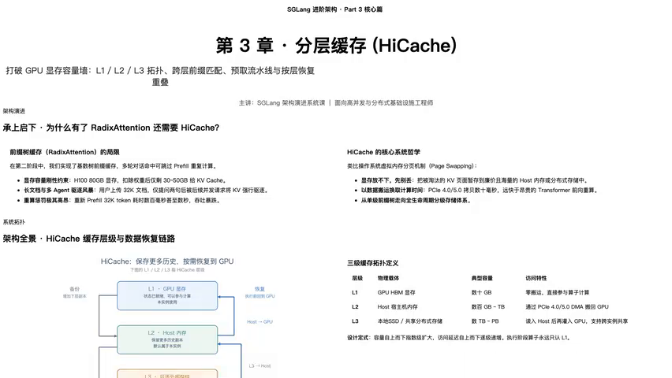

# 第 18 章 分层缓存

> 本章基于 Datawhale × RadixArk 的 zero-to-sglang 原课程《分层缓存》重组，原文见[《第3章_分层缓存.md》](https://github.com/datawhalechina/zero-to-sglang/blob/main/course-material/ch/part3/第3章_分层缓存.md)，采用 [CC BY-NC-SA 4.0](https://creativecommons.org/licenses/by-nc-sa/4.0/) 许可。

前缀缓存能避免重复计算，Paged KV Cache 能改善显存分配与回收，但两者都不能突破 GPU 显存容量。长文档、多轮对话或 Agent 工作流中的历史前缀一旦因容量压力被驱逐，再次出现时仍可能需要重算。SGLang HiCache 的思路是把可复用状态扩展到 Host 内存和可选外部存储，以额外搬运换取更少的重复 Prefill。

## 从 GPU 前缀缓存到 HiCache



*图 18.1　HiCache 将热数据留在 GPU，把较冷前缀扩展到主机内存乃至外部存储，并在需要时恢复。分层设计用访问延迟换取更大的有效缓存容量，缓解长前缀无法全部驻留显存的问题。（原课程视频帧，06:47）*


假设两次请求都以同一份长文档开头，只是后续问题不同。第一次请求计算出的文档 KV 可以服务第二次请求，但两次请求之间的其他流量可能已经把这段 KV 从 GPU 驱逐。

这里要区分三个问题：

- **分页**回答“KV 的显存块怎样分配、索引和回收”；
- **前缀复用**回答“哪些历史已经算过，可以不再执行前向”；
- **分层保存**回答“GPU 暂时放不下的历史，能否在其他介质保留并在需要时恢复”。

HiCache 解决第三个问题，同时沿用前缀匹配和分页管理。它不是无限显存，也不会扩大模型定义的最大上下文窗口。

## L1、L2、L3 的职责

| 层级 | 数据位置 | 命中后的使用方式 | 主要成本 |
| --- | --- | --- | --- |
| L1 | GPU 显存 | KV 已在计算设备上，可直接复用 | 容量最小，容易受到活跃请求挤压 |
| L2 | 本实例 Host 内存 | 分配 GPU 槽位，将所需 KV 恢复到 GPU | Host 容量、Host—GPU 带宽和恢复延迟 |
| L3 | 可选外部存储后端 | 通常先读取到 Host，再恢复到 GPU | 存储延迟、吞吐量、网络和一致性管理 |

L3 是可选层，并不天然等于共享存储；只有部署和配置支持共享时，才可能跨实例复用。层数增加意味着保存范围扩大，也意味着命中后的数据路径更长。因此“命中了下层缓存”不等于“无需等待”。

对全注意力模型，恢复对象主要是各层 KV。混合架构还可能涉及滑动窗口状态、Mamba 递归状态等，必须确认相应状态能否完整保存和恢复，不能只把普通 KV 的结论直接套用。

## 跨层前缀匹配

复用条件不是两份文本“语义相近”，而是从请求开头开始的 token 序列一致，并且模型、位置及缓存格式等上下文兼容。system prompt、模板或特殊 token 不同，都可能改变可复用前缀。

跨层匹配需要同时确定“相同前缀到哪里”和“对应状态在哪里”。其逻辑可抽象为：

```text
matched = empty prefix
for page in request.prefix_pages from left to right:
    location = local_index.lookup(parent=matched, tokens=page)
    if location is missing and L3 is enabled:
        location = remote_lookup(parent_digest(matched), page.tokens)
    if location is missing:
        break
    record(location, page)       # 查询索引，不代表数据已经到 GPU
    matched = matched + page
restore recorded states in prefix order
compute the suffix that was not matched
```

L1/L2 的本地索引可按 Radix 树组织；启用 L3 时，对本地未覆盖的后续缓存页按需查询。课程将远程 key 解释为结合当前页 token 与此前前缀的“前缀指纹”，用于防止相同局部文字在不同历史下错误复用。具体编码和查询机制以实现版本为准。

命中的各段必须从开头连续拼接。若前两段可用、第三段缺失，则不能跳过缺口直接使用第四段 KV，因为后面的状态依赖此前完整上下文。查到 L2/L3 副本也只是确认“有地方可取”，执行前仍须把连续可复用部分恢复到 GPU。

## 一次缓存的生命周期

第一次处理“文档＋问题甲”时，如果没有可用前缀，系统执行 Prefill，在 GPU 形成各层 KV。按照所选备份策略，HiCache 可以把适合保留的状态复制到 Host，必要时再写入 L3；GPU 原副本仍可继续服务当前计算。

**备份与驱逐是两个动作**：备份在下层增加副本，驱逐才回收 GPU 空间。若前缀未被选择备份，或备份尚未完成，GPU 副本被回收后仍可能需要重算。立即备份所有内容会增加未来命中机会，却也会消耗当前带宽和 Host/存储容量。

第二次处理“同一文档＋问题乙”时，可能出现四种情形：

1. **L1 命中**：直接复用仍在 GPU 的文档 KV。
2. **L2 命中**：GPU 副本已驱逐，从 Host 恢复所需状态。
3. **L3 命中**：本地副本不足，经存储读取、Host 中转后恢复到 GPU。
4. **未命中或部分命中**：对缺失后缀执行必要计算，并按策略建立新副本。

实际请求可以同时包含 L1、L2、L3 和新计算的后缀。缓存只省去可复用前缀的重复前向；新问题仍需计算，新增 token 的 Attention 仍要读取文档 KV，不能理解为“命中缓存后不再访问文档”。

## 恢复与重算的成本比较

对同一段前缀，忽略暂时无法重叠的其他成本，可写为：

$$
T_{L2}\approx T_{Host\rightarrow GPU}+T_{sync}
$$

$$
T_{L3}\approx T_{storage\rightarrow Host}+T_{Host\rightarrow GPU}+T_{sync}
$$

若恢复路径比重新计算更慢，下层命中反而可能增加首 token 延迟。可用下面的条件理解直接收益：

$$
T_{restore}+T_{extra}<T_{recompute}
$$

其中 $T_{extra}$ 包括排队、分配、同步及未被重叠的备份摊销等影响。数据量除以链路**有效**带宽只能给出传输部分的估算，真实结果还受并发竞争、存储负载、page 粒度和 GPU 计算速度影响。

备份成本也不能省略。如果大量写入的前缀再也没有出现，系统只付出了写入与保存成本。评估时应观察实际复用 token 数和后续端到端收益，而不是仅追求缓存项数量或命中率。

## 预取与按层恢复

### 在排队窗口中预取

若请求 B 尚在排队，而已知它的一段前缀只存在于 L3，系统可提前把数据读取到 Host，使存储访问与其他请求的 GPU 计算交叠。轮到 B 时，若数据已就绪，就减少临时读取的等待；但 Host—GPU 恢复仍然需要执行。

课程讨论了预取未完成时的三种策略：

| 策略 | 执行时数据未完全就绪的处理 | 权衡 |
| --- | --- | --- |
| `best_effort` | 使用已就绪前缀，其余部分重算 | 降低等待，可能牺牲复用量 |
| `wait_complete` | 等待预取完成 | 争取更多复用，可能延长排队 |
| `timeout` | 在限定时间内等待，之后使用已就绪部分 | 在等待与重算之间折中 |

没有固定最优策略。长前缀重算昂贵时，等待可能值得；短前缀或存储拥堵时，继续等待可能更慢。策略目标是完整请求的服务质量，而不是最大化命中长度。

### 让层间搬运与计算重叠

模型逐层执行，第 0 层的新增计算只需要第 0 层历史 KV，因此可在该层数据就绪后开始计算，同时继续恢复后续层。其抽象流水为：

```text
restore layer 0 KV
for layer l in 0 .. L-1:
    start restoring layer l+1 KV, if present
    wait until layer l KV is ready
    compute new tokens at layer l
```

真正的实现需要异步拷贝、事件和缓冲区协调。上述伪代码只表达依赖关系：第 $l$ 层计算之前，第 $l$ 层状态必须就绪。如果搬运跟不上，计算仍会停顿；重叠减少的是暴露的等待，不会消除传输本身。

## 适用边界与配置实践

更可能受益的负载包括：围绕同一长文档反复问答、多轮对话重复携带历史、Agent 多次使用相同任务前缀。还需存在 GPU 容量压力；如果热点前缀始终留在 L1，下层缓存带来的新增收益有限。

输入短、请求几乎没有共同前缀、复用间隔超过缓存保留期限（可保留窗口）、相关副本已因容量压力被淘汰，或传输链路已拥堵时，开启分层缓存可能只有成本。它主要减少重复 Prefill，不能据此推断 Decode 一定加快。

在兼容环境中，可从 GPU 与 Host 两层开始：

```bash
python3 -m sglang.launch_server \
  --model-path Qwen/Qwen3-0.6B \
  --enable-hierarchical-cache
```

该参数用于启用 HiCache，不会自动配置共享 L3。Host 池大小、备份策略、预取参数和存储后端应查阅安装版本文档。

## 实践检查

1. **连续性检查**：构造“L1 命中一段、L2 命中下一段、随后缺页”的请求，确认只复用连续前缀，不跨越缺口读取后续状态。
2. **身份检查**：改变前置 system prompt、模板或模型/缓存配置，验证不会仅因局部 token 相同而错误复用。
3. **生命周期检查**：区分计算、备份完成、GPU 驱逐和恢复四个事件，检查未完成备份不能被当作可恢复副本。
4. **成本对照**：在相同模型和请求下比较关闭与开启 HiCache，重复长前缀之间插入其他流量，分别记录 TTFT、吞吐、尾延迟、实际复用 token 数和恢复耗时。
5. **压力检查**：观察 Host 占用、Host—GPU 与存储有效带宽、预取等待以及 GPU 槽位分配，避免把排队时间误记为 kernel 重算时间。
6. **负例检查**：测试短输入、无重复前缀和一次性长前缀，确认系统在这些负载下不会被“更高命中率”这一单一指标误导。

本章的公式用于构建成本模型，不代表任何硬件上的实测结果；若开展实验，应保存版本、缓存容量、请求轨迹和带宽条件。

## 小结

HiCache 将前缀状态从 GPU L1 扩展到 Host L2 和可选外部存储 L3。跨层复用必须从请求开头连续匹配，并在计算前把所需状态恢复到 GPU。备份增加副本，驱逐释放显存，恢复则引入存储、传输和同步成本。预取与按层恢复可以隐藏部分等待，但不能改变数据依赖。只有在真实重复前缀上，节省的重算足以覆盖备份和恢复开销时，分层缓存才形成端到端收益。

## 参考资料

- [Datawhale × RadixArk 原课程：分层缓存](https://github.com/datawhalechina/zero-to-sglang/blob/main/course-material/ch/part3/第3章_分层缓存.md)
- [SGLang：HiCache 系统设计](https://github.com/sgl-project/sglang/blob/1d019ce1c85e11ff2f425344e66f446b106f6074/docs/docs/advanced_features/hicache_design.mdx)
- [SGLang：HiCache 使用与配置](https://github.com/sgl-project/sglang/blob/1d019ce1c85e11ff2f425344e66f446b106f6074/docs/docs/advanced_features/hicache_best_practices.mdx)
- [SGLang：HiCacheController 数据搬运实现](https://github.com/sgl-project/sglang/blob/1d019ce1c85e11ff2f425344e66f446b106f6074/python/sglang/srt/managers/cache_controller.py)
- [SGLang：Unified Radix Cache 状态管理](https://github.com/sgl-project/sglang/blob/1d019ce1c85e11ff2f425344e66f446b106f6074/python/sglang/srt/mem_cache/unified_radix_cache.py)
- [AI Infra Visualized：HiCache 可视化课程](https://yichizhang.dev/AI-Infra-Visualized/lessons/hicache/)
