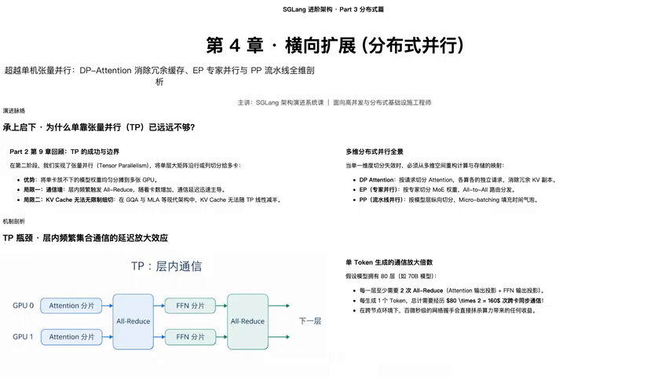

# 第 19 章 横向扩展：DP Attention、EP、PP

> 本章基于 Datawhale × RadixArk 的 zero-to-sglang 原课程《横向扩展》重组，原文见[《第4章_横向扩展.md》](https://github.com/datawhalechina/zero-to-sglang/blob/main/course-material/ch/part3/第4章_横向扩展.md)，采用 [CC BY-NC-SA 4.0](https://creativecommons.org/licenses/by-nc-sa/4.0/) 许可。

张量并行（TP）把同一层的矩阵分到多张 GPU，可分摊权重和计算，却不是增加卡数就必然加速。小 batch Decode 的计算本已较小，层内通信可能抵消收益；GQA、MLA 的共享缓存也使 KV 不能无限按 TP 切分。DP Attention、专家并行（EP）和流水线并行（PP）分别从请求、专家和模型层重新组织工作，为横向扩展提供不同路径。

## 先识别 TP 的边界



*图 19.1　张量并行能拆分单层计算，却也引入频繁的层内集合同步。横向扩展需要结合 DP-Attention、专家并行和流水线并行，在请求分工、专家分布与层间切分之间权衡通信开销。（原课程视频帧，08:05）*


在常见 TP Transformer 中，Attention 输出投影、FFN 输出投影等位置可能需要 All-Reduce 或其他集合通信。每个 token 经过多层，这类通信会反复发生。可用一个非常简化的关系理解扩展趋势：

$$
T_{step}(p)\approx T_{local\ compute}(p)+T_{communication}(p)+T_{sync}(p)
$$

增加并行度 $p$ 通常减少第一项，却未必减少后两项。跨节点时还要考虑网络带宽与延迟。这个表达式不是性能预测模型，只提醒我们不能用单卡计算时间除以卡数推算加速比。

KV Cache 也有结构约束：

- **MHA/GQA**：可按 KV head 切分时，每卡保存不同 head 的缓存。GQA 的 KV head 少于 Query head；当 TP 度数超过可完整切分的 KV head 数后，简单方案可能出现副本，单卡 KV 不再随 TP 等比下降。
- **MLA**：历史主要由多个 Query head 共享的低维 latent 状态表示，不能直接沿用“一卡一个独立 KV head”的切法。在复制状态的 TP 实现中，同一请求的缓存会在多卡重复保存。

具体显存结果取决于实现。重点是：模型已经通过 GQA 或 MLA 减少缓存，不等于 TP 仍能无限均分这些缓存。

## DP Attention：按请求分配注意力与 KV

不同请求的 Attention 通常相互独立。请求 A 的下一个 token 只读 A 的历史，请求 B 只读 B 的历史，因此可把请求分配给不同 GPU 或 GPU 组，各自计算 Attention 并保存相应 KV。

以四卡、四个请求为例，若基线 TP 实现在每卡复制四个请求的完整 KV，改为每卡负责一个请求后，每卡只保留自己的那份历史。释放的是**原本重复保存**的 KV，而不是所有场景都能额外获得四倍容量。

| 维度 | 复制 KV 的基线 | DP Attention 示例 |
| --- | --- | --- |
| 请求 A 的 Attention | 多卡 TP 协同 | 由负责 A 的卡或卡组执行 |
| 请求 A 的 KV | 可能在多卡重复 | 留在负责 A 的卡或卡组 |
| 请求间关系 | 共同参与层内 TP 通信 | Attention 阶段可独立推进 |
| 容量收益来源 | 按实现切分或复制 | 消除可避免的跨组缓存副本 |

若原基线的 KV 已能均匀切分，就没有同样的重复副本可消除。还要扣除 Attention 权重副本、临时缓冲区，并考虑请求长短与分配不均。可容纳请求数增加也不等于吞吐同比例增加，因为计算和通信能力仍有限。

### 注意力独立，不等于整层无通信

Attention 后的 FFN 或 MoE 可继续使用 TP 或 EP。此时需要把各请求的当前激活整理成后续并行布局，计算后再送回相应请求所属的数据布局：

```text
for each attention group:
    run Attention for its assigned requests using local KV
    keep those requests' historical KV in the local cache
rearrange current activations for TP-FFN or EP-MoE
run FFN / expert computation across the participating GPUs
route results back to the corresponding request layout
```

交换的是当前计算需要的激活和结果，不要求把完整历史 KV 随 token 搬到专家所在卡。Attention 本身也可在一小组 GPU 内使用 TP，再让不同小组处理不同请求。

普通数据并行通常为每组 GPU 放一份完整模型，各组独立完成推理；DP Attention 只对 Attention 按请求分工，后续 FFN/MoE 仍可由这些 GPU 协作。两者不应混称。

## EP：按专家分配 MoE 权重与计算

普通 FFN 中，每个 token 经过同一套网络。Mixture of Experts（MoE）包含多套专家网络，router 为每个 token 选择少数专家，并按路由权重合并结果：

$$
y_t=\sum_{e\in\operatorname{TopK}(t)}g_{t,e}E_e(x_t)
$$

专家是训练得到的参数集合，并不必然对应人类可解释的学科。虽然每个 token 只激活少数专家，不同 token 可能选择不同专家，常驻部署仍需保存全部专家权重。EP 将专家分到不同 GPU，使每卡只保存并计算其中一部分。

若 token 在 GPU 0 完成 Attention，却被路由到 GPU 1 的 E2 和 GPU 3 的 E7，则流程为：

1. **dispatch**：把 token 激活分别发送到 GPU 1 和 GPU 3；
2. **expert compute**：对应专家在本地执行计算；
3. **combine**：将结果送回并按 $g_{t,e}$ 合并，恢复请求所需布局。

一批 token 会选中不同卡上的专家，形成多对多交换，典型实现使用 All-to-All 类通信。每个 token 只需发给它选中的专家，而不是广播给所有专家；但被多个专家选中时会产生多份路由工作。

EP 的主要收益是分摊专家权重和计算，主要代价是 dispatch/combine 通信与等待。专家数量平均分卡也不保证负载均衡：若多数 token 集中选择少数专家，对应卡会成为瓶颈。

可定义某批中专家 $e$ 收到的 token 次数为 $n_e$。除了均值 $\bar n$，还应观察 $\max_e n_e$、各卡实际工作量和尾部分布。路由权重 $g_{t,e}$ 决定输出加权，不等于该专家的计算耗时或负载比例。

## PP：按连续层划分流水线

PP 将连续的若干层组成一个 stage。以 24 层、三个 stage 为例，可分别负责第 1—8、9—16、17—24 层。每个 stage 保存本段层的权重和相应 KV，计算后只把阶段边界的中间激活交给下一个 stage。

一个 stage 可以位于一张 GPU，也可由多张 GPU 通过 TP、DP Attention 或 EP 协作。PP 切的是**模型层**，不是 Prefill 与 Decode 两个推理阶段。

### 流水线气泡与 micro-batch

若只有一批数据，三个 stage 只能依次工作，其他设备处于等待。将请求组成多个 micro-batch 后，第 0 段把 A 交给下一段便可继续处理 B，各段逐渐同时忙碌。开始填充与结束排空时的空档称为流水线气泡。

在各 stage 耗时均为一个时间片、忽略通信的理想模型中，$P$ 个 stage、$M$ 个 micro-batch 的完成时间为：

$$
T_{ideal}=(P+M-1)\,\tau
$$

流水线利用率可表示为：

$$
U_{ideal}=\frac{PM\tau}{P(P+M-1)\tau}=\frac{M}{P+M-1}
$$

例如 $P=3,M=4$ 时需 6 个时间片，而不是各 micro-batch 完全串行地经过三段所需的 12 个时间片；理想利用率仍为 $4/6$，头尾气泡没有消失。这些只是说明调度关系的算术例子，不是实测加速比。

micro-batch 过小会降低单次计算效率并增加通信、调度次数；stage 耗时不均时，快阶段也要等待最慢阶段。自回归 Decode 还有严格依赖：同一请求的未来 token 尚未生成，不能把它们伪造为独立 micro-batch。多请求或独立工作才能为流水线提供可重叠任务，因此增加 PP stage 不保证降低单请求的逐 token 延迟。

## 组合方式与适用边界

| 方式 | 划分对象 | 主要收益 | 主要代价或瓶颈 |
| --- | --- | --- | --- |
| TP | 同一层的矩阵维度和计算 | 分摊单层权重与矩阵计算 | 层内频繁通信，过细分片降低计算效率 |
| DP Attention | 不同请求的 Attention 与 KV | 减少可避免的 KV 副本，按请求扩展 | 权重副本、请求负载不均、后续激活交换 |
| EP | MoE 的不同专家 | 分摊专家权重与专家计算 | All-to-All、热点专家和跨卡等待 |
| PP | 连续模型层组成的 stage | 将整模型分段部署到更多设备 | 阶段间传输、气泡、最慢 stage |

实际系统可先按 PP 划层，再在每个 stage 内组合 Attention 和 MoE 的并行方式。同一组 GPU 可在 Attention 与 MoE 阶段承担不同分工，所以不能看到 TP、DP、EP、PP 的数字就直接全部相乘得到总卡数，必须先画清设备组和各阶段映射。

选择依据应来自瓶颈：权重装不下时区分普通矩阵、专家或整段层；KV 副本过多时检查 Attention 的请求分配；通信占比过高时避免继续细切；流水线空闲时检查 micro-batch 和 stage 均衡。没有一种方式能同时消除显存、通信和调度问题。

## 实践检查

1. **TP 核算**：列出目标模型每层通信位置、每卡矩阵规模和 KV head 数，检查小 batch Decode 中通信是否可能抵消计算收益。
2. **DP 状态检查**：追踪两个长度不同的请求，确认历史 KV 只位于其 Attention 负责组，后续 TP/EP 只交换必要激活；记录负载是否偏向某一组。
3. **容量对照**：先确认基线究竟复制还是切分 KV，再估算 DP Attention 的节省，不套用固定倍数；同时计入权重和 workspace。
4. **EP 路由检查**：用少量 token 手工写出 Top-k 目标 GPU、dispatch、combine 和加权结果，随后统计每专家 $n_e$ 与每卡总工作量。
5. **PP 调度检查**：画出 $P=3$、$M=2$ 的时序并标出气泡；再改变最慢 stage 的耗时，观察最快阶段为何仍需等待。
6. **端到端评估**：若开展实验，固定模型、总设备数、输入输出分布与并发，记录吞吐、TTFT、TPOT/ITL、各集通信耗时和 GPU 空闲，不能把容量增长直接当作性能提升。

## 小结

TP 的继续扩展受层内通信和 KV 结构限制。DP Attention 按请求分配 Attention 与历史 KV，EP 按专家分配 MoE 权重和计算，PP 按连续层组织阶段。三者分别面对缓存副本、专家规模和整模型部署问题，同时引入激活交换、All-to-All、负载不均或流水线气泡。合理组合需要明确每张卡在每一阶段的职责，并用真实负载同时验证显存、通信、等待和端到端服务质量。

## 参考资料

- [Datawhale × RadixArk 原课程：横向扩展](https://github.com/datawhalechina/zero-to-sglang/blob/main/course-material/ch/part3/第4章_横向扩展.md)
- [SGLang：DP、DP Attention 与 DP Router](https://docs.sglang.io/docs/advanced_features/dp_dpa_smg_guide)
- [SGLang v0.4：Data Parallelism Attention for DeepSeek Models](https://www.lmsys.org/blog/2024-12-04-sglang-v0-4/)
- [SGLang：Expert Parallelism](https://docs.sglang.io/docs/advanced_features/expert_parallelism)
- [SGLang：Pipeline Parallelism](https://docs.sglang.io/docs/advanced_features/pipeline_parallelism)
- [SGLang：PD 分离与大规模 EP 部署案例](https://www.lmsys.org/blog/2025-05-05-large-scale-ep/)
- [GQA 论文](https://arxiv.org/abs/2305.13245)
- [DeepSeek-V2：Multi-head Latent Attention](https://arxiv.org/html/2405.04434v5#S2.SS1)
- [DeepSeek-V3：Inference and Deployment](https://arxiv.org/html/2412.19437v2#S3.SS4)
