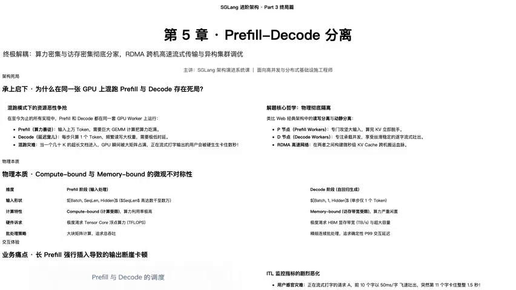

# 第 20 章 Prefill-Decode 分离

> 本章基于 Datawhale × RadixArk 的 zero-to-sglang 原课程《Prefill-Decode 分离》重组，原文见[《第5章_PrefillDecode分离.md》](https://github.com/datawhalechina/zero-to-sglang/blob/main/course-material/ch/part3/第5章_PrefillDecode分离.md)，采用 [CC BY-NC-SA 4.0](https://creativecommons.org/licenses/by-nc-sa/4.0/) 许可。

Prefill 处理输入并建立 KV Cache，Decode 复用这些状态逐 token 生成。二者共置于一组 GPU 时，长输入的 Prefill 可能插入已有请求的 Decode 轮次，使流式输出出现明显停顿。Prefill-Decode 分离（PD 分离）将两种工作交给不同设备组，以减少相互干扰并分别调优；代价是模型副本、KV 传输和更复杂的调度。

## 为什么两阶段会相互影响



*图 20.1　Prefill 与 Decode 的资源诉求不同，混合部署容易互相干扰。PD 分离让两类阶段在独立节点上扩缩容，再通过 RDMA 传输 KV Cache，以数据通路换取更灵活的调度与资源匹配。（原课程视频帧，03:15）*


Prefill 同时处理输入中的许多位置，形成较大的矩阵计算，长输入下通常更偏计算受限。普通 Decode 每条请求每轮只处理一个新位置，却仍要读取模型权重和历史 KV，小 batch 时更容易受显存带宽限制。这些只是常见负载特征，实际瓶颈仍需测量。

假设请求 A 正在输出，长文档请求 B 到达。若同组 GPU 接下来执行 B 的完整 Prefill，A 必须等到能够获得下一次 Decode 执行机会。对 A 来说，这表现为某个相邻 token 间隔突然增大。

- **ITL（Inter-Token Latency）**描述相邻输出 token 的间隔，适合观察这种局部停顿及其尾部分布。
- **TPOT（Time Per Output Token）**通常是整条请求的平均每 token 时间，一次长等待可能被平均值稀释。

因此平均 TPOT 变化不明显，并不能排除用户已经感受到卡顿。

Chunked Prefill 将 B 的输入分成多个块，让 A 的 Decode 有机会穿插执行，能够缩短单次等待。但块越小，B 的调度轮数越多；块越大，A 的单次等待越长。两种工作仍共享设备，计算、带宽和调度竞争不会因此消失。PD 分离则通过物理或逻辑资源分组改变这一执行关系。

## P 与 D 如何交接一条请求

负责 Prefill 的一端称为 P，负责 Decode 的一端称为 D。每一端可以是一张 GPU，也可以是一组使用 TP、EP 或 PP 的 GPU。两端都要运行模型的**全部层**，因此各自需要完整的模型权重；PD 不是把模型前半层给 P、后半层给 D。

一条请求的典型逻辑流程为：

1. Router 为请求选择 P 与 D，并协调接收资源。
2. P 对输入执行完整 Prefill，产生输入对应的各层 KV，并采样首个 token。
3. D 准备 KV 接收空间；P 传输所需 KV、首个 token 和必要请求元数据。
4. D 使用首个 token 与已接收历史继续前向，计算第二个 token，之后逐轮生成。
5. D 在本地缓存追加后续生成产生的 KV，直到停止条件满足。

```text
# P side
input_kv, first_token = full_model_prefill(input_tokens)
wait_until_D_receiver_is_ready(request_id)
send(request_metadata, first_token, input_kv)

# D side
allocate_receive_slots(request_id, expected_input_length)
receive(request_metadata, first_token, input_kv)
validate_layout_and_lengths()
next_token = full_model_decode(first_token, input_kv)
continue_decoding_with_local_KV(next_token)
```

伪代码强调状态依赖，不对应某个版本的函数签名。实现需要处理 page 布局、层顺序、dtype、传输完成通知、背压和失败清理。首个 token 由 P 产生，第二个 token 才由 D 基于交接状态继续计算，不能把“传 KV”误写为“传完整回答”。

分开后，B 在 P 上处理长输入时，A 可继续在 D 上 Decode。P 可以围绕输入 batch 和 Prefill 吞吐调优，D 则控制正在生成的请求规模及逐轮耗时。若两端采用不同设备，还必须具备模型格式、KV 表示和传输协议等兼容适配。

## KV 传输量与暴露延迟

共置执行时，输入 KV 可直接留在本组显存中继续使用；分离后，至少要把 D 所需的历史状态交付过去。对标准 MHA/GQA，一条长度为 $n$ 的输入，其 KV 数据量可估算为：

$$
S_{KV}=2\times L\times h_{kv}\times d_k\times n\times b_{KV}
$$

其中 $L$ 是层数，$h_{kv}$ 是 KV 头数，$d_k$ 是每头维度，$b_{KV}$ 是每元素字节数。GQA 应按 KV 头而非 Query 头计算，MLA 应使用实际 latent 等缓存布局，量化则改变 $b_{KV}$ 并可能增加 scale 元数据。

仅考虑传输，可用下式估算：

$$
T_{transfer}\gtrsim\frac{S_{KV}}{B_{effective}}+T_{setup}+T_{sync}
$$

$B_{effective}$ 是多请求竞争下的有效带宽，不是链路标称峰值。例如 1 GiB KV 在 20 GiB/s 有效带宽下，纯数据时间约为 50 ms；若有效带宽降为 5 GiB/s，则约为 200 ms。这两个数字只是教学估算，未计入排队、建立连接、同步和协议成本，也不是实测结果。

真正影响用户的只是**未被重叠的交接等待**。若 P 已算好部分层并提前发送，后续层计算可与前序层传输重叠；但 D 执行到某层之前，该层所需数据必须就绪。多条请求共享链路时，还要把排队纳入端到端测量。

## 资源比例与系统代价

P、D 各保存一份模型，权重显存投入增加。交接期间，同一输入 KV 还可能在发送缓冲区、接收端或中转路径短暂同时存在；D 接收后还要为整个剩余 Decode 保留缓存空间。模型原本就勉强装下时，再划出独立设备组未必可行。

两端也不应机械地平分 GPU。长输入短输出服务通常对 P 的输入处理能力要求较高，长输出服务会让请求长期占用 D。设请求到达率为 $\lambda$，平均输入、输出长度分别为 $\bar n_{in},\bar n_{out}$，若每个 P 组在目标并发下可持续处理 $C_P$ input token/s，每个 D 组可持续输出 $C_D$ output token/s，则容量初筛可写为：

$$
N_P C_P\gtrsim\lambda\bar n_{in},\qquad
N_D C_D\gtrsim\lambda\bar n_{out}
$$

$C_P,C_D$ 应来自相同模型与负载条件下的可持续容量，而非理论峰值。上述不等式只用于发现明显供给不足，不保证 TTFT、ITL 或尾延迟达标，也未包含前缀命中、动态 batch、长度方差和传输瓶颈。

运行时可观察排队位置辅助调整：P 前排队而 D 空闲，可能输入处理不足；P 已完成而 D 堆积，可能 Decode 容量不足；两侧都有余量但请求停在交接，则应优先检查网络、接收缓冲与同步。前两种现象也可能是调度或负载不均造成，不能只凭一个队列指标直接加卡。

| 收益 | 对应成本 | 失效或收益有限的条件 |
| --- | --- | --- |
| 隔离长 Prefill 对已有 Decode 的干扰 | 两份模型与独立 KV 资源 | 请求很少，分开后设备长期闲置 |
| P、D 分别选择 batch、并行和后端策略 | 路由、背压、失败恢复更复杂 | 运维和协议适配成本超过隔离收益 |
| 按输入、输出工作量独立扩缩容 | KV 传输与额外显存占用 | 短问短答，交接成本占比过高 |
| 支持适配后的异构设备组合 | dtype、布局、协议兼容要求 | 网络慢或 KV 数据量过大 |

## 与缓存和传输优化的配合

减少 KV 交接成本可从三个方向入手：

1. **减少数据量**：两端支持时采用更低精度 KV，但必须同时验证 Attention 后端兼容性和任务精度。
2. **提高有效带宽**：依据设备拓扑选择适当传输方式，例如 RDMA，并检查多请求竞争下的实际吞吐，而不只看链路规格。
3. **重叠计算与传输**：按层或分块提前发送已就绪 KV，减少最后集中搬运的暴露等待，同时满足每层数据依赖。

前缀缓存和 HiCache 主要减少 P 的重复 Prefill。若 P 从缓存恢复了文档 KV，而 D 没有副本，这段状态仍需通过交接提供给 D；只有 D 也保存兼容前缀，且路由和传输协议支持复用时，才可能只传缺失部分。**P 少算**与**D 少收**是两个不同收益，不能混为一谈。

## 适用边界与性能评估

持续有新请求进入、长输入与长输出并存，且已有 Decode 经常受 Prefill 干扰的服务，更值得评估 PD 分离。长文档问答要同时检查 KV 传输量，长回答生成则重点关注 D 的容量。少量短问短答、单组 GPU 本已空闲的场景，分离可能只增加模型副本和交接成本。

比较共置与分离时，应尽量固定总 GPU 数、模型、精度、输入输出长度分布、并发和请求轨迹，并给出 Chunked Prefill 等合理共置基线。至少记录：

- 端到端 TTFT，包含适用的 P/D 排队和交接等待；
- ITL 的分布与尾部，而非只看平均 TPOT；
- 输入、输出 token 吞吐及完成请求吞吐；
- P/D 各自队列、活跃请求、KV 占用与设备利用率；
- KV 数据量、有效带宽、传输等待和失败/重试情况。

公开部署结果若同时改变 PD、EP、batch 或设备规模，不能把全部提升归因于 PD。判断单项收益时，应一次只改变目标因素，或明确报告整套组合方案，避免混淆“系统总收益”与“PD 的独立贡献”。

## 实践检查

1. **交接追踪**：用一条短请求标出输入 KV、首个 token、第二个 token 的产生位置，确认 P、D 都执行完整模型，且后续 KV 在 D 本地追加。
2. **传输估算**：依据目标模型实际层数、KV 头和 dtype 计算 $S_{KV}$，再除以不同有效带宽；将结果明确标为估算，并另计同步和排队。
3. **停顿复现**：在共置基线中让长输入与持续 Decode 混合，比较 ITL 尾部与平均 TPOT，再加入 Chunked Prefill，观察两种指标的变化差异。
4. **配比检查**：分别构造长输入短输出、短输入长输出和混合负载，检查 P/D 队列及链路，而不是默认两端卡数相等。
5. **缓存检查**：分别验证“仅 P 命中”和“D 也有兼容前缀”两种情形，记录少算与少传是否真正同时发生。
6. **公平对照**：若开展实验，保存总资源、模型版本、并行配置和完整请求轨迹；不得把包含 EP、batch 改变等多项优化的公开数字当成本地 PD 单独实测。

## 小结

PD 分离让 P 专注输入 Prefill，让 D 基于接收的 KV 和首个 token 继续生成，从而减少长 Prefill 对已有 Decode 的直接干扰，并允许两端独立扩缩容和调优。它不会把模型切成两半，也不会免除 KV 依赖：两端各需完整权重，交接还要消耗显存、网络与同步时间。是否值得采用，应结合输入输出分布、有效带宽、前缀复用和资源配比，用 TTFT、ITL 尾部与端到端吞吐共同判断。

## 参考资料

- [Datawhale × RadixArk 原课程：Prefill-Decode 分离](https://github.com/datawhalechina/zero-to-sglang/blob/main/course-material/ch/part3/第5章_PrefillDecode分离.md)
- [SGLang：PD Disaggregation](https://docs.sglang.io/docs/advanced_features/pd_disaggregation)
- [SGLang：Prefill 端首个 token 与 KV 交接实现（main）](https://github.com/sgl-project/sglang/blob/main/python/sglang/srt/disaggregation/prefill.py)；该路径当前可访问，但 main 上的文件和函数会随版本演进，核对实现时应结合所安装版本或对应 tag/commit。
- [SGLang：KV Cache 量化](https://docs.sglang.io/docs/advanced_features/quantized_kv_cache)
- [SGLang：Benchmark and Profiling](https://docs.sglang.io/docs/developer_guide/benchmark_and_profiling)
- [SGLang：PD 分离与大规模 EP 部署案例](https://www.lmsys.org/blog/2025-05-05-large-scale-ep/)
