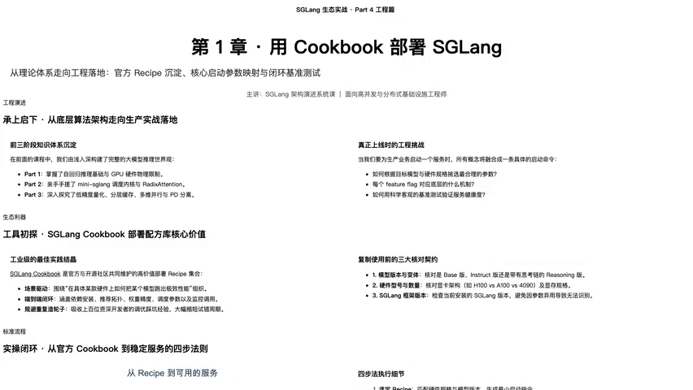

# 第 21 章 用 Cookbook 部署 SGLang

> 本章基于 Datawhale × RadixArk 的 zero-to-sglang 原课程《用 Cookbook 部署 SGLang》重组，原文见[课程文件](https://github.com/datawhalechina/zero-to-sglang/blob/main/course-material/ch/part4/第1章_用Cookbook部署SGLang.md)，采用 [CC BY-NC-SA 4.0](https://creativecommons.org/licenses/by-nc-sa/4.0/) 许可。

前面各章分别讨论了并行、量化、前缀缓存与分离式部署。真正启动服务时，这些知识会汇聚为一组相互约束的配置：加载哪个模型、使用几张 GPU、采用什么精度、监听哪个地址。本章以官方 Cookbook 的 Qwen3 recipe 为起点，走完“选择配置—启动—请求—检查—基准测试”的部署闭环。

## 环境与流程定位



*图 21.1　Cookbook 将部署经验整理为可复用 Recipe：先按模型和硬件选择配置，再启动服务并验证接口。它把零散的命令与参数组织成可重复执行的部署路径。（原课程视频帧，04:20）*


本章属于课程的实践与贡献部分，重点不是修改推理算法，而是把算法配置转化为可验证的服务。完整流程为：**匹配 recipe → 启动服务 → 验证接口 → 检查日志与显存 → 固定负载测量 → 单变量调整**。

原课程示例假定一台装有单张 H100 80GB 的 Linux GPU 机器，已按官方安装指南准备好 SGLang、模型访问权限和可用网络。其他 GPU 不应直接照抄该配置，而应在 recipe 的交互式命令生成器中重新选择硬件、模型规模与精度。首次启动还可能需要下载权重并占用相应磁盘空间。

> **执行状态说明：**下文部署、请求和 benchmark 命令均取自原课程或其列出的 SGLang 官方文档，未在本机执行。Bash 代码块是可执行命令而非伪代码；本章不虚构启动日志、模型回答或性能数字。实际参数应以所安装版本的文档和 `--help` 为准。

## Cookbook 提供的是什么

[SGLang Cookbook](https://docs.sglang.io/cookbook/intro) 是按模型和硬件组织的部署 recipe 集合。它通常给出安装入口、推荐启动参数、调用方式与调优建议，帮助使用者从经过实践的配置开始，而不是逐个猜测命令行选项。

Recipe 不是跨环境通用的保证。复制前应至少核对五项：

1. **模型标识**：名称、规模和具体 revision 是否符合任务，权重是否可访问；
2. **硬件条件**：GPU 型号、数量、单卡显存及互联条件是否匹配；
3. **权重与计算精度**：BF16、FP8 等选择是否同时受权重格式、硬件和后端支持；
4. **软件版本**：SGLang 及其依赖是否满足 recipe 要求，旧版入口或参数是否不同；
5. **服务功能**：是否确实需要 reasoning parser、tool call parser、投机解码等可选能力。

本章沿用原课程的 Qwen3 示例：在 `Autoregressive Models → Qwen → Qwen3` 中选择 H100、8B、BF16，并将可选的 Reasoning Parser 与 Tool Call Parser 设为 Disabled。这样先验证基本推理路径，避免把解析器配置与首次部署问题混在一起。

## 启动服务

以下命令显式写出模型、精度、张量并行度和监听地址。官方生成器中的 `--model` 与此处的 `--model-path` 是同一参数的两种写法。

```bash
python3 -m sglang.launch_server \
  --model-path Qwen/Qwen3-8B \
  --dtype bfloat16 \
  --tp-size 1 \
  --host 127.0.0.1 \
  --port 30000
```

| 配置 | 本例含义 | 调整时的约束 |
| --- | --- | --- |
| `--model-path` | 加载 `Qwen/Qwen3-8B` | 可换为 recipe 支持的模型 ID 或本地权重目录 |
| `--dtype bfloat16` | 使用 BF16 | 不能把权重格式、硬件支持和计算精度混为一谈 |
| `--tp-size 1` | 单卡，不做张量并行切分 | 多卡 TP 会引入切分与卡间通信 |
| `--host 127.0.0.1` | 只监听本机回环地址 | 客户端与服务端在同一机器；远程暴露需另行评估访问控制 |
| `--port 30000` | 使用 30000 端口 | 改端口时，请求与 benchmark 地址必须同步修改 |

本例保留默认前缀缓存。`--disable-radix-cache` 可用于对照实验，但关闭后不能仍把跨请求前缀复用当作性能来源。量化、EP、PD 分离等配置也应回到对应 recipe，而不是向基础命令无依据地叠加参数。

## 验证服务

### 发送一条真实请求

等服务完成权重加载和初始化后，在同一台机器的另一个终端执行以下命令。这里使用 Qwen3 的 non-thinking 模式，使首次连通性检查保持简短。

```bash
curl --fail-with-body http://127.0.0.1:30000/v1/chat/completions \
  -H 'Content-Type: application/json' \
  -d '{
    "model": "Qwen/Qwen3-8B",
    "messages": [{"role": "user", "content": "用一句话解释什么是 KV Cache。"}],
    "max_tokens": 128,
    "chat_template_kwargs": {"enable_thinking": false}
  }'
```

首先检查 HTTP 请求是否成功，再检查 JSON 中的 `choices[0].message.content` 是否为正常文本，并确认回答与问题相关。一次成功回答只能证明基本请求链路可用，不能证明高并发性能、长上下文稳定性或模型精度达标。

### 检查日志、进程与显存

回到服务终端，核对实际加载的模型、精度、并行配置和监听端口，检查初始化及请求阶段是否出现异常。另一个终端可执行：

```bash
nvidia-smi
```

用其确认 GPU 进程和显存占用，而不是把某次占用数字当作固定答案。显存中除了权重，还包括 KV Cache、运行时工作区等；服务驻留时占用较高并不自动意味着泄漏。首条请求还可能触发额外初始化，因此性能比较要保持一致的 warmup 方式。

常见故障可按阶段排查：权重下载失败时检查网络、访问权限与磁盘空间；权重加载阶段显存不足与运行阶段缓存不足应分别处理；端口冲突时修改服务端和客户端两处端口。不要只看到最终报错就同时更改多项配置。

## 用小规模 benchmark 验证

服务保持运行，在同一个 Python 环境中执行原课程采用的官方 serving benchmark：

```bash
python3 -m sglang.benchmark.serving \
  --backend sglang \
  --host 127.0.0.1 --port 30000 \
  --model Qwen/Qwen3-8B \
  --dataset-name random \
  --random-input-len 256 --random-output-len 64 \
  --random-range-ratio 1 \
  --num-prompts 80 --max-concurrency 4 \
  --seed 42
```

该练习使用随机数据、256 token 输入和 64 token 目标输出，共发送 80 条主测试请求，最多并发 4 条。旧版 SGLang 可能使用 `sglang.bench_serving` 入口，应按安装版本核对，不能将新旧参数混用。

阅读结果时按以下顺序进行：

- **成功请求数**：先确认负载确实完成，失败后的吞吐数字没有同等意义；
- **TTFT**：从发起到首个 token 的等待，包含请求路径、排队和 Prefill 等影响；
- **TPOT**：首 token 之后的平均每输出 token 时间。`tokens > 1` 时，官方工具按 `(latency - ttft) / (tokens - 1)` 计算；`tokens = 1` 时分母为零，该数学定义无定义。SGLang `bench_serving` 为统计和 Goodput 将单 token 响应的 TPOT 记为 `0`，这是工具约定，不是真实零延迟；
- **输出吞吐**：单位时间生成的 token 数，必须连同并发、输入输出长度和成功请求数报告。

这组小测试适合验证连通性和建立个人基线，不代表生产容量，也不能用随机文本判断回答质量。若比较优化前后结果，应关闭 profiling、固定硬件与版本，重复测量并记录波动，而非只挑选一次较快的运行。

## 单变量调整与结果记录

建立基线后，每次只改变一个变量。例如，在 recipe 明确支持时比较 BF16 与 FP8，或者比较启用与禁用 Radix Cache。测试前停止旧服务，使用相同模型、数据集、随机种子、请求数、并发和 warmup；比较缓存时还应使用具有共同长前缀的负载，并让两组从相同的缓存状态开始。

实验记录至少包含 recipe 链接、GPU、SGLang 版本、完整命令、成功请求数、TTFT、TPOT、输出吞吐和重复次数。没有明显收益也是有效结论；若收益伴随失败请求、输出异常或精度下降，则不能仅凭吞吐宣布优化成功。

## 实践检查

1. 为自己的设备选择一份 recipe，列出模型、GPU、显存、精度和 SGLang 版本，说明每个选择来自页面何处。
2. 启动基础服务并发送一条请求，保存完整命令和真实返回；确认模型标识与监听地址一致，不抄写本章未执行的结果。
3. 对照服务日志与 `nvidia-smi`，判断下载、加载、初始化和请求分别处于什么状态，记录实际故障所在阶段。
4. 运行小规模 benchmark，检查成功请求数后再整理 TTFT、TPOT 与输出吞吐，并注明输入输出长度、并发及 warmup。
5. 设计一次单变量对照：写出保持不变的条件、唯一变化和正确性检查。解释为何随机数据吞吐不能替代模型质量评估。

## 小结

Cookbook 的价值在于提供有适用条件的部署起点，而不是免除环境核对。可靠部署应先匹配模型、硬件、精度与版本，再通过真实请求、日志、显存和固定负载逐层验证。调整配置时坚持单变量、同条件和可重复测量，才能把“服务能启动”推进为“结果可解释、实验可复现”。

## 参考资料

- [Datawhale × RadixArk 原课程：用 Cookbook 部署 SGLang](https://github.com/datawhalechina/zero-to-sglang/blob/main/course-material/ch/part4/第1章_用Cookbook部署SGLang.md)
- [SGLang Cookbook](https://docs.sglang.io/cookbook/intro)
- [SGLang：Qwen3 recipe](https://docs.sglang.io/cookbook/autoregressive/Qwen/Qwen3)
- [SGLang：安装指南](https://docs.sglang.io/docs/get-started/install)
- [SGLang：Server Arguments](https://docs.sglang.io/docs/advanced_features/server_arguments)
- [SGLang：Bench Serving Guide](https://docs.sglang.io/docs/developer_guide/bench_serving)
