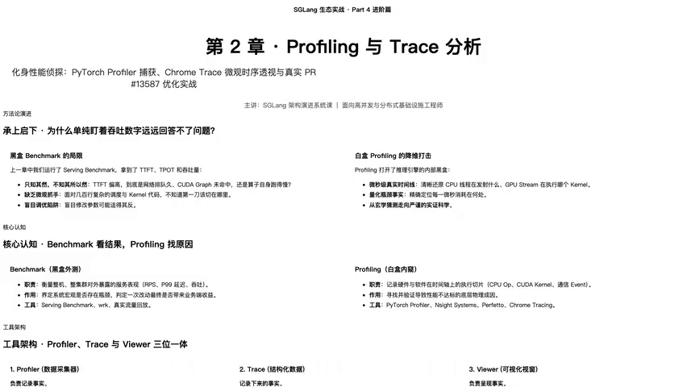

# 第 22 章 Profiling 与 Trace 分析

> 本章基于 Datawhale × RadixArk 的 zero-to-sglang 原课程《Profiling 与 Trace 分析》重组，原文见[课程文件](https://github.com/datawhalechina/zero-to-sglang/blob/main/course-material/ch/part4/第2章_Profiling与Trace分析.md)，采用 [CC BY-NC-SA 4.0](https://creativecommons.org/licenses/by-nc-sa/4.0/) 许可。

Benchmark 能告诉我们要不要优化，却未必能说明时间花在哪里。TTFT 升高可能来自排队，也可能来自 Prefill；TPOT 抖动可能涉及 Decode、调度或通信。本章把请求侧指标与 CPU/GPU 时间线结合起来，形成“发现症状—提出假设—采集证据—修改—回归验证”的分析闭环。

## 环境与流程定位



*图 22.1　Benchmark 告诉我们性能是否达标，Profiling 与 Trace 则帮助解释时间花在哪里。结合 CPU 事件、GPU Kernel 和时间线 Viewer，才能把性能症状转化为可验证的优化假设。（原课程视频帧，04:56）*


本章面向已经能够启动 SGLang 服务的读者。练习需要受支持的 GPU、可容纳模型的运行环境、一个服务终端和一个客户端终端，以及可写入 trace 的目录；浏览器中的 Perfetto 或 Chrome Tracing 用于查看结果。多卡或多机实验还要记录 rank、并行方式与各节点路径，不能把不同执行阶段的时间线直接混在一起。

> **执行状态说明：**下文采集命令来自 SGLang 官方 Benchmark and Profiling 文档，未在本机执行。Bash 块是替换占位符后可执行的命令，标注为“伪代码”的块只用于解释流程。PR 中的数字均为原作者公开记录，不是本章实测输出。

## Benchmark、Profiler 与 Trace 的分工

| 工具或产物 | 回答的问题 | 不能单独证明什么 |
| --- | --- | --- |
| Benchmark | TTFT、TPOT、ITL、吞吐和端到端延迟是否变化 | 某个 kernel 就是变化原因 |
| PyTorch Profiler | 在选定窗口记录 CPU operator、GPU kernel 等事件 | 未采集时段或其他负载也具有相同行为 |
| Trace | 各事件何时发生、持续多久、如何重叠或等待 | 仅凭色块宽度即可推出端到端加速比 |
| Perfetto / Chrome Tracing | 将 trace 可视化为可筛选的时间线 | 替代正确性测试与对照实验 |

因此，合理顺序不是“先采集一份很大的文件再找问题”，而是先固定模型、硬件、版本、输入输出长度和并发，用 benchmark 明确症状，再提出可检查的假设并缩短采集窗口。修改后先确认目标开销和正确性，再关闭 profiler 重跑端到端测试。

## 采集一次在线服务 Trace

### 启动带管理密钥的服务

官方示例使用 `meta-llama/Llama-3.1-8B-Instruct`；实际使用时需要相应模型访问权限，也可按官方说明替换为已部署模型，但客户端 `--model` 必须与服务一致。下面的 `/root/sglang/profile_log` 是官方示例路径，非 root 环境应改为可写目录。

```bash
# 服务终端；先替换 <your-admin-api-key>
export SGLANG_TORCH_PROFILER_DIR=/root/sglang/profile_log
export SGLANG_ADMIN_API_KEY=<your-admin-api-key>
python -m sglang.launch_server --model-path meta-llama/Llama-3.1-8B-Instruct
```

`SGLANG_ADMIN_API_KEY` 保护 `/start_profile` 和 `/stop_profile` 管理端点。普通 `--api-key` 不能代替它；未配置管理密钥时，这些端点会返回 HTTP 403。密钥不应写入公开日志、截图或 PR。

### 用 benchmark 自动开始和结束采集

在客户端终端设置同一密钥和输出目录，再执行官方命令。`--profile` 会调用开始与结束端点，不需要另外手动停止。

```bash
# 客户端终端；占位符必须替换为与服务端相同的密钥
export SGLANG_ADMIN_API_KEY=<your-admin-api-key>
export SGLANG_TORCH_PROFILER_DIR=/root/sglang/profile_log
python -m sglang.benchmark.serving --backend sglang --model meta-llama/Llama-3.1-8B-Instruct --num-prompts 10 --sharegpt-output-len 100 --profile
```

对于 `bench_serving --profile`，客户端从 `--profile-output-dir` 或 `SGLANG_TORCH_PROFILER_DIR` 选择目录，并在开始请求中发送给服务端；直接调用 `/start_profile` 且省略 `output_dir` 时，才由服务端自身环境变量决定位置。官方建议在两端都设置该变量，远程执行时还要确认目录位于哪台机器。

若需要跳过预热并限定步数，可在负载运行期间使用官方 HTTP API。以下是**可执行的 `curl` 命令**，其中 `start_step=5` 表示从第 5 步开始，`num_steps=10` 表示共采集 10 步并自动停止。

```bash
curl -X POST http://127.0.0.1:30000/start_profile \
  -H "Authorization: Bearer ${SGLANG_ADMIN_API_KEY}" \
  -H "Content-Type: application/json" \
  -d '{
    "output_dir": "/tmp/profiles",
    "start_step": 5,
    "num_steps": 10,
    "activities": ["CPU", "GPU"]
  }'
```

若开始请求没有 `num_steps`，则必须在采集结束后调用 `/stop_profile`；自动停止的请求不应再重复停止。最终以服务端日志报告的 trace 保存路径为准，并核对请求是否成功、采集窗口是否覆盖目标 Prefill 或 Decode。

## 怎样阅读时间线

将生成的 trace 导入 [Perfetto UI](https://ui.perfetto.dev/)，或在 Chrome 中打开 `chrome://tracing`。这是查看器操作，不是 shell 命令。时间线横轴表示时间，CPU thread、GPU stream 等通常分属不同 track，色块宽度对应事件持续时间。

阅读时集中检查四类证据：

1. **长事件**：找目标阶段中持续时间突出的 operator 或 kernel，再对应源码与调用关系；
2. **重复事件**：单次很短的操作可能在多层、多步中反复执行，总成本仍然可观；
3. **空隙与等待**：某个 stream 的空隙不等于整张 GPU 空闲，应检查其他 stream、CPU 提交、同步和依赖；
4. **重叠与关键路径**：不同 stream 可重叠，把所有 duration 相加不等于请求延迟，要识别真正限制完成时间的路径。

CPU 上“发起 kernel”与 GPU 上“执行 kernel”不是同一时刻，也不应混算。截图中的名称可能被截断，需结合完整事件、源码和 diff 确认身份。若要从 CUDA kernel 回溯 SGLang Python 源码，官方文档建议启动服务时使用 `--disable-cuda-graph`；但禁用 CUDA Graph 会改变执行方式，所得性能不能直接代表原配置。

Trace 过大时，应减少请求数、输出长度或采集步数，而不是盲目扩大文件。采集本身有开销，优化后的正式 benchmark 应关闭 profiler，并确保对照组与实验组采用相同采集策略。

## 从症状到结论的分析伪代码

下面只描述分析逻辑，**不是可直接运行的 Python 程序**。其中函数名代表实际要完成的 benchmark、profiling 和测试步骤。

```python
baseline = benchmark(fixed_config, fixed_workload)
hypothesis = formulate_from_symptom(baseline)
trace_before = profile_same_stage(fixed_config, fixed_workload, short_window)

if not trace_supports(trace_before, hypothesis):
    revise_hypothesis_and_repeat()
else:
    patch = make_one_focused_change()
    verify_correctness(patch)
    trace_after = profile_same_stage(patch, fixed_workload, short_window)
    verify_target_cost(trace_before, trace_after)
    result = benchmark_without_profiler(patch, fixed_workload)
    report_environment_variance_and_untested_cases(result)
```

关键是每一步都能被证据推翻。没有找到目标事件、对照负载不同或正确性失败时，都不能沿用原先的优化叙事。

## 案例：PR #13587 省掉独立 padding kernel

原课程选用 BBuf 的 [SGLang PR #13587](https://github.com/sgl-project/sglang/pull/13587) 展示这条证据链。该 PR 于 2025-11-21 合并，针对 MoE alignment 路径。Token 分配给 expert 后，工作量需要补齐到 block size 的整数倍；padding 位置使用无效 token 标记，后续计算会忽略它。

优化前，小 buffer 在 alignment kernel 内完成 padding；超过 4,096 个元素时，则先执行 `sorted_ids.fill_()`，再执行 alignment。作者提出的假设是：已有 kernel 能否接手这条路径的 padding，从而省去独立 kernel？

以下是依据合并 diff 缩写的**教学伪代码，不可直接运行**；省略号表示原函数参数。

```python
# Before
fuse_sorted_ids_padding = sorted_ids.shape[0] <= 4096
if not fuse_sorted_ids_padding:
    sorted_ids.fill_(topk_ids.numel())
sgl_moe_align_block_size(..., fuse_sorted_ids_padding)

# After
sgl_moe_align_block_size(..., True)
```

固定提交的 CUDA 实现表明，`pad_sorted_token_ids` 为真时仍会写入必要标记。因此优化删除的是独立 `fill_` 的启动与执行开销，不是删除正确性所需的填充。阅读 trace 时，Before 中 alignment 前的独立事件在 After 中消失，恰好与这一代码机制对应。

**以下数字均为 PR 作者公开记录，并非本章本机实测。**作者截图中，对齐后的局部选区从 7.854 μs 降至 6.544 μs，约减少 16.7%。其 DeepSeek-R1、TP8 benchmark 使用输入/输出长度均 1,000、`random-range-ratio=1` 和每组 5 个 warmup 请求，结果如下：

| 最大并发 | 请求数 | Output throughput：main → PR（token/s） | Mean TPOT：main → PR（ms） |
| --- | --- | --- | --- |
| 1 | 5 | 105.806 → 105.542 | 9.067 → 9.164 |
| 4 | 20 | 372.914 → 373.976 | 10.243 → 10.211 |
| 16 | 80 | 1,049.407 → 1,060.126 | 14.590 → 14.482 |
| 32 | 160 | 1,657.395 → 1,675.659 | 18.158 → 18.030 |

局部耗时下降没有转化为同比例端到端收益，各并发档位的吞吐变化约为 −0.25% 至 +1.10%。模型还包含大量其他计算，一次测量也存在波动，因此不能把局部微秒数直接外推为服务加速比。

PR 正文另附一次 GSM8K 记录：完成 1,319 道题，accuracy 为 0.938，invalid 为 0。这说明作者检查了输出，但没有成对的 main/PR accuracy，不能据此声称两版完全等价。这个案例的价值正在于范围小、trace 与代码机制一致，同时清楚保留端到端收益和验证范围的边界。

## 验证方法与实践检查

1. **采集验证**：完成一次短 trace，记录模型、硬件、版本、完整启动与负载命令、输出目录和实际保存路径，确认没有泄露管理密钥。
2. **时间线验证**：分别找出一个长事件、一组重复事件和一处空隙；写明观察到的事实、对应假设以及仍需排除的解释。
3. **对照验证**：在相同 rank、阶段、输入输出长度与并发下比较修改前后 trace，不用不同负载的截图拼接结论。
4. **端到端验证**：关闭 profiler，重复运行相同 benchmark，报告成功请求数、延迟、吞吐和波动，同时执行与改动相匹配的正确性测试。
5. **概念检查**：解释为何单个 stream 有空隙不代表 GPU 全部空闲，以及 kernel 快 20% 为何不等于服务吞吐提高 25%。

## 小结

Benchmark 界定性能症状，Profiler 采集内部事件，Trace 则帮助检验原因。可信分析必须固定环境与负载，把长事件、重复、空隙和依赖对应到代码，并在修改后同时验证目标开销、端到端表现和正确性。局部优化只能在其关键路径占比和实际负载允许的范围内转化为整体收益。

## 参考资料

- [Datawhale × RadixArk 原课程：Profiling 与 Trace 分析](https://github.com/datawhalechina/zero-to-sglang/blob/main/course-material/ch/part4/第2章_Profiling与Trace分析.md)
- [SGLang：Benchmark and Profiling](https://docs.sglang.io/docs/developer_guide/benchmark_and_profiling)
- [SGLang：Bench Serving Guide](https://docs.sglang.io/docs/developer_guide/bench_serving)
- [PyTorch Profiler Recipe](https://docs.pytorch.org/tutorials/recipes/recipes/profiler_recipe.html)
- [SGLang PR #13587：原始 trace、代码与测试记录](https://github.com/sgl-project/sglang/pull/13587)
- [PR #13587：DeepSeek-R1 benchmark 评论](https://github.com/sgl-project/sglang/pull/13587#issuecomment-3558359315)
- [PR #13587 合并提交 bfcf15a](https://github.com/sgl-project/sglang/commit/bfcf15a129fd4e26ef8d4af140f30cbcf02a6696)
- [固定提交中的 CUDA padding 实现](https://github.com/sgl-project/sglang/blob/bfcf15a129fd4e26ef8d4af140f30cbcf02a6696/sgl-kernel/csrc/moe/moe_align_kernel.cu)
