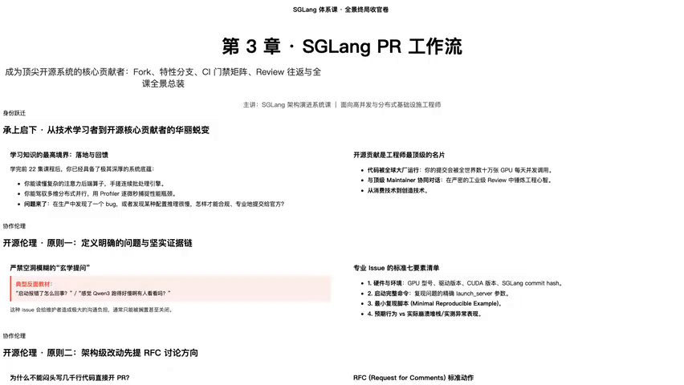

# 第 23 章 SGLang PR 工作流

> 本章基于 Datawhale × RadixArk 的 zero-to-sglang 原课程《SGLang PR 工作流》重组，原文见[课程文件](https://github.com/datawhalechina/zero-to-sglang/blob/main/course-material/ch/part4/第3章_SGLangPR工作流.md)，采用 [CC BY-NC-SA 4.0](https://creativecommons.org/licenses/by-nc-sa/4.0/) 许可。

发现一条过期命令、一个可复现的错误或一处有证据支持的开销，都可能成为开源贡献的起点。但“改完代码”只是中间步骤：维护者还需要理解问题、检查范围、复现验证，并通过 CI 与 Review 判断修改是否适合共同维护。本章按官方流程梳理一次 PR 从准备到合并的完整路径。

## 流程定位与协作前提



*图 23.1　一个 PR 从问题定义开始，经分支开发、自动化 CI 与 Review 反馈逐步走向合并。清晰的复现材料、聚焦的改动和及时响应评审，是进入 SGLang 开源协作流程的基本功。（原课程视频帧，01:19）*


SGLang 的典型贡献路径是：**明确问题 → Fork → 配置上游仓库 → 建立任务分支 → 小范围修改与验证 → 推送并创建 PR → CI/Review 往返 → 审批合并**。Fork 解决上游写权限问题，任务分支隔离不同工作，CI 自动检查可验证的规则，Review 则判断正确性、设计与维护成本。

> **执行状态说明：**本章命令整理自 SGLang 官方贡献指南、安装指南以及 GitHub 官方 Fork/PR 文档，未在本机执行。`<your_user_name>`、`<path-to-changed-file>` 等是必须替换的占位符。代码块中的 Git/Bash 行是终端命令，PR 评论命令和文字提纲会另行标明；本章不虚构 CI、Review 或合并结果。

官方文档会持续更新，实际操作应优先阅读当时的 Contribution Guide、仓库 PR 模板和 CI 权限说明。使用 AI 辅助并不改变作者责任：必须自己读懂修改、执行可行的验证、如实报告未测试部分，避免批量制造低质量 issue 或 PR。

## 第一步：定义范围合适的问题

先搜索已有 issue 和 PR，避免重复工作。Bug 报告应提供最小复现、预期与实际行为、相关日志、模型、GPU、SGLang 版本或 commit 以及启动命令；性能问题还应在相同硬件、模型和负载下给出前后 benchmark 与必要的 profiling。

新功能、接口调整或较大的性能改造，宜先通过 RFC 或 issue 讨论使用场景、方案和影响范围。明确的错字或小修复通常可以直接开 PR。一个 PR 聚焦一个问题，不在修调度 bug 时顺手重排整个文件，也不把无依据的“重构优化”混入文档修复。

尚无明确任务时，可以从官方标注的 `good first issue` 或 `help wanted` 入手；文档、Cookbook、最小复现和小型回归测试都是合理起点，但不要为了练习向真实仓库提交没有价值的改动。

## 第二步：Fork、克隆并配置上游

在 GitHub 打开 `sgl-project/sglang`，点击 **Fork**，在自己的账号下创建副本。新贡献者通常没有上游仓库的推送权限，因此官方贡献指南要求克隆自己的 Fork：

```bash
git clone https://github.com/<your_user_name>/sglang.git
cd sglang
git remote add upstream https://github.com/sgl-project/sglang.git
git remote -v
```

`origin` 应指向自己的 Fork，`upstream` 应指向官方仓库。`git remote -v` 用于核实两者；本章不提供伪造的输出示例。

开始修改前检查工作区，再按 GitHub 官方同步 Fork 的流程获取上游主线。若已有未提交修改，先妥善处理，避免覆盖其他工作。

```bash
git status
git fetch upstream
git checkout main
git merge upstream/main
git checkout -b docs/fix-cookbook-command
```

这里 `docs/fix-cookbook-command` 只是与任务相符的分支名示例。官方贡献指南明确要求不要直接在 `main` 上提交，而应从任务分支推送并发起 PR。若同步产生冲突，应先理解并解决冲突，不能用强制覆盖代替检查。

## 第三步：准备源码环境并实施修改

开发环境可使用官方开发容器，或在已激活的隔离 Python 环境中按安装指南进行 editable install：

```bash
pip install --upgrade pip
pip install -e "python"
```

随后只修改解决问题所需的内容。修 Cookbook 命令时，应说明在哪个模型、硬件和版本上失效，更新后是否真的启动并返回回答；修 bug 时，应定位根因并保留必要兼容行为；做性能优化时，应让代码变化与 trace 中的目标开销一一对应。

## 第四步：运行格式检查与匹配测试

SGLang 使用 pre-commit 维持代码风格。官方贡献指南要求在推送前执行：

```bash
pip3 install pre-commit
pre-commit install
pre-commit run --all-files
```

`pre-commit run --all-files` 可能自动修正格式。若首次失败，应检查实际变更、解决问题并重跑，直到检查通过；不要把自动修改一并提交而未审阅。

测试范围随改动而定。官方当前将无需服务器的单元测试放在 `test/registered/unit/`，目录与 `python/sglang/srt/` 源码结构对应。例如，修改 radix cache 时可按贡献指南运行：

```bash
python3 test/registered/unit/mem_cache/test_radix_cache_unit.py
pytest test/registered/unit/mem_cache/ -v
```

这两个入口分别接近 CI 的单文件执行方式与便于本地目录发现的 pytest 方式。它们只是该模块的官方示例，不是所有 PR 的固定命令；其他模块应选择对应测试，服务器相关改动则按 `test/registered/README.md` 添加和运行 E2E 测试。

文档修改要按 `docs/README.md` 的当前说明检查页面、链接与锚点。文档构建通过不等于部署验证通过；没有 GPU 实测时必须明确写出。影响模型输出时，还要做相应精度检查。官方给出的 GSM8K sanity check 示例为：

```bash
# 先按文档启动兼容的 Qwen3 服务，再在客户端执行
sgl-eval run gsm8k \
  --base-url http://127.0.0.1:30000/v1 \
  --num-examples 200
```

官方提醒该检查存在波动，不能视为严格精度证明，其中的延迟或吞吐也不能替代正式 speed benchmark。性能 PR 则应沿用第 22 章方法，固定环境、负载和 warmup，分别提供正确性、trace 与端到端证据。

## 第五步：审阅差异、提交并推送

提交前确认只包含本任务文件，检查空白错误和最终差异：

```bash
git status
git diff --check
git diff
git add <path-to-changed-file>
git commit -m "Fix Cookbook launch command"
git push -u origin docs/fix-cookbook-command
```

`git add` 应替换为实际文件，或按明确清单逐个添加，避免把密钥、trace、临时文件和无关修改带入提交。推送目标是自己的 Fork，不是直接推上游 `main`。

## 第六步：创建可审查的 PR

按 GitHub 官方“从 Fork 创建 PR”流程进入上游仓库，在 **Compare & pull request** 或 **compare across forks** 页面选择：

- **base repository / base branch**：`sgl-project/sglang` 的 `main`；
- **head fork / compare branch**：自己的 Fork 与刚推送的任务分支；
- 尚未准备好接受完整 Review 时，可选择 **Create Draft Pull Request**；
- 完成后填写标题与描述，再创建 PR，并按当前模板完成 checklist。

SGLang 当前标题格式为 `[Type] scope: title`，硬件专用改动可用 `[Type] [Hardware] scope: title`。Type 包括 `Feat`、`Fix`、`Refactor`、`Perf`、`Doc`、`Test`、`CI`、`Chore`、`Misc`，scope 必须填写模块或模型名。例如：

```text
[Doc] cookbook: Fix Qwen3 launch command
[Fix] attention: Fix KV cache indexing
[Perf] [AMD] diffusion/attention: Optimize decode performance
```

以上是标题文字，不是终端命令。PR 描述至少回答“原问题是什么、怎样修改、如何验证、哪些没有验证”。下面只是**内容提纲而非命令**，提交时以仓库最新模板为准：

```text
Motivation: 最小复现、影响范围或性能症状。
Modifications: 集中说明代码或文档变化及其机制。
Verification: 列出实际执行的命令、环境和真实结果。
Unverified: 明确缺少的硬件、精度、E2E 或其他测试。
```

性能数据必须同时说明模型、硬件、输入输出长度和并发；只有单侧精度结果时，不能宣称与基线完全等价。Reviewer 应能从描述中区分“亲自验证”“引用他人结果”和“尚未验证”。

## 第七步：处理 CI、Review 与合并

SGLang 的 GPU 资源有限，并非所有检查都会在开 PR 后自动运行。官方流程要求相应 PR 具有 `run-ci` 标签，部分命令还受权限限制。未启动时按贡献指南请求维护者协助，不要连续发送命令或反复重跑来碰运气。

PR 作者在自己的 PR 上可以使用 **`/rerun-failed-ci`** 请求重跑失败、跳过、取消或超时的 workflow。这是 **GitHub PR 评论命令，不是 shell 命令**；其他选择性重跑命令有不同权限和适用范围，应查当前指南。失败时先读日志，区分代码回归、测试环境问题与既有波动，再补充有解释的修改。

Reviewer 提出意见后，在同一任务分支修改、验证并再次推送，原 PR 会自动更新，无需另开重复 PR。回复时指出改动位置和新增证据；若不同意建议，应以代码、复现或数据解释。新增提交可能使旧 CI 结果失效，必须检查新提交的验证状态。

CI 通过不等于自动合并。按照 `MAINTAINER.md`，作者需填写 checklist，Merge Oncall 协调 Review，受 CODEOWNERS 保护的文件需要相应 Codeowner approval，并满足要求的测试与分支保护条件，之后由有权限的人员合并。作者应配合这一过程，而不是把“Review 通过”或“CI 变绿”写成“已经合并”。

## 提交前验证与实践检查

1. **范围检查**：最终 diff 是否只解决一个问题，是否夹带自动格式化、临时产物或无关重构？
2. **复现检查**：问题是否有环境、最小复现和预期/实际行为，性能结论是否来自相同条件？
3. **测试检查**：格式、单元、E2E、文档、精度和 benchmark 中，哪些实际运行，哪些未运行，描述是否逐项一致？
4. **流程演练**：为一个假想的小修复写出 Fork、upstream、分支、提交和 PR 的目标仓库/分支关系，确认不会直接向官方 `main` 推送。
5. **PR 草稿**：选择一个真实但尚未提交的问题，拟好合规标题、Motivation、Modifications、Verification 与 Unverified；没有实际价值时只保留草稿，不创建公开 PR。
6. **情境判断**：如果 CI 尚未启动或 Reviewer 要求补证据，说明下一步该找谁、补什么，以及为何不应另开 PR 或盲目重跑。

## 小结

高质量 PR 是问题、修改与证据的闭环，而不是一次代码投递。Fork 和任务分支建立协作边界，小范围 diff 降低审查成本，匹配测试支撑正确性，CI 与 Review 共同控制进入主线的风险。如实呈现环境和未验证部分、在原分支持续回应意见，比追求提交数量更重要。

## 参考资料

- [Datawhale × RadixArk 原课程：SGLang PR 工作流](https://github.com/datawhalechina/zero-to-sglang/blob/main/course-material/ch/part4/第3章_SGLangPR工作流.md)
- [SGLang：Contribution Guide](https://docs.sglang.io/docs/developer_guide/contribution_guide)
- [SGLang：安装指南（From source）](https://docs.sglang.io/docs/get-started/install#method-2-from-source)
- [SGLang：维护者与 PR 合并流程](https://github.com/sgl-project/sglang/blob/main/.github/MAINTAINER.md)
- [SGLang：文档与 Cookbook 贡献入口](https://github.com/sgl-project/sglang/tree/main/docs)
- [GitHub Docs：Fork a repository](https://docs.github.com/en/pull-requests/collaborating-with-pull-requests/working-with-forks/fork-a-repo)
- [GitHub Docs：Syncing a fork](https://docs.github.com/en/pull-requests/collaborating-with-pull-requests/working-with-forks/syncing-a-fork)
- [GitHub Docs：Creating a pull request from a fork](https://docs.github.com/en/pull-requests/collaborating-with-pull-requests/proposing-changes-to-your-work-with-pull-requests/creating-a-pull-request-from-a-fork)
- [SGLang Issues：good first issue 与 help wanted](https://github.com/sgl-project/sglang/issues?q=is%3Aissue+label%3A%22good+first+issue%22%2C%22help+wanted%22)
